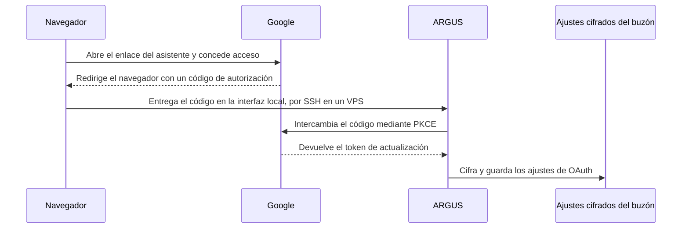
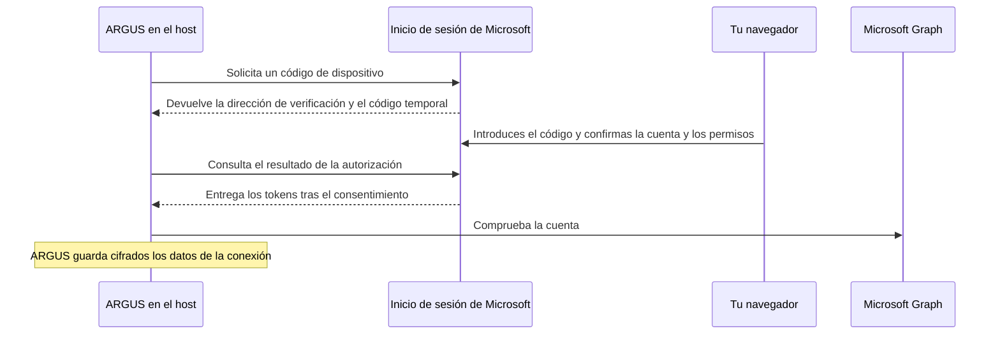

# Correo de ARGUS

[English](mail.md) · [Русский](mail-ru.md) · **Español** · [Français](mail-fr.md) · [简体中文](mail-zh.md) · [Glosario](../../docs/localization-glossary.md)

Conecta un buzón al host de ARGUS. En el chat privado de Telegram del propietario puedes leer correos recientes, preparar respuestas y decidir qué operaciones puede realizar el agente. Para Gmail, autoriza a ARGUS en el navegador con tu cuenta de Google. ARGUS obtiene el token de actualización y lo guarda cifrado junto con los datos del cliente OAuth. Guarda la frase de contraseña en el gestor de secretos del host. Usa el archivo JSON de Google y el enlace temporal de autorización dentro de tu sesión privada.

Para la primera prueba de Gmail, usa una cuenta separada que solo contenga mensajes de prueba. Añade esa dirección a **Test users** y selecciónala al conceder el acceso en Google. Envía los mensajes de prueba desde otra dirección bajo tu control.

## Configurar Google OAuth

1. En tu proyecto de Google Cloud, abre **Google Auth Platform**. Configura **Branding** con un nombre de aplicación que reconozcas, el correo de soporte y los datos de contacto.
2. En **Audience**, selecciona **External** para una cuenta personal de Gmail. Para la primera prueba deja el proyecto en **Testing** y añade la cuenta de Gmail de prueba en **Test users**. Con Google Workspace también puedes usar **Internal** si el proyecto y la cuenta pertenecen a la misma organización y su política lo permite. [Público de la aplicación](https://support.google.com/cloud/answer/15549945) · [Abrir Audience en Google Cloud](https://console.cloud.google.com/auth/audience)
3. En **Data Access**, añade el alcance `https://mail.google.com/` si la consola pide declarar los alcances. Google usa este alcance para autenticar IMAP y SMTP con XOAUTH2 y concede acceso completo al buzón. Google no ofrece un permiso exclusivo para códigos de verificación por IMAP, incluso si el envío usa Gmail API. ARGUS aplica por separado sus permisos de lectura, obtención de códigos y envío, que al principio están desactivados. **Test users** determina qué cuentas pueden autorizar la aplicación. [Consentimiento de OAuth](https://developers.google.com/workspace/guides/configure-oauth-consent) · [Gmail XOAUTH2](https://developers.google.com/workspace/gmail/imap/xoauth2-protocol)
4. En **Clients**, selecciona **Create client** y el tipo **Desktop app**. Descarga el JSON del cliente y guárdalo en una ubicación privada del host, fuera del repositorio. El usuario que ejecuta ARGUS debe ser el propietario del archivo. Dale permiso de lectura y escritura solo a ese usuario con `chmod 600`. ARGUS lee el archivo indicado con `--gmail-client` y cifra los datos del cliente con los ajustes del buzón. [Crear un cliente OAuth](https://developers.google.com/workspace/guides/create-credentials) · [Abrir Clients en Google Cloud](https://console.cloud.google.com/auth/clients)
5. Configura `ARGUS_KEYSTORE_PASSPHRASE` en el entorno privado del host. El asistente y el servicio necesitan la misma frase de contraseña y el mismo `stateDir`. Si usas un archivo de configuración personalizado, pasa la misma opción `--config`. Si el bot funciona como servicio, configura su entorno privado de arranque y reinícialo tras cambiarlo.

Con el proyecto en **External / Testing**, el token de actualización para este alcance caduca a los siete días. Ejecuta de nuevo la autorización si necesitas renovar una conexión de prueba. Antes de aprobar, comprueba que la pantalla de Google muestra el proyecto y la cuenta que acabas de configurar. [Caducidad de tokens en Google OAuth](https://developers.google.com/identity/protocols/oauth2#expiration)

## Conectar el buzón en ARGUS

En un terminal privado e interactivo del host, ejecuta el asistente con la ruta del JSON de Google.

```sh
argus mail setup --gmail-client '/ruta/privada/cliente-gmail.json'
argus mail status
```

Si ejecutas ARGUS desde el código fuente, sustituye `argus` por `node dist/index.js` desde el directorio `argus` después de `npm run build`. También puedes usar `argus mail setup` con `ARGUS_GMAIL_CLIENT_ID` y `ARGUS_GMAIL_CLIENT_SECRET` ya configurados en el entorno privado. En ese caso el asistente y el bot necesitan ambos valores.

1. Escribe tu dirección en el asistente. Para Gmail, confirma `imap.gmail.com:993`. El envío predeterminado usa `smtp.gmail.com:465`. En el campo de inicio de sesión conserva la dirección completa de la cuenta de Google.
2. Con `--gmail-client` el asistente selecciona OAuth automáticamente. Si usas la opción con variables de entorno y aparece `Google sign-in or app password? [Google/app]`, elige **Google**. Abre el enlace que imprime el asistente en el navegador del host y aprueba el acceso para esa cuenta.
3. Al terminar, vuelve al terminal. ARGUS intercambia el código de autorización con Google, obtiene el token de actualización, comprueba la conexión configurada y guarda el buzón cifrado. `argus mail status` debe mostrar `Authentication: Google OAuth` y los tres permisos desactivados. El estado puede mostrar la dirección de Gmail. Para comunicar el resultado basta con indicar el método de autenticación y el estado de los permisos.

Para enviar respuestas de Gmail por HTTPS, habilita Gmail API en el mismo proyecto de Google Cloud que el cliente OAuth de tipo **Desktop app**. Añade `--gmail-send-api` al configurar el buzón. ARGUS sigue usando IMAP para leer y recuperar códigos de verificación. El alcance `https://mail.google.com/` cubre Gmail API e IMAP. En un VPS con los puertos SMTP bloqueados, este modo envía por HTTPS a través del puerto 443. [Habilitar Gmail API](https://console.cloud.google.com/apis/library/gmail.googleapis.com) · [Alcances de envío de Gmail API](https://developers.google.com/workspace/gmail/api/reference/rest/v1/users.messages/send)

```sh
argus mail setup --gmail-client '/path/to/desktop-oauth-client.json' --gmail-send-api
```

Una vez conectado, `argus mail status` debe mostrar `Authentication: Google OAuth` y `Outgoing: Gmail API (HTTPS)`. Para sustituir una conexión existente, añade `--force` y vuelve a activar los permisos que necesites.

El enlace dura hasta tres minutos. El navegador devuelve la autorización a `127.0.0.1`. Por defecto el asistente elige un puerto disponible. Para un host sin navegador, fija el puerto con `--oauth-port` y abre un túnel SSH local en tu equipo. Sustituye `HOST_SSH` por el destino habitual de ARGUS. [OAuth para aplicaciones de escritorio](https://developers.google.com/identity/protocols/oauth2/native-app)

```sh
ssh -N -o ExitOnForwardFailure=yes -L 127.0.0.1:8765:127.0.0.1:8765 HOST_SSH
```

Con el túnel abierto, ejecuta el asistente en el host desde una segunda sesión SSH.

```sh
argus mail setup --gmail-client '/ruta/privada/cliente-gmail.json' --oauth-port 8765
```

Abre el enlace original en el navegador de tu equipo. Mantén el túnel abierto hasta que el asistente confirme la conexión. Si el puerto está ocupado, elige el mismo puerto libre en el túnel y el asistente. Si el enlace caduca, inicia una nueva sesión de configuración.

Si ARGUS se ejecuta en Docker con una red bridge de Linux, ejecuta el asistente en un contenedor temporal con `--network host`. Usa la misma imagen, el mismo usuario, la configuración y el volumen de estado del servicio. Monta el JSON como archivo de solo lectura, con propietario y permisos que permitan leerlo al usuario de ARGUS. Así el túnel alcanza el puerto de retorno en el host. Ejecuta las verificaciones posteriores con el mismo estado y la misma frase de contraseña.

El ayudante [`gmail-oauth-vps.py`](../scripts/gmail-oauth-vps.py) prepara ese contenedor a partir del servicio `argus` en ejecución. Comprueba que el JSON tiene permisos `600`. Abre un terminal privado en el directorio del script en el host Docker y ejecútalo como root. Mantén el túnel SSH abierto en el equipo con el navegador.

```sh
python3 gmail-oauth-vps.py '/path/to/desktop-oauth-client.json' --container argus --port 8765
```

Para enviar por Gmail API en el VPS, añade la misma opción al comando del script.

```sh
python3 gmail-oauth-vps.py '/path/to/desktop-oauth-client.json' --container argus --port 8765 --gmail-send-api
```

Después, ejecuta las verificaciones en el servicio habitual, por ejemplo `docker exec -it argus node dist/index.js mail status`. Conserva el JSON original en almacenamiento privado para futuras autorizaciones y elimina la copia temporal del VPS al terminar.



Para otros proveedores, `argus mail discover owner@example.com` consulta los ajustes por dominio. Elige `manual` en el asistente para cambiar un servidor, seleccionar POP3 o desactivar una dirección de correo. Usa la contraseña o la contraseña de aplicación que autorice tu proveedor e introdúcela en el campo oculto del terminal. Gmail admite contraseñas de aplicación en las cuentas que permiten esta opción con verificación en dos pasos. [Contraseñas de aplicación de Google](https://support.google.com/accounts/answer/185833)

| Operación | Conexión |
| --- | --- |
| Lectura | IMAP sobre TLS en `993`, POP3 sobre TLS en `995` o Microsoft Graph por HTTPS en Outlook.com |
| Respuestas | SMTP sobre TLS en `465` o STARTTLS obligatorio en `587`. Gmail OAuth admite Gmail API por HTTPS. Outlook.com usa Microsoft Graph por HTTPS. |
| Códigos de verificación | IMAP sobre TLS o Microsoft Graph en Outlook.com, con la hora de recepción del proveedor |

## Conectar un buzón personal de Outlook.com

ARGUS usa Microsoft Graph por HTTPS para leer mensajes, recuperar códigos de verificación y enviar respuestas de un buzón personal de Outlook.com. La primera prueba puede hacerse con un buzón de Outlook.com dedicado y otra dirección bajo tu control. ARGUS guarda un buzón por directorio de estado. Añade `--force` si vas a sustituir uno ya conectado y vuelve a activar los permisos de ARGUS que necesites.

1. Abre **App registrations → New registration** en Microsoft Entra. Inicia sesión con una cuenta que tenga permiso para registrar aplicaciones en un directorio de Microsoft Entra. Si la cuenta personal de Outlook.com carece de acceso a ese directorio, registra la aplicación con una cuenta autorizada y usa la cuenta personal de Outlook.com para dar el consentimiento en el paso siguiente. Elige **Personal Microsoft accounts only** en **Supported account types**, registra la aplicación y copia su **Application (client) ID** de la página **Overview**. [Abrir App registrations](https://entra.microsoft.com/#view/Microsoft_AAD_RegisteredApps/ApplicationsListBlade) · [Registro de aplicaciones de Microsoft](https://learn.microsoft.com/en-us/entra/identity-platform/quickstart-register-app)
2. En **Authentication → Advanced settings**, establece **Allow public client flows** en **Yes** y guarda. El flujo de código de dispositivo funciona sin un secreto de cliente ni una URI de redirección. [Configuración del cliente público](https://learn.microsoft.com/en-us/entra/identity-platform/scenario-desktop-app-configuration) · [Flujo de código de dispositivo](https://learn.microsoft.com/en-us/entra/identity-platform/v2-oauth2-device-code)
3. En **API permissions → Add a permission → Microsoft Graph → Delegated permissions**, selecciona `User.Read` y `Mail.Read`. Si `User.Read` ya está en la lista, consérvalo. Añade `Mail.Send` si quieres enviar respuestas con ARGUS. ARGUS solicita `offline_access` durante el inicio de sesión. Microsoft solicita el consentimiento de la cuenta personal cuando inicias sesión. Los permisos de ARGUS para leer, recuperar códigos y enviar se configuran por separado y empiezan desactivados. **Solo códigos** es un modo de ARGUS. En Microsoft, `Mail.Read` permite leer el correo del buzón autorizado. [Permisos de Microsoft Graph](https://learn.microsoft.com/en-us/graph/permissions-reference) · [Alcances de Microsoft](https://learn.microsoft.com/en-us/entra/identity-platform/scopes-oidc)

| Permiso delegado | Uso en ARGUS |
|---|---|
| `User.Read` | Comprueba que la sesión corresponde a la cuenta configurada. |
| `Mail.Read` | Lee los mensajes y busca códigos de verificación cuando el permiso correspondiente de ARGUS está activo. |
| `Mail.Send` | Envía una respuesta tras la aprobación del propietario. Se requiere al configurar el buzón sin `--incoming-only`. |
| `offline_access` | Obtiene un token de actualización para mantener la conexión entre sesiones. |

Ejecuta el asistente en el host de ARGUS con el mismo directorio de estado, configuración y valor de `ARGUS_KEYSTORE_PASSPHRASE` que usa el servicio. Usa la dirección principal del buzón Outlook.com y el identificador de aplicación de Entra. Puedes omitir la dirección y escribirla cuando el asistente la solicite. Usa `--incoming-only` para leer mensajes o recuperar códigos de verificación. Para enviar respuestas, ejecuta el asistente sin esa opción y añade el permiso delegado `Mail.Send` como se indica arriba.

```sh
argus mail setup '<outlook-address>' --microsoft-client-id '<application-client-id>' --incoming-only
argus mail status
```

Si el servicio usa Docker, ejecuta el asistente dentro de su contenedor. Puedes abrir el navegador en tu propio equipo. Para una sesión por SSH solo necesitas un terminal interactivo.

```sh
docker exec -it argus node dist/index.js mail setup '<outlook-address>' --microsoft-client-id '<application-client-id>' --incoming-only
docker exec -it argus node dist/index.js mail status
```

Abre la dirección de verificación que muestra el terminal, introduce allí el código temporal e inicia sesión con el buzón personal que elegiste. Comprueba la cuenta en la pantalla de consentimiento y confirma el acceso en Microsoft. Introduce el código únicamente en la página de Microsoft de la sesión que acabas de iniciar. Al volver al terminal, `argus mail status` debe mostrar `Authentication: Microsoft OAuth`, `Incoming: Microsoft Graph (HTTPS)` y `Outgoing: off` con `--incoming-only` o `Outgoing: Microsoft Graph (HTTPS)` si la conexión permite enviar mensajes. Todos los permisos de ARGUS empiezan desactivados.



Haz las pruebas de lectura o recuperación de códigos de la sección siguiente con Microsoft Graph. La prueba de respuesta confirmada requiere una conexión con permiso de envío. Si Microsoft rechaza la autorización, comprueba el identificador de aplicación, el tipo de cuenta, el flujo de cliente público y los permisos delegados. Si la sesión caduca o se revoca, repite la configuración con `--force` y vuelve a activar los permisos de ARGUS. Para desconectar, ejecuta `argus mail disconnect --yes` y retira el acceso de la aplicación en tu cuenta Microsoft. [Aplicaciones con acceso a tu cuenta Microsoft](https://account.live.com/consent/Manage)

## Permisos y pruebas en el buzón real

Abre `/mail` en el chat privado del propietario de ARGUS. En un host compartido, configura `ARGUS_TELEGRAM_OWNER_ID` con tu identificador de Telegram antes de iniciar el bot. En **Permissions** puedes habilitar **Read**, **Verification codes** y **Send** por separado. Para cambiar un permiso desde el terminal, usa `argus mail permissions <read|otp|send> <on|off>`.

Usa mensajes de prueba sin datos personales y una segunda dirección bajo tu control. Puedes hacer las tres pruebas desde un terminal privado del host y usar Telegram para las operaciones diarias. Si compartes los resultados, indica si pasó cada prueba. Conserva la dirección, el texto del buzón y los códigos en tus sesiones privadas.

### Lectura

Envía desde tu segunda dirección un correo sencillo al buzón conectado con un asunto único, por ejemplo `ARGUS mailbox test`, y un texto que puedas reconocer. En el host, sustituye `sender@example.com` por tu segunda dirección y usa el asunto exacto.

```sh
argus mail permissions otp off
argus mail permissions send off
argus mail permissions read on
argus mail check-read sender@example.com 'ARGUS mailbox test'
```

El comando busca una coincidencia única de remitente y asunto entre los últimos 20 correos de la bandeja de entrada. Abre el mensaje y confirma la lectura con `PASS`. En Telegram, también puedes abrir **Inbox** en `/mail`, seleccionar el correo y revisar el asunto y el texto. El contenido mostrado allí pasa por los servidores de Telegram. ARGUS mantiene el correo fuera de la memoria de conversación del agente.

### Solo códigos

Desactiva la lectura y el envío y activa únicamente el permiso de verificación.

```sh
argus mail permissions read off
argus mail permissions send off
argus mail permissions otp on
argus mail status
```

En `/mail`, **Inbox** debe indicar que la lectura está desactivada. En el host, inicia la verificación con la segunda dirección como remitente esperado. Sustituye `sender@example.com` por esa dirección.

```sh
argus mail check-otp sender@example.com
```

Desde la segunda dirección, envía manualmente al buzón conectado el asunto y el texto que muestra el comando. El texto contiene la referencia única de esa ejecución y `314159`, un código sintético fijo. Usa los valores de esa sesión y envía el mensaje después de iniciar la verificación. El comando espera hasta tres minutos e informa si la verificación pasó. El código recuperado queda en el flujo autorizado, sin pasar a Telegram ni al modelo. Para probar el envío utiliza el mensaje normal `ARGUS mailbox test`.

### Respuesta con aprobación del propietario

En un terminal privado e interactivo, activa la lectura y el envío y busca el correo normal de prueba.

```sh
argus mail permissions otp off
argus mail permissions read on
argus mail permissions send on
argus mail check-reply sender@example.com 'ARGUS mailbox test'
```

ARGUS muestra el destinatario, el asunto y un texto fijo de prueba. Comprueba que el destinatario es tu segunda dirección. Escribe `SEND` en los cinco minutos siguientes si apruebas el envío de ese texto. Pulsa Intro sin escribir `SEND` para cancelar.

En Telegram, puedes preparar el mismo ensayo en `/mail`. Activa **Read** y **Send**, selecciona el correo normal en **Inbox** y usa el comando `/mail_reply` que muestra ARGUS con la referencia del mensaje y tu texto de prueba. Comprueba la vista previa y pulsa **Send this reply** para aprobar el envío o **Discard** para descartar el borrador. La aprobación vale para ese borrador y caduca después de cinco minutos. Elige una vía de envío para cada prueba.

En el terminal, `PASS` indica que el servicio de correo saliente aceptó la respuesta. En Telegram, `Reply accepted by the outgoing mail service.` confirma la aceptación por SMTP, Gmail API o Microsoft Graph según el método de envío configurado. Comprueba que la respuesta aparece en la carpeta de enviados del buzón conectado y llega a la segunda dirección. Si el estado del envío es incierto, revisa ambas cuentas antes de repetirlo. Al acabar, desactiva los permisos que habilitaste para el ensayo, uno a uno.

Si usas **Draft a reply with AI**, ARGUS pide otra aprobación para compartir el asunto y un extracto con el proveedor del modelo indicado. La respuesta sigue siendo un borrador hasta que pulses **Send this reply**.

## Desconectar y resolver problemas

```sh
argus mail setup --force --gmail-client '/ruta/privada/cliente-gmail.json'
argus mail disconnect --yes
```

`--force` sustituye la conexión cifrada y deja desactivados los tres permisos. `disconnect --yes` elimina los ajustes cifrados del host. Para retirar también la autorización de Google, abre las conexiones de tu cuenta de Google y quita el acceso a tu aplicación OAuth. Si usaste una contraseña de aplicación, puedes revocarla desde la configuración de seguridad de Google. [Conexiones de la cuenta de Google](https://myaccount.google.com/connections) · [Contraseñas de aplicación](https://support.google.com/accounts/answer/185833)

| Síntoma | Qué comprobar |
| --- | --- |
| El asistente solo ofrece contraseña | Comprueba que indicaste el JSON de un cliente **Desktop app** con `--gmail-client` o que ambas variables de OAuth están disponibles para el proceso. Comprueba también que los servidores seleccionados son los de Gmail. |
| Google muestra `access_denied` | Confirma la cuenta activa y su presencia en **Test users** si el proyecto está en **External / Testing**. En una cuenta administrada, comprueba también la política de Google Workspace. |
| El navegador no puede abrir `127.0.0.1` | Mantén abierto el asistente. Usa el navegador del host o el túnel SSH con el puerto exacto de la sesión. |
| ARGUS pide volver a conectar después de una semana | Comprueba si la autorización de **External / Testing** caducó y vuelve a ejecutar el asistente con `--force` y las opciones de la conexión original. |
| `/mail` indica que el buzón está desconectado | Comprueba que el bot y el asistente usan el mismo `stateDir` y la misma configuración privada. |
| No aparece un código | Comprueba que el permiso está activo, que el buzón usa IMAP o Microsoft Graph y que coinciden el remitente, la referencia y la hora de recepción del correo de prueba. |
| Gmail API no puede enviar | Comprueba que Gmail API está habilitada en el proyecto del cliente OAuth y que `mail status` muestra `Outgoing: Gmail API (HTTPS)`. |
