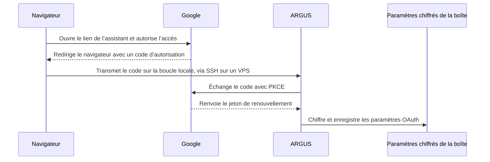
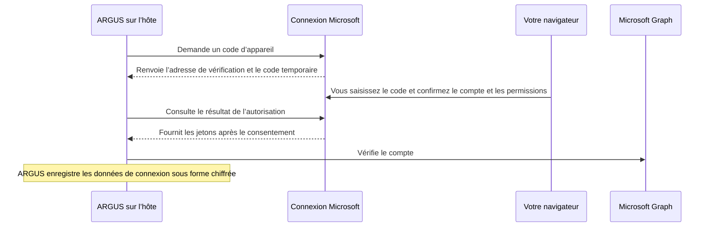

# Messagerie ARGUS

[English](mail.md) · [Русский](mail-ru.md) · [Español](mail-es.md) · **Français** · [简体中文](mail-zh.md) · [Glossaire](../../docs/localization-glossary.md)

Connectez une boîte aux lettres à l’hôte ARGUS. Dans la conversation privée Telegram du propriétaire, vous pouvez lire les messages récents, préparer des réponses et choisir les opérations accessibles à l’agent. Pour Gmail, donnez votre autorisation à ARGUS dans le navigateur avec votre compte Google. ARGUS obtient le jeton de renouvellement et le conserve chiffré avec les données du client OAuth. Conservez la phrase secrète dans le gestionnaire de secrets de l’hôte. Utilisez le fichier JSON de Google et le lien temporaire d’autorisation dans votre session privée.

Pour le premier essai de Gmail, utilisez un compte séparé qui contient uniquement des messages de test. Ajoutez son adresse dans **Test users** et sélectionnez-la sur l’écran de consentement Google. Envoyez les messages de test depuis une autre adresse que vous contrôlez.

## Configurer Google OAuth

1. Dans votre projet Google Cloud, ouvrez **Google Auth Platform**. Dans **Branding**, indiquez un nom d’application reconnaissable, une adresse d’assistance et vos coordonnées.
2. Dans **Audience**, sélectionnez **External** pour un compte Gmail personnel. Pour le premier essai, laissez le projet en **Testing** et ajoutez le compte Gmail de test dans **Test users**. Avec Google Workspace, **Internal** est également possible si le projet et le compte appartiennent à la même organisation et que sa politique l’autorise. [Audience de l’application](https://support.google.com/cloud/answer/15549945) · [Ouvrir Audience dans Google Cloud](https://console.cloud.google.com/auth/audience)
3. Dans **Data Access**, ajoutez le périmètre `https://mail.google.com/` si la console demande de déclarer les périmètres d’autorisation. Google l’utilise pour authentifier IMAP et SMTP avec XOAUTH2 et accorde un accès complet à la boîte aux lettres. Google ne propose pas de permission réservée aux codes de vérification sur IMAP, y compris lorsque l’envoi passe par Gmail API. ARGUS applique séparément ses permissions de lecture, de récupération des codes et d’envoi. Elles sont désactivées au départ. **Test users** détermine quels comptes peuvent autoriser l’application. [Consentement OAuth](https://developers.google.com/workspace/guides/configure-oauth-consent) · [Gmail XOAUTH2](https://developers.google.com/workspace/gmail/imap/xoauth2-protocol)
4. Dans **Clients**, sélectionnez **Create client**, puis le type **Desktop app**. Téléchargez le JSON du client et placez-le dans un emplacement privé de l’hôte, hors du dépôt. Le fichier doit appartenir à l’utilisateur qui exécute ARGUS. Réservez à cet utilisateur les droits de lecture et d’écriture avec `chmod 600`. ARGUS lit le fichier indiqué par `--gmail-client` et chiffre les données du client avec les paramètres de la boîte. [Créer un client OAuth](https://developers.google.com/workspace/guides/create-credentials) · [Ouvrir Clients dans Google Cloud](https://console.cloud.google.com/auth/clients)
5. Configurez `ARGUS_KEYSTORE_PASSPHRASE` dans l’environnement privé de l’hôte. L’assistant et le service utilisent la même phrase secrète et le même `stateDir`. Si vous utilisez un fichier de configuration personnalisé, passez la même option `--config`. Si le bot fonctionne en tant que service, configurez son environnement privé de démarrage et redémarrez-le après modification.

Quand le projet est en **External / Testing**, le jeton de renouvellement associé à ce périmètre expire au bout de sept jours. Relancez l’autorisation si vous devez renouveler une connexion de test. Avant de consentir, vérifiez que l’écran Google affiche le projet et le compte que vous venez de configurer. [Expiration des jetons Google OAuth](https://developers.google.com/identity/protocols/oauth2#expiration)

## Connecter la boîte aux lettres dans ARGUS

Dans un terminal privé et interactif sur l’hôte, lancez l’assistant avec le chemin du fichier JSON de Google.

```sh
argus mail setup --gmail-client '/chemin/prive/client-gmail.json'
argus mail status
```

Si vous exécutez ARGUS depuis le code source, remplacez `argus` par `node dist/index.js` depuis le répertoire `argus` après `npm run build`. Vous pouvez aussi utiliser `argus mail setup` avec `ARGUS_GMAIL_CLIENT_ID` et `ARGUS_GMAIL_CLIENT_SECRET` déjà configurés dans l’environnement privé. L’assistant et le bot ont alors besoin des deux valeurs.

1. Saisissez votre adresse dans l’assistant. Pour Gmail, confirmez `imap.gmail.com:993`. L’envoi par défaut utilise `smtp.gmail.com:465`. Conservez l’adresse complète du compte Google comme identifiant de connexion.
2. Avec `--gmail-client`, l’assistant sélectionne OAuth automatiquement. Si vous utilisez les variables d’environnement et que l’invite `Google sign-in or app password? [Google/app]` s’affiche, choisissez **Google**. Ouvrez le lien affiché dans le navigateur de l’hôte et autorisez l’accès à ce compte.
3. Revenez au terminal. ARGUS échange le code d’autorisation avec Google, obtient le jeton de renouvellement, vérifie la connexion configurée, puis enregistre les paramètres chiffrés. `argus mail status` doit afficher `Authentication: Google OAuth` et les trois permissions désactivées. La commande peut afficher l’adresse Gmail. Pour communiquer le résultat, indiquez le mode d’authentification et l’état des permissions.

Pour envoyer les réponses Gmail sur HTTPS, activez Gmail API dans le même projet Google Cloud que le client OAuth de type **Desktop app**. Ajoutez `--gmail-send-api` lors de la configuration de la boîte. ARGUS continue à utiliser IMAP pour lire les messages et récupérer les codes. Le périmètre `https://mail.google.com/` couvre Gmail API et IMAP. Sur un VPS dont les ports SMTP sont bloqués, ce mode envoie le courrier sur HTTPS via le port 443. [Activer Gmail API](https://console.cloud.google.com/apis/library/gmail.googleapis.com) · [Périmètres d’envoi de Gmail API](https://developers.google.com/workspace/gmail/api/reference/rest/v1/users.messages/send)

```sh
argus mail setup --gmail-client '/path/to/desktop-oauth-client.json' --gmail-send-api
```

Après la connexion, `argus mail status` doit afficher `Authentication: Google OAuth` et `Outgoing: Gmail API (HTTPS)`. Pour remplacer une connexion existante, ajoutez `--force`, puis réactivez les permissions dont vous avez besoin.

Le lien reste utilisable pendant trois minutes au maximum. Le navigateur renvoie l’autorisation à `127.0.0.1`. Par défaut, l’assistant choisit un port disponible. Sur un hôte sans navigateur, fixez le port avec `--oauth-port` et ouvrez un tunnel SSH local depuis votre ordinateur. Remplacez `HOTE_SSH` par votre destination habituelle pour exécuter ARGUS. [OAuth pour les applications de bureau](https://developers.google.com/identity/protocols/oauth2/native-app)

```sh
ssh -N -o ExitOnForwardFailure=yes -L 127.0.0.1:8765:127.0.0.1:8765 HOTE_SSH
```

Le tunnel ouvert, lancez l’assistant sur l’hôte depuis une seconde session SSH.

```sh
argus mail setup --gmail-client '/chemin/prive/client-gmail.json' --oauth-port 8765
```

Ouvrez le lien d’origine dans le navigateur de votre ordinateur. Laissez le tunnel ouvert jusqu’à la confirmation de la connexion dans l’assistant. Si le port est occupé, choisissez le même port libre dans le tunnel et l’assistant. Si le lien expire, relancez la configuration.

Si ARGUS tourne dans Docker sur un réseau bridge sous Linux, lancez l’assistant dans un conteneur temporaire avec `--network host`. Reprenez l’image, l’utilisateur, la configuration et le volume d’état du service. Montez le JSON en lecture seule, avec un propriétaire et des permissions permettant à l’utilisateur ARGUS de le lire. Le tunnel peut ainsi atteindre le port de retour sur l’hôte. Exécutez les vérifications suivantes avec le même état et la même phrase secrète.

Le script [`gmail-oauth-vps.py`](../scripts/gmail-oauth-vps.py) prépare ce conteneur temporaire à partir du service `argus` en cours d’exécution. Vérifiez que le JSON a les permissions `600`. Depuis le répertoire du script sur l’hôte Docker, lancez-le en tant que root dans un terminal privé. Gardez le tunnel SSH ouvert sur l’ordinateur où tourne le navigateur.

```sh
python3 gmail-oauth-vps.py '/path/to/desktop-oauth-client.json' --container argus --port 8765
```

Pour envoyer via Gmail API sur le VPS, ajoutez la même option à la commande du script.

```sh
python3 gmail-oauth-vps.py '/path/to/desktop-oauth-client.json' --container argus --port 8765 --gmail-send-api
```

Exécutez ensuite les vérifications dans le service habituel, par exemple `docker exec -it argus node dist/index.js mail status`. Conservez le JSON d’origine dans un espace privé pour une future autorisation. Supprimez la copie temporaire du VPS après la configuration.



Pour les autres fournisseurs, `argus mail discover owner@example.com` recherche les paramètres d’après le domaine. Choisissez `manual` dans l’assistant pour changer de serveur, sélectionner POP3 ou désactiver un sens de communication. Saisissez le mot de passe ou le mot de passe d’application autorisé par votre fournisseur dans le champ masqué du terminal. Gmail propose des mots de passe d’application aux comptes qui disposent de cette option et de la validation en deux étapes. [Mots de passe d’application Google](https://support.google.com/accounts/answer/185833)

| Opération | Connexion |
| --- | --- |
| Lecture | IMAP sur TLS sur le port `993`, POP3 sur TLS sur le port `995` ou Microsoft Graph sur HTTPS avec Outlook.com |
| Réponses | SMTP sur TLS sur le port `465` ou STARTTLS obligatoire sur le port `587`. Gmail OAuth permet d’utiliser Gmail API sur HTTPS. Outlook.com utilise Microsoft Graph sur HTTPS. |
| Codes de vérification | IMAP sur TLS ou Microsoft Graph avec Outlook.com, avec l’heure de réception du fournisseur |

## Connecter une boîte Outlook.com personnelle

ARGUS utilise Microsoft Graph sur HTTPS pour lire les messages, récupérer les codes de vérification et envoyer des réponses depuis une boîte Outlook.com personnelle. Pour le premier essai, vous pouvez utiliser une boîte Outlook.com dédiée et une seconde adresse que vous contrôlez. ARGUS conserve une seule boîte par répertoire d’état. Pour remplacer une connexion existante, ajoutez `--force`, puis réactivez les permissions ARGUS dont vous avez besoin.

1. Ouvrez **App registrations → New registration** dans Microsoft Entra. Connectez-vous avec un compte autorisé à inscrire des applications dans un annuaire Microsoft Entra. Si le compte Outlook.com personnel n’a pas accès à cet annuaire, inscrivez l’application avec un compte autorisé, puis utilisez le compte Outlook.com personnel à l’étape de consentement ci-dessous. Choisissez **Personal Microsoft accounts only** sous **Supported account types**, inscrivez l’application, puis copiez son **Application (client) ID** depuis **Overview**. [Ouvrir App registrations](https://entra.microsoft.com/#view/Microsoft_AAD_RegisteredApps/ApplicationsListBlade) · [Inscrire une application auprès de Microsoft](https://learn.microsoft.com/en-us/entra/identity-platform/quickstart-register-app)
2. Dans **Authentication → Advanced settings**, réglez **Allow public client flows** sur **Yes** et enregistrez. Le flux de code d’appareil fonctionne sans secret client ni URI de redirection. [Configuration du client public](https://learn.microsoft.com/en-us/entra/identity-platform/scenario-desktop-app-configuration) · [Flux de code d’appareil](https://learn.microsoft.com/en-us/entra/identity-platform/v2-oauth2-device-code)
3. Dans **API permissions → Add a permission → Microsoft Graph → Delegated permissions**, sélectionnez `User.Read` et `Mail.Read`. Si `User.Read` figure déjà dans la liste, conservez-la. Ajoutez `Mail.Send` si vous souhaitez envoyer des réponses avec ARGUS. ARGUS demande `offline_access` lors de la connexion. Microsoft demande le consentement du compte personnel lors de la connexion. Les permissions ARGUS de lecture, de récupération des codes et d’envoi sont distinctes et désactivées au départ. **Codes uniquement** est un mode ARGUS. Du côté de Microsoft, `Mail.Read` permet de lire les messages de la boîte autorisée. [Permissions Microsoft Graph](https://learn.microsoft.com/en-us/graph/permissions-reference) · [Étendues d’autorisation Microsoft](https://learn.microsoft.com/en-us/entra/identity-platform/scopes-oidc)

| Permission déléguée | Utilisation dans ARGUS |
|---|---|
| `User.Read` | Vérifie que la session correspond au compte configuré. |
| `Mail.Read` | Lit les messages et recherche les codes de vérification si la permission ARGUS correspondante est active. |
| `Mail.Send` | Envoie une réponse après l’approbation du propriétaire. Requise lors d’une configuration sans `--incoming-only`. |
| `offline_access` | Obtient un jeton de renouvellement pour maintenir la connexion entre les sessions. |

Lancez l’assistant sur l’hôte ARGUS avec le même répertoire d’état, la même configuration et la même valeur de `ARGUS_KEYSTORE_PASSPHRASE` que le service. Utilisez l’adresse principale de la boîte Outlook.com et l’identifiant d’application Entra. Vous pouvez omettre l’adresse et la saisir lorsque l’assistant la demande. Utilisez `--incoming-only` pour lire les messages ou récupérer les codes de vérification. Pour envoyer des réponses, lancez la configuration sans cette option et ajoutez l’autorisation déléguée `Mail.Send` comme indiqué ci-dessus.

```sh
argus mail setup '<outlook-address>' --microsoft-client-id '<application-client-id>' --incoming-only
argus mail status
```

Si le service utilise Docker, lancez l’assistant dans son conteneur. Vous pouvez ouvrir le navigateur sur votre ordinateur. Une session SSH nécessite seulement un terminal interactif.

```sh
docker exec -it argus node dist/index.js mail setup '<outlook-address>' --microsoft-client-id '<application-client-id>' --incoming-only
docker exec -it argus node dist/index.js mail status
```

Ouvrez l’adresse de vérification affichée dans le terminal, saisissez le code temporaire, puis connectez-vous à la boîte personnelle choisie. Vérifiez le compte sur l’écran de consentement et accordez l’accès auprès de Microsoft. Saisissez le code uniquement sur la page Microsoft de la session que vous venez de lancer. De retour dans le terminal, `argus mail status` doit afficher `Authentication: Microsoft OAuth`, `Incoming: Microsoft Graph (HTTPS)` et `Outgoing: off` avec `--incoming-only` ou `Outgoing: Microsoft Graph (HTTPS)` pour une connexion avec envoi. Toutes les permissions ARGUS sont désactivées au départ.



Effectuez les essais de lecture ou de récupération des codes décrits dans la section suivante avec Microsoft Graph. L’essai de réponse confirmée nécessite une connexion avec envoi. Si Microsoft refuse l’autorisation, vérifiez l’identifiant d’application, le type de compte, le flux de client public et les permissions déléguées. Si la session expire ou si l’accès est révoqué, relancez la configuration avec `--force`, puis réactivez les permissions ARGUS. Pour déconnecter la boîte, exécutez `argus mail disconnect --yes` et retirez l’accès de l’application depuis votre compte Microsoft. [Applications ayant accès à votre compte Microsoft](https://account.live.com/consent/Manage)

## Permissions et essais sur la boîte réelle

Ouvrez `/mail` dans la conversation privée Telegram du propriétaire d’ARGUS. Sur un hôte partagé, configurez `ARGUS_TELEGRAM_OWNER_ID` avec votre identifiant Telegram avant de démarrer le bot. Dans **Permissions**, activez séparément **Read**, **Verification codes** et **Send**. Pour modifier une permission depuis le terminal, utilisez `argus mail permissions <read|otp|send> <on|off>`.

Utilisez des messages de test sans données personnelles et une seconde adresse que vous contrôlez. Vous pouvez réaliser les trois essais dans un terminal privé de l’hôte et utiliser Telegram pour les opérations courantes. Si vous communiquez les résultats, indiquez si chaque essai a réussi. Gardez l’adresse, le contenu de la boîte et les codes dans vos sessions privées.

### Lecture

Depuis votre seconde adresse, envoyez un message à la boîte connectée avec un objet unique, par exemple `ARGUS mailbox test`, et un texte reconnaissable. Sur l’hôte, remplacez `sender@example.com` par cette seconde adresse et utilisez l’objet exact.

```sh
argus mail permissions otp off
argus mail permissions send off
argus mail permissions read on
argus mail check-read sender@example.com 'ARGUS mailbox test'
```

La commande cherche une correspondance unique d’expéditeur et d’objet parmi les 20 derniers messages de la boîte de réception. Elle ouvre le message et confirme la lecture avec `PASS`. Dans Telegram, vous pouvez aussi ouvrir **Inbox** depuis `/mail`, sélectionner le message et vérifier l’objet et le texte. Le contenu affiché passe alors par les serveurs de Telegram. ARGUS garde le courrier hors de la mémoire de conversation de l’agent.

### Codes uniquement

Désactivez la lecture et l’envoi et activez uniquement la permission de vérification.

```sh
argus mail permissions read off
argus mail permissions send off
argus mail permissions otp on
argus mail status
```

Dans `/mail`, **Inbox** doit indiquer que la lecture est désactivée. Sur l’hôte, lancez la vérification avec la seconde adresse comme expéditeur attendu. Remplacez `sender@example.com` par cette adresse.

```sh
argus mail check-otp sender@example.com
```

Depuis la seconde adresse, envoyez manuellement à la boîte connectée l’objet et le texte affichés par la commande. Le texte contient la référence unique de cette exécution et `314159`, un code synthétique fixe. Utilisez les valeurs de cette session et envoyez le message après le début de la vérification. La commande attend jusqu’à trois minutes et indique si la vérification a réussi. Le code récupéré reste dans le flux autorisé, sans passer par Telegram ni par le modèle. Pour l’essai d’envoi, reprenez le message ordinaire `ARGUS mailbox test`.

### Réponse avec l’approbation du propriétaire

Dans un terminal privé et interactif, activez la lecture et l’envoi, puis recherchez le message de test ordinaire.

```sh
argus mail permissions otp off
argus mail permissions read on
argus mail permissions send on
argus mail check-reply sender@example.com 'ARGUS mailbox test'
```

ARGUS affiche le destinataire, l’objet et un texte de test fixe. Vérifiez que le destinataire est votre seconde adresse. Saisissez `SEND` dans les cinq minutes si vous approuvez l’envoi de ce texte. Appuyez sur Entrée sans saisir `SEND` pour annuler.

Dans Telegram, vous pouvez préparer le même essai dans `/mail`. Activez **Read** et **Send**, sélectionnez le message ordinaire dans **Inbox**, puis utilisez la commande `/mail_reply` affichée par ARGUS avec la référence du message et votre texte de test. Vérifiez l’aperçu et sélectionnez **Send this reply** pour approuver l’envoi ou **Discard** pour supprimer le brouillon. L’approbation vaut pour ce brouillon et expire après cinq minutes. Choisissez une voie d’envoi par essai.

Dans le terminal, `PASS` indique que le service de courrier sortant a accepté la réponse. Dans Telegram, `Reply accepted by the outgoing mail service.` confirme l’acceptation par SMTP, Gmail API ou Microsoft Graph, selon le mode d’envoi configuré. Vérifiez que la réponse figure dans le dossier des messages envoyés de la boîte connectée et arrive à la seconde adresse. En cas d’état incertain, vérifiez les deux boîtes avant de réessayer. À la fin, désactivez une par une les permissions activées pour l’essai.

Si vous sélectionnez **Draft a reply with AI**, ARGUS demande une approbation distincte avant de transmettre l’objet et un extrait au fournisseur de modèle indiqué. Le texte reste un brouillon jusqu’à ce que vous sélectionniez **Send this reply**.

## Déconnexion et dépannage

```sh
argus mail setup --force --gmail-client '/chemin/prive/client-gmail.json'
argus mail disconnect --yes
```

`--force` remplace la connexion chiffrée et désactive les trois permissions. `disconnect --yes` supprime les paramètres chiffrés de l’hôte. Pour retirer également l’autorisation Google, ouvrez les connexions de votre compte Google et supprimez l’accès de votre application OAuth. Si vous avez utilisé un mot de passe d’application, révoquez-le depuis les paramètres de sécurité de Google. [Connexions du compte Google](https://myaccount.google.com/connections) · [Mots de passe d’application](https://support.google.com/accounts/answer/185833)

| Symptôme | Point à vérifier |
| --- | --- |
| L’assistant propose uniquement un mot de passe | Vérifiez que `--gmail-client` pointe vers le JSON d’un client **Desktop app** ou que les deux variables OAuth sont disponibles pour le processus. Vérifiez aussi que les serveurs sélectionnés sont ceux de Gmail. |
| Google affiche `access_denied` | Vérifiez le compte actif et sa présence dans **Test users** lorsque le projet est en **External / Testing**. Pour un compte administré, vérifiez également la politique de Google Workspace. |
| Le navigateur ne peut pas ouvrir `127.0.0.1` | Laissez l’assistant ouvert. Utilisez le navigateur de l’hôte ou le tunnel SSH avec le port exact de cette session. |
| ARGUS demande une reconnexion après une semaine | Vérifiez si l’autorisation **External / Testing** a expiré, puis relancez l’assistant avec `--force` et les options de la connexion initiale. |
| `/mail` indique que la boîte est déconnectée | Vérifiez que le bot et l’assistant utilisent le même `stateDir` et les mêmes paramètres privés. |
| Le code est introuvable | Vérifiez que la permission est active, que la boîte utilise IMAP ou Microsoft Graph et que l’expéditeur, la référence et l’heure de réception du message de test correspondent. |
| L’envoi échoue avec Gmail API | Vérifiez que Gmail API est activée dans le projet du client OAuth et que `mail status` affiche `Outgoing: Gmail API (HTTPS)`. |
