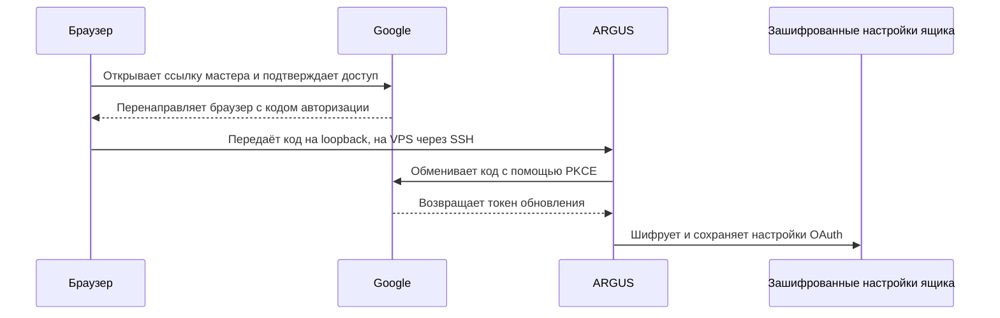
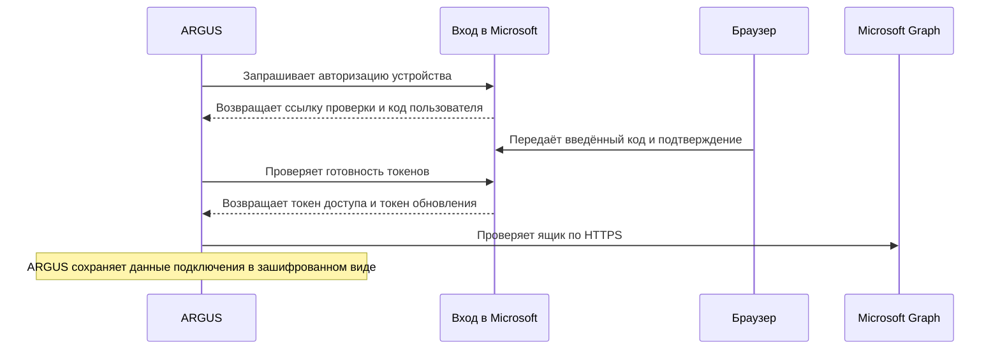

# Почта в ARGUS

[English](mail.md) · **Русский** · [Español](mail-es.md) · [Français](mail-fr.md) · [中文](mail-zh.md) · [Глоссарий](../../docs/localization-glossary.md)

ARGUS подключает один почтовый ящик. Владелец в приватном чате Telegram открывает входящие, готовит ответы и даёт подтверждение на отправку каждого ответа. Чтение, получение кодов подтверждения и отправка включаются отдельно. При подключении все три разрешения выключены.

Для первого теста Gmail используйте отдельный ящик, в котором будут только тестовые письма. Добавьте его адрес в **Test users** и выберите его на экране согласия Google. Тестовые письма отправляйте с другого адреса под вашим контролем.

## Подключение Gmail через OAuth

1. Откройте Google Cloud Console, выберите свой проект и настройте **Google Auth Platform → Branding** и **Audience**. Для личного Gmail в режиме **Testing** выберите **External** и добавьте отдельный тестовый адрес в **Test users**. На странице **Data Access** проверьте наличие области `https://mail.google.com/`, которую Gmail требует для IMAP и SMTP через XOAUTH2. Политики организации Google Workspace могут ограничивать доступ к IMAP или этой области. Разрешение и токен обновления для этой области в режиме **Testing** действуют семь дней с момента согласия. [Настройка Google Auth Platform](https://support.google.com/cloud/answer/15544987) · [Аудитория и режим Testing](https://support.google.com/cloud/answer/15549945) · [Область Gmail XOAUTH2](https://developers.google.com/workspace/gmail/imap/xoauth2-protocol) · [Открыть Audience в Google Cloud](https://console.cloud.google.com/auth/audience)
2. В **Clients → Create client** выберите **Desktop app** и скачайте JSON клиента OAuth. Храните файл в приватном каталоге вне репозитория. Файл должен принадлежать пользователю, который запускает мастер, с доступом только для этого пользователя (`chmod 600`). ARGUS использует идентификатор и секрет клиента из файла. Согласие на доступ к ящику вы дадите непосредственно Google в браузере. [Клиенты OAuth](https://support.google.com/cloud/answer/15549257) · [Открыть Clients в Google Cloud](https://console.cloud.google.com/auth/clients)
3. Задайте `ARGUS_KEYSTORE_PASSPHRASE` в окружении процесса ARGUS на хосте, где работает бот. Мастер и бот должны использовать одну парольную фразу и тот же каталог `stateDir`. При нестандартной конфигурации передайте тот же `--config`. Сохраните парольную фразу в менеджере секретов, которым пользуется служба ARGUS.
4. На хосте ARGUS запустите мастер в приватном интерактивном терминале. Замените путь на путь к скачанному файлу. Для локальной копии репозитория выполните `npm run build` в каталоге `argus` и используйте `node dist/index.js` вместо `argus`.

   ```sh
   argus mail setup --gmail-client /path/to/desktop-oauth-client.json
   ```

5. Введите адрес Gmail, примите предложенные настройки и подтвердите логин. Для Gmail мастер предлагает IMAP `imap.gmail.com:993` и по умолчанию отправку через SMTP `smtp.gmail.com:465`. С `--gmail-client` мастер автоматически выбирает OAuth. Откройте ссылку авторизации на том же компьютере, выберите тот же аккаунт Gmail и подтвердите доступ на странице Google. Дождитесь `Mailbox connected`. ARGUS получает токен обновления через локальный callback и шифрует его вместе с данными клиента OAuth в настройках ящика. Храните JSON клиента, ссылку авторизации и токены у себя. [OAuth для настольных приложений](https://developers.google.com/identity/protocols/oauth2/native-app) · [Подключение Gmail к почтовому клиенту](https://support.google.com/mail/answer/7126229)

```sh
argus mail status
```

В выводе должны быть `Authentication: Google OAuth`, настройки входящей и исходящей почты и три выключенных разрешения. Вывод может содержать адрес ящика. Для отчёта достаточно результата и состояний разрешений.

Если служба уже получает `ARGUS_GMAIL_CLIENT_ID` и `ARGUS_GMAIL_CLIENT_SECRET` из своего менеджера секретов, запустите `argus mail setup` и выберите **Google**. При таком способе эти переменные нужны и мастеру, и боту. Для замены существующего подключения добавьте `--force`. Мастер сбросит разрешения и применит новое подключение после проверки. Если браузер открылся на другом компьютере, настройте туннель ниже.

Для входа по паролю приложения включите двухэтапную проверку, создайте пароль приложения в Google и введите его в скрытом запросе мастера. Флаг `--incoming-only` включает только входящие по IMAP. Он подходит и для OAuth через JSON, если нужны письма с кодами. [Пароли приложений Google](https://myaccount.google.com/apppasswords)

```sh
argus mail setup '<адрес Gmail>' --app-password --incoming-only
argus mail setup '<адрес Gmail>' --gmail-client '/path/to/desktop-oauth-client.json' --incoming-only
```

Чтобы отправлять ответы Gmail по HTTPS, включите Gmail API в том же проекте Google Cloud, где создан клиент OAuth типа **Desktop app**. Добавьте `--gmail-send-api` при подключении ящика. ARGUS продолжит получать письма и коды через IMAP. Область `https://mail.google.com/` действует для Gmail API и IMAP. На VPS с закрытыми исходящими портами SMTP этот режим отправляет почту по HTTPS через порт 443. [Включить Gmail API](https://console.cloud.google.com/apis/library/gmail.googleapis.com) · [Области доступа для отправки через Gmail API](https://developers.google.com/workspace/gmail/api/reference/rest/v1/users.messages/send)

```sh
argus mail setup --gmail-client '/path/to/desktop-oauth-client.json' --gmail-send-api
```

После подключения `argus mail status` должен показывать `Authentication: Google OAuth` и `Outgoing: Gmail API (HTTPS)`. При замене существующего подключения добавьте `--force` и после настройки заново включите нужные разрешения.

### OAuth на удалённом хосте

Укажите фиксированный порт для локального callback. Запустите мастер на удалённом хосте с JSON, доступным на этом хосте.

```sh
argus mail setup --gmail-client /path/to/desktop-oauth-client.json --oauth-port 8765
```

Оставьте мастер открытым. На компьютере с браузером откройте второй терминал и запустите перенаправление SSH. Замените `user@host.example` своим адресом SSH.

```sh
ssh -N -o ExitOnForwardFailure=yes -L 127.0.0.1:8765:127.0.0.1:8765 user@host.example
```

После запуска туннеля откройте ссылку авторизации, которую вывел мастер, и подтвердите доступ. Google вернёт браузер на `127.0.0.1:8765`, а SSH передаст запрос мастеру. Используйте одинаковый свободный порт в обеих командах. Мастер ждёт согласия до трёх минут. Когда появится `Mailbox connected`, остановите туннель. [Локальное перенаправление портов SSH](https://man.openbsd.org/ssh#L)

Если ARGUS на Linux работает в контейнере Docker с сетью bridge, запустите отдельный интерактивный контейнер на время настройки с `--network host`, чтобы callback был доступен на loopback хоста. Используйте тот же образ ARGUS, конфигурацию, пользователя, том `stateDir` и парольную фразу, что и у службы. Подключите JSON клиента только для чтения с владельцем и правами, указанными выше. После настройки служба сможет прочитать зашифрованное подключение из общего тома.

Помощник [`gmail-oauth-vps.py`](../scripts/gmail-oauth-vps.py) подготавливает такой контейнер по настройкам запущенного `argus`. На хосте Docker откройте приватный терминал в каталоге со скриптом, проверьте права `600` у файла JSON, выполните команду от root и держите SSH-туннель открытым на компьютере с браузером.

```sh
python3 gmail-oauth-vps.py '/path/to/desktop-oauth-client.json' --container argus --port 8765
```

Для отправки через Gmail API на VPS добавьте тот же флаг к команде скрипта.

```sh
python3 gmail-oauth-vps.py '/path/to/desktop-oauth-client.json' --container argus --port 8765 --gmail-send-api
```

После подключения запускайте проверки в рабочем контейнере, например `docker exec -it argus node dist/index.js mail status`. Временную копию JSON на VPS можно удалить после подключения. Сохраните оригинал в приватном хранилище для повторной авторизации.



## Подключение личного ящика Outlook.com

ARGUS использует Microsoft Graph по HTTPS для чтения, получения кодов и отправки ответов из ящика Outlook.com личного аккаунта Microsoft. Для первой проверки подойдёт отдельный личный ящик с тестовыми письмами. ARGUS хранит одно подключение на `stateDir`. Чтобы заменить Gmail или другой ящик, повторите настройку с `--force`. После замены все три разрешения изначально выключены.

1. В центре администрирования Microsoft Entra откройте **App registrations → New registration**. Войдите с учётной записью, у которой есть право регистрировать приложения в каталоге Entra. Если у личного аккаунта Outlook.com нет доступа к этому каталогу, используйте для регистрации учётную запись с нужными правами, а на этапе согласия войдите в личный Outlook.com. Укажите узнаваемое имя приложения и выберите **Personal Microsoft accounts only**. Для авторизации по коду устройства оставьте **Redirect URI** пустым. Скопируйте **Application (client) ID** из **Overview**. [Открыть Microsoft Entra](https://entra.microsoft.com/#view/Microsoft_AAD_RegisteredApps/ApplicationsListBlade) · [Регистрация приложения](https://learn.microsoft.com/en-us/entra/identity-platform/quickstart-register-app) · [Требования к каталогу](https://learn.microsoft.com/en-us/entra/identity-platform/quickstart-create-new-tenant)
2. В **Authentication → Advanced settings** установите **Allow public client flows** в **Yes** и сохраните настройки. Мастер использует OAuth с кодом устройства и идентификатор приложения публичного клиента. Для этого способа достаточно идентификатора приложения, без секрета клиента и URI перенаправления. [Настройка публичного клиента](https://learn.microsoft.com/en-us/entra/identity-platform/scenario-desktop-app-configuration) · [Авторизация по коду устройства](https://learn.microsoft.com/en-us/entra/identity-platform/v2-oauth2-device-code)
3. В **API permissions → Add a permission → Microsoft Graph → Delegated permissions** выберите `User.Read` и `Mail.Read`. Если `User.Read` уже есть в списке, оставьте его. Добавьте `Mail.Send`, если планируете отправлять ответы через ARGUS. При входе ARGUS запрашивает `offline_access` для обновления подключения. Microsoft выдаёт делегированные разрешения для ящика аккаунта, который вошёл в систему. Переключатели `read`, `otp` и `send` ограничивают действия внутри ARGUS. Для режима только кодов тоже нужен `Mail.Read`, чтобы проверить подходящее письмо. [Разрешения Graph](https://learn.microsoft.com/en-us/graph/permissions-reference) · [Области OAuth](https://learn.microsoft.com/en-us/entra/identity-platform/scopes-oidc)

| Разрешение | Для чего его использует ARGUS |
| --- | --- |
| `User.Read` | Проверяет, что профиль Microsoft соответствует ящику, указанному при настройке. |
| `Mail.Read` | Читает входящие, включая тело письма с подходящим кодом подтверждения. |
| `Mail.Send` | Отправляет ответ от имени подключённого ящика после подтверждения владельца. Требуется при настройке без `--incoming-only`. |
| `offline_access` | Обновляет доступ с помощью токена обновления из зашифрованных настроек ящика. |

Запустите мастер на хосте ARGUS с тем же значением `ARGUS_KEYSTORE_PASSPHRASE`, тем же каталогом `stateDir` и той же конфигурацией, что у службы. Укажите основной адрес Outlook.com и идентификатор приложения Entra. Если опустить адрес, мастер запросит его. Для чтения почты или получения кодов используйте `--incoming-only`. Для отправки ответов запустите настройку без этого флага и добавьте делегированное разрешение `Mail.Send`, как указано выше.

```sh
argus mail setup '<outlook-address>' --microsoft-client-id '<application-client-id>' --incoming-only
argus mail status
```

Если ARGUS работает в Docker, запустите мастер в существующем контейнере. При запуске по SSH используйте интерактивный терминал.

```sh
docker exec -it argus node dist/index.js mail setup '<outlook-address>' --microsoft-client-id '<application-client-id>' --incoming-only
docker exec -it argus node dist/index.js mail status
```

Оставьте мастер открытым. В своём браузере откройте показанную мастером страницу Microsoft, введите временный код устройства, войдите в выбранный личный аккаунт и проверьте имя приложения и разрешения перед подтверждением. Вводите код только на странице Microsoft в сеансе браузера, который открыли сами. Браузер может работать на другом компьютере без SSH-туннеля. ARGUS проверяет ящик через Graph и шифрует токен обновления. В статусе должны появиться `Authentication: Microsoft OAuth`, `Incoming: Microsoft Graph (HTTPS)` и `Outgoing: off` для `--incoming-only` либо `Outgoing: Microsoft Graph (HTTPS)` для подключения с отправкой. Все разрешения ARGUS изначально выключены.



Выполните описанные ниже проверки чтения или получения кодов на входящих Outlook.com. Проверка подтверждённого ответа требует подключения с отправкой. Для проверки кода время получения сообщает Graph. ARGUS сопоставляет отправителя, идентификатор запроса и время и выводит только результат. Подтверждение Graph означает приём запроса на отправку. Доставку проверьте во втором ящике. Если срок авторизации истёк или доступ отозван, повторите настройку с `--force` и заново включите нужные разрешения. Чтобы отключить ящик, выполните `argus mail disconnect --yes` и отзовите доступ приложения на странице разрешений личного аккаунта Microsoft. [Ответ Graph на запрос отправки](https://learn.microsoft.com/en-us/graph/api/user-sendmail?view=graph-rest-1.0) · [Разрешения приложений аккаунта Microsoft](https://account.live.com/consent/Manage)

## Разрешения и команды

На хосте, где бот доступен нескольким пользователям, задайте `ARGUS_TELEGRAM_OWNER_ID` своим идентификатором Telegram. Откройте `/mail` в приватном чате владельца и выберите **Permissions**. Кнопки бота подписаны на английском.

| Разрешение | Действие |
| --- | --- |
| `read` · **Read** | **Inbox** показывает недавние письма, выбранное письмо открывается в приватном чате. Содержимое, показанное там, проходит через серверы Telegram. |
| `otp` · **Verification codes** | Разрешённый рабочий процесс ищет свежий код по отправителю, идентификатору запроса и времени получения через IMAP или Microsoft Graph. ARGUS передаёт код этому процессу, минуя Telegram и модель. POP3 используется для чтения писем. |
| `send` · **Send** | Команда `/mail_reply` готовит ответ на выбранное письмо. Владелец проверяет адресата, тему и текст и подтверждает отправку кнопкой **Send this reply**. |

Для ответа выберите письмо в **Inbox** и используйте команду `/mail_reply`, показанную под ним. Подтверждение действует пять минут и срабатывает один раз. **Discard** удаляет черновик. Если хотите получить черновик от модели, **Draft a reply with AI** запрашивает отдельное подтверждение на передачу темы и отрывка письма указанному поставщику модели. Отправка этого черновика требует отдельного подтверждения владельца.

Разрешения Google и разрешения ARGUS действуют на разных уровнях. Область `https://mail.google.com/` даёт приложению полный доступ к ящику со стороны Google. Google не предоставляет отдельное разрешение на получение кодов через IMAP, в том числе при отправке через Gmail API. ARGUS сам проверяет разрешения на чтение, получение кодов и отправку. Все три изначально выключены. Список **Test users** определяет, какие аккаунты могут дать согласие приложению. [Область Gmail XOAUTH2](https://developers.google.com/workspace/gmail/imap/xoauth2-protocol)

## Проверка на реальном ящике

Для проверки приготовьте второй почтовый адрес под вашим контролем. Отправляйте обычное тестовое письмо и сообщение с синтетическим кодом по отдельности. Для отчёта запишите, прошли ли чтение, поиск кода и доставка ответа.

1. **Чтение.** Со второго адреса отправьте письмо на подключённый ящик с уникальной нейтральной темой, например `ARGUS mailbox test a7f3`, и одной строкой нейтрального текста. Включите `read` и запустите проверку с точным адресом отправителя и темой. Команда ищет ровно одно совпадение среди последних 20 входящих и при успехе выводит `PASS` без содержимого письма.

   ```sh
   argus mail permissions read on
   argus mail check-read sender@example.com 'ARGUS mailbox test a7f3'
   ```

2. **Режим только кодов.** Отключите `read` и `send`, затем включите `otp`. Запустите диагностическую команду на хосте ARGUS, указав второй адрес. Команда покажет уникальную тему, идентификатор запроса и образец письма с синтетическим кодом. Скопируйте тему и текст без изменений и в течение трёх минут вручную отправьте письмо со второго адреса на подключённый ящик. `PASS` подтверждает, что ARGUS получил нужный код через IMAP или Microsoft Graph при выключенных чтении и отправке. В результате команды выводится только итог поиска.

   ```sh
   argus mail permissions read off
   argus mail permissions send off
   argus mail permissions otp on
   argus mail check-otp sender@example.com
   ```

3. **Ответ с подтверждением владельца.** Выключите `otp`, включите `read` и `send` и запустите `check-reply` для обычного тестового письма. В приватном терминале проверьте адресата, тему и текст. Если готовы отправить этот ответ, введите ровно `SEND` в течение пяти минут. Результат `PASS` означает, что исходящая почтовая служба приняла ответ. Проверьте доставку во втором ящике.

   ```sh
   argus mail permissions otp off
   argus mail permissions read on
   argus mail permissions send on
   argus mail check-reply sender@example.com 'ARGUS mailbox test a7f3'
   ```

Если бот уже настроен, чтение и ответ можно проверить через `/mail`. В **Inbox** откройте обычное письмо и проверьте его текст. В режиме только кодов **Inbox** сообщит об отключённом чтении. Для тестового ответа используйте `/mail_reply` из обычного письма и кнопку **Send this reply** после проверки предпросмотра. Сообщение `Reply accepted by the outgoing mail service.` подтверждает приём через SMTP, Gmail API или Microsoft Graph в зависимости от настроенного способа отправки. Проверка кода выполняется командой `check-otp` на хосте.

После проверки выключите временные разрешения в **Permissions** или командами `argus mail permissions <read|otp|send> off` по одному разрешению за раз.

## Другие ящики, отключение и ошибки

`argus mail discover owner@example.com` подбирает настройки по адресу. В мастере можно выбрать `manual`, чтобы указать другой хост или отключить одно направление. Для входящих поддерживаются IMAP через TLS на порту 993 и POP3 через TLS на 995. Для исходящих используются SMTP через TLS на 465 или SMTP с обязательным STARTTLS на 587. Вводите пароль или пароль приложения, который разрешает ваш почтовый сервис, в скрытом приглашении мастера. Для Gmail пароль приложения доступен при включённой двухэтапной аутентификации и с учётом ограничений аккаунта. [Пароли приложений Google](https://support.google.com/accounts/answer/185833)

| Что произошло | Что проверить |
| --- | --- |
| Мастер предлагает пароль приложения | Проверьте `--gmail-client` или обе переменные клиента, тип **Desktop app**, адрес Gmail и настройки IMAP и SMTP. |
| Google отклоняет согласие или доступ перестал работать | Проверьте тестового пользователя, политики Google Workspace и срок в режиме **Testing**. Повторная настройка через `--force` снова запросит согласие. |
| Браузер не возвращает запрос мастеру | Проверьте, что мастер ещё открыт и браузер запущен на том же компьютере или что туннель SSH использует тот же порт. |
| Тестовое письмо не найдено | Проверьте, что среди последних 20 входящих есть одно письмо с точной темой и адресом отправителя. |
| Код не найден | Проверьте отправителя, тему и идентификатор запроса, а также что письмо поступило во входящие после запуска диагностики. При новом запуске используйте новый образец. |
| Не удаётся отправить через Gmail API | Убедитесь, что API включён в проекте клиента OAuth и `mail status` показывает `Outgoing: Gmail API (HTTPS)`. |
| Отправка не подтверждена | Проверьте второй ящик и папку отправленных в подключённом ящике перед повторной попыткой. |

`argus mail disconnect --yes` удаляет зашифрованные настройки подключения на хосте ARGUS. Для отзыва доступа на стороне Google откройте список сторонних подключений своего аккаунта, выберите приложение по имени, заданному в **Branding**, и удалите доступ. Если использовали пароль приложения, отзовите его в настройках аккаунта Google. [Управление доступом сторонних приложений](https://support.google.com/accounts/answer/13533235)
