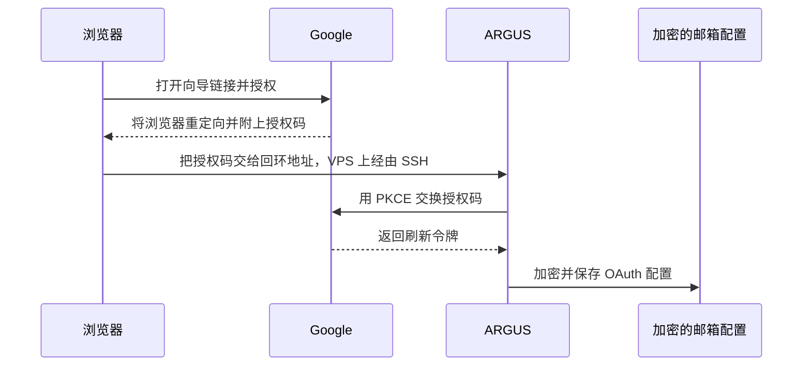
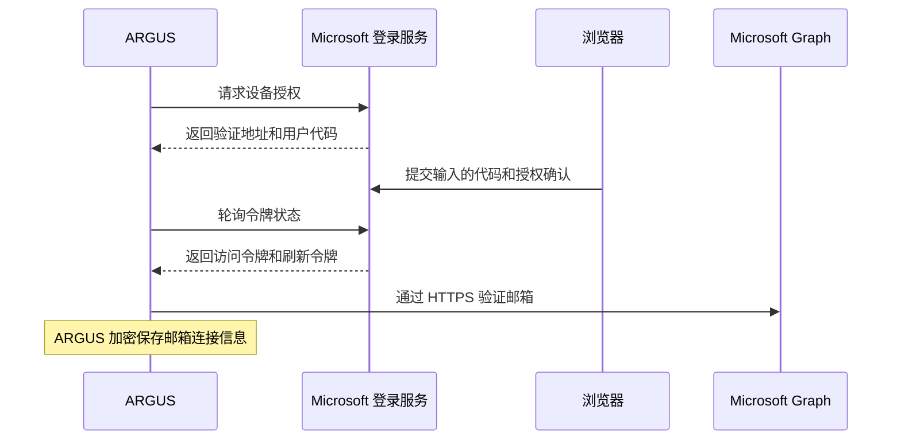

# 在 ARGUS 中使用邮件

[English](mail.md) · [Русский](mail-ru.md) · [Español](mail-es.md) · [Français](mail-fr.md) · **中文** · [术语表](../../docs/localization-glossary.md)

ARGUS 可连接一个邮箱。主人可在 Telegram 私聊中打开收件箱、准备回复，并逐封批准发送。读信、提取验证码和发送回复三项权限分别设置。新连接的三项权限默认关闭。

首次测试 Gmail 时，请使用一个只含测试邮件的独立账号。将该地址添加到 **Test users**，并在 Google 授权页面选择该账号。请从另一个由你控制的邮箱发送测试邮件。

## 通过 OAuth 连接 Gmail

1. 打开 Google Cloud Console，选择自己的项目，并配置 **Google Auth Platform → Branding** 和 **Audience**。个人 Gmail 在 **Testing** 模式下请选择 **External**，再将独立测试邮箱添加到 **Test users**。在 **Data Access** 中确认包含 `https://mail.google.com/` 授权范围。Gmail 的 IMAP 和 SMTP 通过 XOAUTH2 使用该范围。Google Workspace 的组织策略可能限制 IMAP 或此授权范围。在 **Testing** 模式下，此范围的授权和刷新令牌会在同意授权七天后过期。[配置 Google Auth Platform](https://support.google.com/cloud/answer/15544987) · [受众与 Testing 模式](https://support.google.com/cloud/answer/15549945) · [Gmail XOAUTH2 授权范围](https://developers.google.com/workspace/gmail/imap/xoauth2-protocol) · [在 Google Cloud 打开 Audience](https://console.cloud.google.com/auth/audience)
2. 在 **Clients → Create client** 中选择 **Desktop app**，下载 OAuth 客户端 JSON 文件，并存放在仓库之外的私有目录中。文件须归运行向导的用户所有，并且只有该用户可以访问（`chmod 600`）。ARGUS 使用文件中的客户端 ID 和客户端密钥。邮箱访问权限由你在 Google 的浏览器页面中授予。[OAuth 客户端](https://support.google.com/cloud/answer/15549257) · [在 Google Cloud 打开 Clients](https://console.cloud.google.com/auth/clients)
请在 ARGUS 主机上使用与服务相同的 `ARGUS_KEYSTORE_PASSPHRASE`、`stateDir` 和配置运行向导。请使用 Outlook.com 的主邮箱地址和 Entra 应用程序 ID。如果省略邮箱地址，向导会提示输入。
4. 在 ARGUS 主机的私有交互式终端中运行设置向导，将示例路径替换为下载文件的位置。如果使用仓库的本地副本，请先在 `argus` 目录运行 `npm run build`，再用 `node dist/index.js` 代替 `argus`。

   ```sh
   argus mail setup --gmail-client /path/to/desktop-oauth-client.json
   ```

5. 输入 Gmail 地址，接受建议的服务器设置，再确认登录名。Gmail 默认通过 IMAP `imap.gmail.com:993` 收信，通过 SMTP `smtp.gmail.com:465` 发信。使用 `--gmail-client` 时，向导自动选择 OAuth。在同一台电脑的浏览器中打开授权链接，选择对应的 Gmail 账号，再在 Google 页面确认授权。等待终端显示 `Mailbox connected`。ARGUS 通过本机回调获取刷新令牌，并把它和 OAuth 客户端信息一起加密保存在邮箱配置中。请自行保管客户端 JSON、授权链接和令牌。[桌面应用 OAuth](https://developers.google.com/identity/protocols/oauth2/native-app) · [将 Gmail 添加到邮件客户端](https://support.google.com/mail/answer/7126229)

```sh
argus mail status
```

检查输出包含 `Authentication: Google OAuth`，收发邮件服务器均已配置，三项权限都处于关闭状态。终端输出可能包含邮箱地址。记录操作结果和权限状态即可。

如果 ARGUS 服务已经通过密钥管理器读取 `ARGUS_GMAIL_CLIENT_ID` 和 `ARGUS_GMAIL_CLIENT_SECRET`，直接运行 `argus mail setup` 并选择 **Google**。此方式需要设置向导和机器人都能读取这两个变量。替换已有连接时加上 `--force`。向导验证新连接后保存，并重置三项权限。如果浏览器与 ARGUS 位于不同电脑上，请按下文设置 SSH 隧道。

如需通过 HTTPS 发送 Gmail 回复，请在创建 **Desktop app** OAuth 客户端的同一个 Google Cloud 项目中启用 Gmail API。设置邮箱时添加 `--gmail-send-api`。ARGUS 仍通过 IMAP 读信和提取验证码。`https://mail.google.com/` 授权范围同时适用于 Gmail API 和 IMAP。如果 VPS 的 SMTP 出站端口被封锁，此模式通过端口 443 使用 HTTPS 发信。[启用 Gmail API](https://console.cloud.google.com/apis/library/gmail.googleapis.com) · [Gmail API 发信授权范围](https://developers.google.com/workspace/gmail/api/reference/rest/v1/users.messages/send)

```sh
argus mail setup --gmail-client '/path/to/desktop-oauth-client.json' --gmail-send-api
```

设置完成后，`argus mail status` 应显示 `Authentication: Google OAuth` 和 `Outgoing: Gmail API (HTTPS)`。替换已有连接时请加上 `--force`，然后重新开启所需权限。

### 在远程主机上完成 OAuth

为本机回调指定固定端口。在远程主机运行向导，并传入该主机可读的 JSON 路径。

```sh
argus mail setup --gmail-client /path/to/desktop-oauth-client.json --oauth-port 8765
```

让设置向导继续运行。在打开浏览器的电脑上另开终端，启动 SSH 本地端口转发。将 `user@host.example` 替换为自己的 SSH 地址。

```sh
ssh -N -o ExitOnForwardFailure=yes -L 127.0.0.1:8765:127.0.0.1:8765 user@host.example
```

隧道建立后，打开向导给出的授权链接并确认。Google 会把浏览器送回 `127.0.0.1:8765`，SSH 再将请求转发给向导。两条命令应使用相同的空闲端口。向导最多等待三分钟。终端显示 `Mailbox connected` 后即可停止隧道。[SSH 本地端口转发](https://man.openbsd.org/ssh#L)

如果 ARGUS 在 Linux 上使用 Docker 的 bridge 网络运行，请在设置期间用 `--network host` 启动一个临时交互式容器，让回调可以通过主机的回环地址访问。沿用服务使用的 ARGUS 镜像、配置、运行用户、`stateDir` 卷和口令。将客户端 JSON 以只读方式挂载，并保持上述所有权和权限要求。设置完成后，服务可从共享卷读取加密的邮箱连接。

[`gmail-oauth-vps.py`](../scripts/gmail-oauth-vps.py) 可根据正在运行的 `argus` 服务配置启动这个临时容器。确认 JSON 文件的权限为 `600`，然后在 Docker 主机上打开私有终端，从脚本所在目录以 root 身份运行。在运行浏览器的电脑上保持 SSH 隧道开启。

```sh
python3 gmail-oauth-vps.py '/path/to/desktop-oauth-client.json' --container argus --port 8765
```

若要在 VPS 上使用 Gmail API 发信，请为脚本命令加上同一个选项。

```sh
python3 gmail-oauth-vps.py '/path/to/desktop-oauth-client.json' --container argus --port 8765 --gmail-send-api
```

连接完成后，在平时使用的服务中执行检查，例如 `docker exec -it argus node dist/index.js mail status`。请私下保管原始 JSON，供日后重新授权使用，并在设置完成后删除 VPS 上的临时副本。



## 连接个人 Outlook.com 邮箱

ARGUS 通过 HTTPS 使用 Microsoft Graph，从个人 Microsoft 账号的 Outlook.com 邮箱读信、提取验证码和发送回复。首次测试可使用一个只存放测试邮件的独立个人邮箱。每个 `stateDir` 只保存一个邮箱连接。要替换 Gmail 或其他已有连接，请加上 `--force` 重新设置。替换后的三项本地权限默认关闭。

1. 在 Microsoft Entra 管理中心打开 **App registrations → New registration**。请使用在 Microsoft Entra 租户中拥有应用注册权限的账号登录。如果个人 Outlook.com 账号无法访问该租户，请使用有权限的账号注册应用，并在下方的授权步骤中使用个人 Outlook.com 账号登录。为应用输入容易辨认的名称，选择 **Personal Microsoft accounts only**。设备代码授权的 **Redirect URI** 留空。从 **Overview** 复制 **Application (client) ID**。[打开 Microsoft Entra](https://entra.microsoft.com/#view/Microsoft_AAD_RegisteredApps/ApplicationsListBlade) · [注册应用](https://learn.microsoft.com/en-us/entra/identity-platform/quickstart-register-app) · [租户要求](https://learn.microsoft.com/en-us/entra/identity-platform/quickstart-create-new-tenant)
2. 在 **Authentication → Advanced settings** 中将 **Allow public client flows** 设为 **Yes**，然后保存。向导使用公共客户端的应用 ID 发起 OAuth 设备代码授权。此流程只需应用 ID，无需客户端密钥或重定向 URI。[配置公共客户端](https://learn.microsoft.com/en-us/entra/identity-platform/scenario-desktop-app-configuration) · [设备代码授权](https://learn.microsoft.com/en-us/entra/identity-platform/v2-oauth2-device-code)
3. 在 **API permissions → Add a permission → Microsoft Graph → Delegated permissions** 中选择 `User.Read` 和 `Mail.Read`。如果列表已有 `User.Read`，请保留。如果需要通过 ARGUS 发送回复，再添加 `Mail.Send`。ARGUS 登录时会请求 `offline_access`，以便更新连接。Microsoft 为登录者的邮箱授予委托权限，`read`、`otp` 和 `send` 开关控制 ARGUS 在本地允许的操作。仅提取验证码仍需 `Mail.Read`，以便检查符合条件的邮件。[Graph 权限参考](https://learn.microsoft.com/en-us/graph/permissions-reference) · [OAuth 授权范围](https://learn.microsoft.com/en-us/entra/identity-platform/scopes-oidc)

| 权限 | ARGUS 的用途 |
| --- | --- |
| `User.Read` | 验证 Microsoft 个人资料与设置时选择的邮箱匹配。 |
| `Mail.Read` | 读取收件箱，包括符合条件的验证码邮件正文。 |
| `Mail.Send` | 经主人批准后，从登录的邮箱发送回复。未使用 `--incoming-only` 配置邮箱时需要此权限。 |
| `offline_access` | 使用加密邮箱配置中保存的刷新令牌更新访问权限。 |

在 ARGUS 主机上运行向导，沿用服务的 `ARGUS_KEYSTORE_PASSPHRASE`、`stateDir` 和配置。请使用 Outlook.com 的主邮箱地址和 Entra 应用程序 ID。省略邮箱地址时，向导会提示输入。读取邮件或提取验证码时请使用 `--incoming-only`。如需发送回复，请省略该选项，并按上文添加 `Mail.Send` 委托权限。

```sh
argus mail setup '<outlook-address>' --microsoft-client-id '<application-client-id>' --incoming-only
argus mail status
```

如果 ARGUS 在 Docker 中运行，请在现有容器中启动向导。通过 SSH 操作时，请使用交互式终端。

```sh
docker exec -it argus node dist/index.js mail setup '<outlook-address>' --microsoft-client-id '<application-client-id>' --incoming-only
docker exec -it argus node dist/index.js mail status
```

保持向导运行。在自己的浏览器中打开向导显示的 Microsoft 验证地址，输入临时用户代码，登录选定的个人账号，再核对应用名称和权限后批准。只在自己打开的浏览器会话中的 Microsoft 页面输入代码。浏览器可在另一台电脑上运行，无需 SSH 隧道。ARGUS 通过 Graph 验证邮箱并加密保存刷新令牌。状态应显示 `Authentication: Microsoft OAuth`、`Incoming: Microsoft Graph (HTTPS)`。使用 `--incoming-only` 时会显示 `Outgoing: off`，允许发送时会显示 `Outgoing: Microsoft Graph (HTTPS)`。ARGUS 权限初始均为关闭状态。



在 Outlook.com 收件箱中运行下文的读信或仅提取验证码检查。经主人批准后回复的检查需要能发送邮件的连接。提取验证码时，Graph 提供邮件的收件时间。ARGUS 核对预期发件人、请求标识和时间，并且只报告结果。Graph 的接收确认表示 Microsoft 已收到发信请求。请到第二个邮箱核对实际送达。授权过期或被撤销后，请用 `--force` 重新设置，再开启所需权限。要断开邮箱连接，请运行 `argus mail disconnect --yes`，再到个人 Microsoft 账号的应用权限页面撤销应用授权。[Graph 发信响应](https://learn.microsoft.com/en-us/graph/api/user-sendmail?view=graph-rest-1.0) · [Microsoft 账号应用权限](https://account.live.com/consent/Manage)

## 权限和命令

如果机器人所在主机供多人使用，请将 `ARGUS_TELEGRAM_OWNER_ID` 设为自己的 Telegram 用户 ID。在主人的私聊中打开 `/mail`，选择 **Permissions**。机器人按钮使用英文。

| 权限 | 用途 |
| --- | --- |
| `read` · **Read** | **Inbox** 显示近期来信，可在私聊中打开选中的邮件。私聊中展示的内容会经过 Telegram 服务器。 |
| `otp` · **Verification codes** | 获准的服务流程通过 IMAP 或 Microsoft Graph，按发件人、请求标识和收件时间查找新的验证码。ARGUS 将验证码直接交给该流程，绕过 Telegram 和模型。POP3 可用来读取邮件。 |
| `send` · **Send** | `/mail_reply` 为选中的邮件准备回复。主人核对收件人、主题和正文后，点击 **Send this reply** 批准发送。 |

如需回复，在 **Inbox** 中选中邮件，再使用正文下方显示的 `/mail_reply` 命令。发送批准在五分钟内有效，按钮只能使用一次。**Discard** 会丢弃草稿。若想让模型起草，可选择 **Draft a reply with AI**。它会列出模型提供方，并单独征求同意，以便向该提供方分享主题和正文节选。发送这份草稿仍须主人另行批准。

Google 授权和 ARGUS 权限在不同层面生效。`https://mail.google.com/` 范围授予应用完整的 Gmail 邮箱访问权限。即使发信使用 Gmail API，Google 也没有为 IMAP 提供仅提取验证码的授权范围。ARGUS 分别检查读信、提取验证码和发送回复三项权限。三项权限默认关闭。**Test users** 决定哪些账号可以为应用授权。[Gmail XOAUTH2 授权范围](https://developers.google.com/workspace/gmail/imap/xoauth2-protocol)

## 使用真实邮箱验证

准备另一个由你控制的邮箱。请分开发送普通测试邮件和包含模拟验证码的邮件。记录读信、验证码查找和回复送达三项结果即可。

1. **读信。** 从第二个邮箱给已连接的邮箱发送一封主题唯一的测试邮件，例如 `ARGUS mailbox test a7f3`，正文写一行普通测试文字。开启 `read`，用准确的发件人地址和主题运行检查。命令在最新的 20 封来信中查找唯一匹配项。成功时显示 `PASS`，并隐藏邮件内容。

   ```sh
   argus mail permissions read on
   argus mail check-read sender@example.com 'ARGUS mailbox test a7f3'
   ```

2. **仅提取验证码。** 关闭 `read` 和 `send`，然后开启 `otp`。在 ARGUS 主机运行诊断命令，填入第二个邮箱的地址。命令会显示唯一主题、请求标识和一封含模拟验证码的测试邮件样例。请原样复制主题和正文，在三分钟内从第二个邮箱手动发送到已连接的邮箱。`PASS` 表明 ARGUS 在读信和发送权限关闭时，通过 IMAP 或 Microsoft Graph 提取了匹配的验证码。命令结果只显示查找是否成功。

   ```sh
   argus mail permissions read off
   argus mail permissions send off
   argus mail permissions otp on
   argus mail check-otp sender@example.com
   ```

3. **经主人批准后回复。** 关闭 `otp`，开启 `read` 和 `send`，对普通测试邮件运行 `check-reply`。在私有终端中核对收件人、主题和正文。决定发送这份回复后，请在五分钟内准确输入 `SEND`。`PASS` 表示发信服务已接受回复。请到第二个邮箱确认回复实际送达。

   ```sh
   argus mail permissions otp off
   argus mail permissions read on
   argus mail permissions send on
   argus mail check-reply sender@example.com 'ARGUS mailbox test a7f3'
   ```

如果 Telegram 机器人已经配置，也可以通过 `/mail` 检查读信和回复。在 **Inbox** 中打开普通测试邮件并核对内容。仅提取验证码时，**Inbox** 会提示读信功能已关闭。要测试回复，请使用普通邮件下方的 `/mail_reply` 命令，核对预览后点击 **Send this reply**。`Reply accepted by the outgoing mail service.` 表示所配置的 SMTP、Gmail API 或 Microsoft Graph 已接受回复。验证码仍通过主机上的 `check-otp` 检查。

验证完成后，在 **Permissions** 中关闭临时权限，也可逐项运行 `argus mail permissions <read|otp|send> off`。

## 其他邮箱、断开连接和排查问题

`argus mail discover owner@example.com` 可按地址查找邮件服务器设置。在向导中选择 `manual` 可以更改主机或关闭收信、发信中的一项。收信支持端口 993 的 IMAP over TLS 和端口 995 的 POP3 over TLS。发信支持端口 465 的 SMTP over TLS 或端口 587 强制使用 STARTTLS 的 SMTP。请在向导的隐藏输入提示中输入邮件服务允许使用的密码或应用专用密码。Gmail 的应用专用密码需要启用两步验证，并受账号策略约束。[Google 应用专用密码](https://support.google.com/accounts/answer/185833)

| 遇到的问题 | 检查项目 |
| --- | --- |
| 向导提示输入应用专用密码 | 检查 `--gmail-client` 或两项客户端变量、**Desktop app** 类型、Gmail 地址以及 IMAP 和 SMTP 设置。 |
| Google 拒绝授权或已有连接失效 | 检查测试用户、Google Workspace 策略和 **Testing** 模式有效期。使用 `--force` 重新设置时，向导会重新请求授权。 |
| 浏览器无法回到向导 | 确认向导仍在运行。浏览器应在同一台电脑上打开，或通过使用相同端口的 SSH 隧道连接。 |
| 找不到普通测试邮件 | 确认最新的 20 封来信中只有一封邮件的发件人地址和主题完全匹配。 |
| 找不到验证码 | 检查发件人、主题和请求标识，并确认邮件在诊断启动后进入收件箱。每次启动请使用当次显示的样例。 |
| 无法通过 Gmail API 发信 | 确认 OAuth 客户端所在项目已启用 Gmail API，并且 `mail status` 显示 `Outgoing: Gmail API (HTTPS)`。 |
| 未能确认发送结果 | 重试前先检查第二个邮箱以及已连接邮箱的已发送邮件文件夹。 |

`argus mail disconnect --yes` 会删除 ARGUS 主机上的加密连接配置。若要撤销 Google 端的权限，请打开该账号的第三方连接列表，按 **Branding** 中设置的名称找到应用，再移除访问权限。如果使用了应用专用密码，请在 Google 账号设置中撤销该密码。[管理第三方应用访问权限](https://support.google.com/accounts/answer/13533235)
