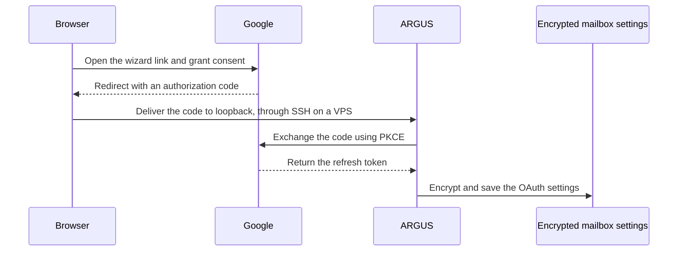
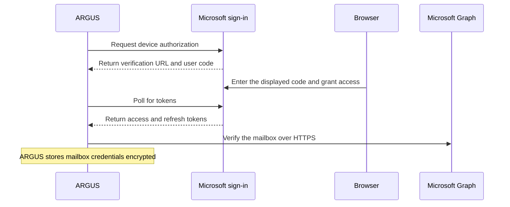

# Mail in ARGUS

**English** · [Русский](mail-ru.md) · [Español](mail-es.md) · [Français](mail-fr.md) · [简体中文](mail-zh.md) · [Glossary](../../docs/localization-glossary.md)

ARGUS connects one mailbox. Use a private terminal or the owner's private Telegram chat to check that it can read mail, retrieve verification codes, and send a reply after owner confirmation. The three ARGUS permissions start off and can be enabled separately.

For the first Gmail test, use a separate account that contains only test messages. Add that address under **Test users** and choose it when Google asks which account to authorize. Use another address you control to send the test messages.

## Create a Gmail OAuth client

1. Open your project in **Google Auth Platform**. Under **Branding**, enter an application name you will recognize in the Google consent screen, a support email, and your contact details.
2. Under **Audience**, use **External → Testing** for a personal Gmail account and add your dedicated Gmail address under **Test users**. For Google Workspace, **Internal** is available when the project and account belong to the same organization and its policy allows the app. With **External → Testing**, the refresh token for the Gmail mailbox scope expires after seven days. [OAuth consent setup](https://developers.google.com/workspace/guides/configure-oauth-consent) · [Token expiration](https://developers.google.com/identity/protocols/oauth2#expiration) · [Open Audience in Google Cloud](https://console.cloud.google.com/auth/audience)
3. Under **Data Access**, declare `https://mail.google.com/` if Google asks for the scopes. Gmail uses this full mailbox scope for IMAP and SMTP with XOAUTH2. Google offers no codes-only grant for the IMAP connection, including when sending uses Gmail API. ARGUS enforces its own permissions for reading, retrieving codes, and sending. They start off. **Test users** controls which accounts can consent to the app. Google Workspace policy may restrict the scope or IMAP access. [Gmail XOAUTH2 scope](https://developers.google.com/workspace/gmail/imap/xoauth2-protocol) · [Gmail client access](https://support.google.com/mail/answer/7126229)
4. Under **Clients → Create client**, select **Desktop app** and download the client JSON. Keep it outside the repository, owned and readable only by the user who runs the wizard (`chmod 600`). The downloaded file identifies the OAuth client. You grant mailbox access yourself on Google's consent page. Keep the client JSON, the authorization URL, and any tokens in your own private session. [Create an OAuth client](https://developers.google.com/workspace/guides/create-credentials) · [Open Clients in Google Cloud](https://console.cloud.google.com/auth/clients)

## Connect Gmail

Run the wizard and the ARGUS service with the same `ARGUS_KEYSTORE_PASSPHRASE` and `stateDir`. Supply the passphrase through the host's private secret configuration. If the service uses a custom config, give the wizard the same `--config` option. On a repository checkout, run `npm run build` in `argus/` and use `node dist/index.js` in place of `argus`.

```sh
argus mail setup --gmail-client '/path/to/desktop-oauth-client.json'
argus mail status
```

Enter your Gmail address. Accept the suggested IMAP `imap.gmail.com:993` settings and use that same address as the login. The default outgoing transport is SMTP at `smtp.gmail.com:465`. The `--gmail-client` option selects OAuth automatically. Open the link from the wizard in your own browser, select the same Google account, and approve the named application. When the browser tells you to return to the terminal, wait for `Mailbox connected`. ARGUS checks the configured mail connection and encrypts the Google client credentials and refresh token together with the mailbox settings. `argus mail status` should show `Authentication: Google OAuth` and all three permissions off. The status may display your mailbox address. Share only the authentication method and permission states when reporting a result. [Google Desktop OAuth](https://developers.google.com/identity/protocols/oauth2/native-app)

If you already provision both `ARGUS_GMAIL_CLIENT_ID` and `ARGUS_GMAIL_CLIENT_SECRET` in the service's private environment, run `argus mail setup` and choose **Google**. With the environment method, both the wizard and the service need those variables. To replace a connection, repeat the original setup command with `--force`. After the replacement passes the connection check, its three permissions start off again.

For app password sign-in, turn on Google 2-Step Verification and create an app password. Enter it at the wizard's hidden prompt. Add `--incoming-only` to configure IMAP alone with either sign-in method. [Google app passwords](https://myaccount.google.com/apppasswords)

```sh
argus mail setup '<gmail-address>' --app-password --incoming-only
argus mail setup '<gmail-address>' --gmail-client '/path/to/desktop-oauth-client.json' --incoming-only
```

To send Gmail replies over HTTPS, enable Gmail API in the same Google Cloud project as the Desktop app OAuth client. Add `--gmail-send-api` when setting up the mailbox. Gmail still uses IMAP for reading and verification codes. The `https://mail.google.com/` scope covers the API call and the IMAP connection. On a VPS with blocked SMTP ports, this mode sends over HTTPS on port 443. [Enable Gmail API](https://console.cloud.google.com/apis/library/gmail.googleapis.com) · [Gmail API send scopes](https://developers.google.com/workspace/gmail/api/reference/rest/v1/users.messages/send)

```sh
argus mail setup --gmail-client '/path/to/desktop-oauth-client.json' --gmail-send-api
```

After setup, `argus mail status` should show `Authentication: Google OAuth` and `Outgoing: Gmail API (HTTPS)`. Add `--force` when replacing an existing connection, then enable the permissions you need again.

### Connect on an SSH host

Run the wizard on the ARGUS host with a fixed callback port. From the computer with the browser, forward the same local loopback port to the host over SSH. Replace the example path and SSH destination.

```sh
argus mail setup --gmail-client '/path/to/desktop-oauth-client.json' --oauth-port 8765
```

```sh
ssh -N -o ExitOnForwardFailure=yes -L 127.0.0.1:8765:127.0.0.1:8765 user@host.example
```

Keep the wizard and the tunnel open. Open the original Google authorization URL locally and approve it within three minutes. Your browser returns to `127.0.0.1:8765`, and SSH carries the response to the wizard. Stop the tunnel after setup. If the port is occupied, choose the same free port in both commands. [SSH local port forwarding](https://man.openbsd.org/ssh#L)

On a Linux Docker host with a running `argus` container, the repository's [`gmail-oauth-vps.py`](../scripts/gmail-oauth-vps.py) runs the wizard in a temporary container on the host network. It uses the service's image, user, state volume and existing passphrase. Put the downloaded JSON in a private file on that host with `chmod 600`. From the directory containing the helper, run it as root in a private terminal. Run the SSH tunnel above on the browser computer. An ordinary `docker exec` in a bridge-networked container uses the container's own loopback.

```sh
python3 gmail-oauth-vps.py '/path/to/desktop-oauth-client.json' --container argus --port 8765
```

For Gmail API delivery on the VPS, add the same flag to the helper command.

```sh
python3 gmail-oauth-vps.py '/path/to/desktop-oauth-client.json' --container argus --port 8765 --gmail-send-api
```

After connecting, run the verification commands in the running service, for example `docker exec -it argus node dist/index.js mail status`. Use the same service and configuration throughout. Keep the JSON in private storage for possible reauthorization, and remove any temporary copy from the VPS when done.



## Connect a personal Outlook.com mailbox

ARGUS uses Microsoft Graph over HTTPS to read mail, retrieve verification codes, and send replies for a personal Microsoft account with an Outlook.com mailbox. A separate personal mailbox with test messages is useful for the first run. ARGUS stores one mailbox per `stateDir`. To replace an existing Gmail or other connection, repeat setup with `--force`. All three local permissions start off after the replacement.

1. Open **App registrations → New registration** in the Microsoft Entra admin center. Sign in with an account that can register applications in an Entra tenant. If the personal Outlook.com account has no access to that tenant, use an authorized tenant account for registration, then use the personal Outlook.com account for the consent step below. Give the app a name you will recognize during sign-in and select **Personal Microsoft accounts only**. Leave **Redirect URI** empty for device authorization. Copy the **Application (client) ID** from **Overview**. [Open Microsoft Entra](https://entra.microsoft.com/#view/Microsoft_AAD_RegisteredApps/ApplicationsListBlade) · [Register an app](https://learn.microsoft.com/en-us/entra/identity-platform/quickstart-register-app) · [Tenant requirements](https://learn.microsoft.com/en-us/entra/identity-platform/quickstart-create-new-tenant)
2. In **Authentication → Advanced settings**, set **Allow public client flows** to **Yes** and save. The wizard uses OAuth device authorization with the application ID as a public client. The device flow requires no client secret or redirect URI. [Public client settings](https://learn.microsoft.com/en-us/entra/identity-platform/scenario-desktop-app-configuration) · [Device authorization](https://learn.microsoft.com/en-us/entra/identity-platform/v2-oauth2-device-code)
3. Under **API permissions → Add a permission → Microsoft Graph → Delegated permissions**, select `User.Read` and `Mail.Read`. Keep `User.Read` if it is already listed. Add `Mail.Send` only if you plan to send replies with ARGUS. ARGUS requests `offline_access` during sign-in so it can refresh the connection. Microsoft delegates permissions for the signed-in mailbox, while the `read`, `otp` and `send` switches limit what ARGUS allows locally. Codes-only mode still needs `Mail.Read` to examine matching mail. [Graph permission reference](https://learn.microsoft.com/en-us/graph/permissions-reference) · [OAuth scopes](https://learn.microsoft.com/en-us/entra/identity-platform/scopes-oidc)

| Permission | What ARGUS uses it for |
| --- | --- |
| `User.Read` | Verify that the Microsoft profile matches the mailbox selected in setup. |
| `Mail.Read` | Read incoming messages, including the body of a matching verification email. |
| `Mail.Send` | Send a reply as the signed-in mailbox after owner confirmation. Required when setup runs without `--incoming-only`. |
| `offline_access` | Renew access with a refresh token stored in the encrypted mailbox settings. |

Run setup on the ARGUS host with the same `ARGUS_KEYSTORE_PASSPHRASE`, `stateDir` and configuration as the service. Use the primary Outlook.com address and the Entra application ID. If you leave out the address, the wizard asks for it. Use `--incoming-only` for reading or retrieving verification codes. To enable replies, omit that flag and add the delegated `Mail.Send` permission as described above.

```sh
argus mail setup '<outlook-address>' --microsoft-client-id '<application-client-id>' --incoming-only
argus mail status
```

If ARGUS runs in Docker, run the wizard in the existing container. From an SSH terminal use the same container, with a TTY for the interactive setup.

```sh
docker exec -it argus node dist/index.js mail setup '<outlook-address>' --microsoft-client-id '<application-client-id>' --incoming-only
docker exec -it argus node dist/index.js mail status
```

Leave the wizard running. In your own browser, open the Microsoft verification URL displayed by the wizard, enter the temporary device user code, sign in to the selected personal account, and review the app name and permissions before approving. Enter the code only on the Microsoft page in the browser session you initiated. The browser can be on a different machine without an SSH tunnel. ARGUS checks the mailbox through Graph and stores the refresh token encrypted. The status should show `Authentication: Microsoft OAuth`, `Incoming: Microsoft Graph (HTTPS)`, and `Outgoing: off` for `--incoming-only` or `Outgoing: Microsoft Graph (HTTPS)` for the full connection. All ARGUS permissions start off.



Run the read or codes-only checks below against the Outlook.com Inbox. The confirmed reply check requires a connection with outgoing mail. In the codes-only check, Graph supplies the message's received time. ARGUS still checks the expected sender, reference, and time and reports only the result. Graph acceptance confirms that Microsoft received the send request. Check delivery in the second mailbox. If authorization expires or is revoked, repeat setup with `--force` and enable the permissions you need again. To disconnect, run `argus mail disconnect --yes` and remove the app's grant on your Microsoft account's connected-app permissions page. [Microsoft Graph send response](https://learn.microsoft.com/en-us/graph/api/user-sendmail?view=graph-rest-1.0) · [Microsoft account app permissions](https://account.live.com/consent/Manage)

## Verify on a real mailbox

Use a second email address you control. Send the ordinary test email and the synthetic code email separately. Record the result of each check. The terminal read and codes-only checks report `PASS` or a failure without printing the retrieved mail or code.

1. **Read.** From the second account, send the connected mailbox an ordinary message with a unique subject and harmless text. Enable read access and supply the exact sender and subject. The check opens one matching message from the most recent 20 Inbox entries.

   ```sh
   argus mail permissions read on
   argus mail check-read sender@example.com 'ARGUS mailbox test a7f3'
   ```

2. **Codes only.** Turn off inbox reading and sending before enabling codes. Start the check, then manually send a new plain-text message from the second account with the exact subject and body displayed. The body contains a fresh request reference and a fixed synthetic code, `314159`. Use the template from this run and deliver it to the connected Inbox within three minutes. ARGUS uses the receipt time from IMAP or Microsoft Graph and matches the sender and reference. A successful check reports only its result.

   ```sh
   argus mail permissions read off
   argus mail permissions send off
   argus mail permissions otp on
   argus mail check-otp sender@example.com
   ```

3. **Confirmed reply.** Use the ordinary test message from step 1. In the private terminal, check the exact recipient, subject, and fixed test reply. Enter `SEND` within five minutes to authorize it. Any other input cancels. When `check-reply` reports `PASS`, the outgoing mail service has accepted the reply. Check that it arrived at the second address. If the result is uncertain, inspect both mailboxes before repeating the send.

   ```sh
   argus mail permissions otp off
   argus mail permissions read on
   argus mail permissions send on
   argus mail check-reply sender@example.com 'ARGUS mailbox test a7f3'
   ```

### Use Telegram for reading and replies

Set `ARGUS_TELEGRAM_OWNER_ID` to the intended owner before running a bot on a shared host. Open `/mail` in that owner's private chat. Under **Permissions**, toggle **Read**, **Verification codes**, and **Send** independently. Use **Inbox** to view recent messages and open the ordinary test message. With codes alone enabled, **Inbox** reports that reading is disabled. Use `check-otp` on the host for the code check.

To prepare a test reply from Telegram, use the `/mail_reply` command under the ordinary test message. Review the recipient, subject, and text, then choose **Send this reply** or **Discard**. A confirmation is valid for one draft for five minutes. The message `Reply accepted by the outgoing mail service.` confirms that SMTP, Gmail API, or Microsoft Graph accepted the reply, depending on the configured transport. Check the second address for delivery. Use one sending path per test.

Mail shown in Telegram passes through its servers. ARGUS keeps it out of the agent's conversation memory. **Draft a reply with AI** asks for separate permission to share the selected subject and an excerpt with the named model provider. Sending that draft still requires owner confirmation. Verification codes obtained by an authorized workflow stay in that workflow.

Turn off the permissions you enabled for the test unless you want to keep using them. The terminal command is `argus mail permissions <read|otp|send> off`, one permission per invocation.

## Other providers and troubleshooting

`argus mail discover owner@example.com` looks up mail settings without signing in. Choose `manual` in setup to change the host, choose POP3, or disable one direction. ARGUS reads IMAP over TLS on `993` or POP3 over TLS on `995`. It sends through SMTP over TLS on `465` or required STARTTLS on `587`. Codes-only access for these providers uses IMAP. The Outlook.com OAuth connection uses Microsoft Graph. Enter a provider-approved password or app password only in the wizard's hidden prompt. Gmail app passwords are available when Google two-step verification and the account policy allow them. [Google app passwords](https://support.google.com/accounts/answer/185833)

| Symptom | Check |
| --- | --- |
| The wizard asks for an app password | Check the **Desktop app** JSON or both OAuth client variables, and use Gmail's IMAP or SMTP settings. |
| Google denies consent or access expires | Check the account in **Test users**, the seven-day limit in **External → Testing**, and any Workspace policy. Run setup again with `--force` and the original options to reauthorize. |
| Browser cannot reach the callback | Keep the wizard open and use the exact matching port in the SSH tunnel. A Linux Docker bridge needs the temporary host-networked wizard. |
| A test message is missing | Check the connected Inbox, the sender address, and the exact subject. The read check needs one match in the most recent 20 Inbox entries. The code check also needs the fresh reference and a message that arrived after it started. |
| Gmail API cannot send | Check that Gmail API is enabled in the OAuth client's project and that `mail status` shows `Outgoing: Gmail API (HTTPS)`. |
| The outgoing mail service does not confirm the reply | Check the connected mailbox's Sent folder and the second account before retrying. |

`argus mail disconnect --yes` removes the encrypted mailbox settings from the ARGUS host. To revoke the grant in Google as well, remove the named application from your Google Account connections. For app-password setup, revoke the app password in Google Account security settings. [Manage Google Account connections](https://support.google.com/accounts/answer/13533235)
