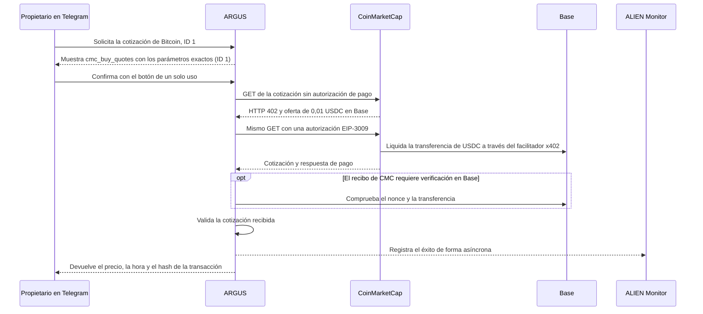

# Una cotización de Bitcoin por 0,01 USDC desde Telegram

> [English](./use-case-cmc-telegram.md) · [Русский](./use-case-cmc-telegram-ru.md) · **Español** · [Français](./use-case-cmc-telegram-fr.md) · [中文](./use-case-cmc-telegram-zh.md)

El 13 de noviembre de 2026, el propietario del bot ARGUS de Attested aprobó en su chat privado de Telegram una llamada a `cmc_buy_quotes` para Bitcoin, identificador `1` de CoinMarketCap. El bot devolvió una cotización histórica de **68.831,48 USD** y mostró la hora **20:56:04 UTC** en su respuesta. La cartera dedicada del bot pagó **0,01 USDC en Base** y su saldo pasó de 0,01 a 0 USDC. [Documentación x402 de CoinMarketCap](https://coinmarketcap.com/api/documentation/ai-agent-hub/x402) · [Transacción en BaseScan](https://basescan.org/tx/0x9ad76626d4ad1505363ecec1f4005e7840abdb516a3877fca39f736d81098ecc)

## De la solicitud a la cotización



En el chat privado, pide que se ejecute una sola vez `cmc_buy_quotes` con `{"ids":[1]}`. Revisa el nombre de la herramienta y el identificador antes de confirmar. ARGUS comprueba la red, el contrato de USDC, el destinatario configurado y que la oferta x402 no supere 0,01 USDC. Si el resultado queda pendiente después de enviar la autorización, revisa la cartera y el recibo antes de volver a ejecutar la herramienta. [Configuración de herramientas de pago](./personal-assistant.md#optional-paid-tools)

## Cómo verificar el cargo y la cotización

1. Abre el recibo de BaseScan del bloque **57.065.273**. El contrato de USDC emitió un evento `AuthorizationUsed` para la cartera dedicada. El siguiente registro, `Transfer`, muestra **10.000 unidades mínimas** transferidas al destinatario configurado de CoinMarketCap. El `nonce` figuraba como no utilizado en el bloque de referencia **57.063.721** y como utilizado después de la transferencia. [Recibo de BaseScan](https://basescan.org/tx/0x9ad76626d4ad1505363ecec1f4005e7840abdb516a3877fca39f736d81098ecc)
2. Compara las comprobaciones. Tres RPC públicos de Base confirmaron el bloque canónico y la disminución del saldo. El bloque aún estaba pendiente de finalización cuando se registraron las mediciones. PublicNode encontró una sola autorización nueva de la cartera durante el intervalo de prueba. Los otros dos RPC comprobaron el recibo por su hash. [Verificación del recibo](../../artifacts/cmc-telegram-live-2026-11-13/verified.json) · [Búsqueda de autorizaciones](../../artifacts/cmc-telegram-live-2026-11-13/authorization-window.json)
3. En ALIEN Monitor, el contador de éxitos de `coinmarketcap / argus / quotes` pasó de **0 a 1** en la ventana de 24 horas. El contador indica que la herramienta devolvió la cotización solicitada. El evento no incluye el hash de la transacción ni el `nonce`. El recibo de Base permite verificar el pago por separado. [Contadores públicos](https://monitor.modelmarket.dev/api/provider-events)

Desde la raíz del repositorio, con Node.js 22 o posterior y acceso HTTPS a los RPC públicos de Base y a ALIEN Monitor, puedes consultar de nuevo el recibo y los contadores. Los contadores cambian con la ventana móvil de 24 horas.

```sh
node artifacts/cmc-telegram-live-2026-11-13/check.mjs 0x9ad76626d4ad1505363ecec1f4005e7840abdb516a3877fca39f736d81098ecc
```

## Prueba separada con la tarjeta Laso

En la prueba de compra del paquete de iconos en itch.io, el bot tenía una dirección de correo configurada para el recibo. El sitio redirigió el navegador a su página de inicio antes de que se abriera el formulario de Stripe. Tras actualizar los datos, Laso mostraba **5 USD disponibles** y ningún cargo de itch.io. La prueba no generó un recibo del comercio ni entregó el ZIP. Para una compra ya hecha en el navegador, la guía explica cómo recuperar el ZIP con `/recover_itch` y el enlace privado del recibo. [Caso de la tarjeta Laso](./use-case-laso-prepaid-card-es.md) · [Guía de recuperación](./personal-assistant.md#buy-the-itchio-icon-pack-from-telegram)
