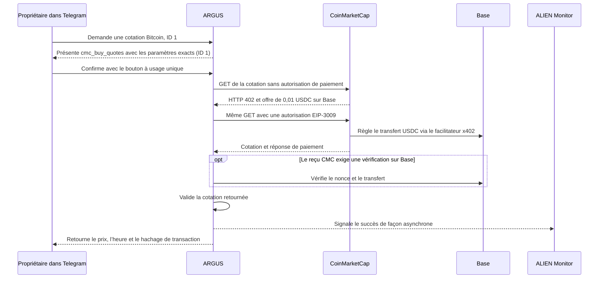

# Une cotation Bitcoin à 0,01 USDC depuis Telegram

> [English](./use-case-cmc-telegram.md) · [Русский](./use-case-cmc-telegram-ru.md) · [Español](./use-case-cmc-telegram-es.md) · **Français** · [中文](./use-case-cmc-telegram-zh.md)

Le 13 novembre 2026, le propriétaire du bot ARGUS d’Attested a approuvé dans sa conversation Telegram privée un appel à `cmc_buy_quotes` pour Bitcoin, identifiant CoinMarketCap `1`. Le bot a retourné une cotation historique de **68 831,48 USD**, horodatée **20:56:04 UTC** dans sa réponse. Le portefeuille dédié du bot a payé **0,01 USDC sur Base** et son solde est passé de 0,01 à 0 USDC. [Documentation x402 de CoinMarketCap](https://coinmarketcap.com/api/documentation/ai-agent-hub/x402) · [Transaction sur BaseScan](https://basescan.org/tx/0x9ad76626d4ad1505363ecec1f4005e7840abdb516a3877fca39f736d81098ecc)

## De la demande à la cotation



Dans le chat privé, demandez une seule exécution de `cmc_buy_quotes` avec `{"ids":[1]}`. Vérifiez le nom de l’outil et l’identifiant avant de confirmer. ARGUS compare l’offre x402 au réseau, au contrat USDC, au destinataire configuré et au plafond de 0,01 USDC. Si le résultat reste incertain après l’envoi de l’autorisation, vérifiez le portefeuille et le reçu avant de relancer l’outil. [Configuration des outils payants](./personal-assistant.md#optional-paid-tools)

## Vérifier le débit et la réception de la cotation

1. Ouvrez le reçu BaseScan du bloc **57 065 273**. Le contrat USDC a émis un événement `AuthorizationUsed` pour le portefeuille dédié. Le journal immédiatement suivant, `Transfer`, indique **10 000 unités minimales** transférées au destinataire CoinMarketCap configuré. Le `nonce` était inutilisé dans le bloc de référence **57 063 721** et marqué comme utilisé après le transfert. [Reçu BaseScan](https://basescan.org/tx/0x9ad76626d4ad1505363ecec1f4005e7840abdb516a3877fca39f736d81098ecc)
2. Comparez les vérifications. Trois RPC publics Base ont confirmé le bloc canonique et la baisse du solde. Le bloc était encore en attente de finalisation lors des mesures consignées. PublicNode a trouvé une seule nouvelle autorisation du portefeuille dans la fenêtre de l’essai. Les deux autres RPC ont vérifié le reçu à partir de son hachage. [Vérification du reçu](../../artifacts/cmc-telegram-live-2026-11-13/verified.json) · [Recherche des autorisations](../../artifacts/cmc-telegram-live-2026-11-13/authorization-window.json)
3. Dans ALIEN Monitor, le compteur de succès de `coinmarketcap / argus / quotes` est passé de **0 à 1** sur la fenêtre de 24 heures. Le compteur indique que l’outil a retourné la cotation demandée. L’événement n’inclut ni hachage de transaction ni `nonce`. Le reçu Base permet de vérifier le paiement séparément. [Compteurs publics](https://monitor.modelmarket.dev/api/provider-events)

Depuis la racine du dépôt, avec Node.js 22 ou plus récent et un accès HTTPS aux RPC publics Base et à ALIEN Monitor, vous pouvez relire le reçu et les compteurs. Les compteurs en direct évoluent avec la fenêtre de 24 heures.

```sh
node artifacts/cmc-telegram-live-2026-11-13/check.mjs 0x9ad76626d4ad1505363ecec1f4005e7840abdb516a3877fca39f736d81098ecc
```

## Essai distinct avec la carte Laso

Lors de l’essai d’achat du pack d’icônes sur itch.io, le bot disposait d’une adresse e-mail configurée pour le reçu. Le site a redirigé le navigateur vers sa page d’accueil avant l’ouverture du formulaire Stripe. Après actualisation, Laso indiquait **5 USD disponibles** et aucun débit itch.io. L’essai n’a produit ni reçu du commerçant ni fichier ZIP. Pour un achat déjà effectué dans le navigateur, le guide décrit la récupération du ZIP via `/recover_itch` à partir du lien privé du reçu. [Cas de la carte Laso](./use-case-laso-prepaid-card-fr.md) · [Guide de récupération](./personal-assistant.md#buy-the-itchio-icon-pack-from-telegram)
