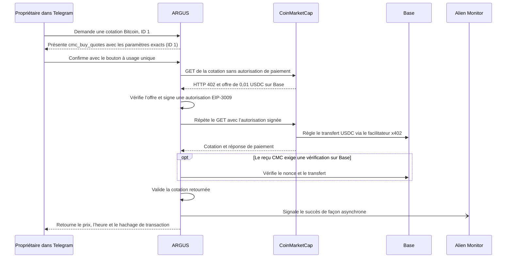

# Une cotation Bitcoin à 0,01 USDC depuis Telegram

> [English](./use-case-cmc-telegram.md) · [Русский](./use-case-cmc-telegram-ru.md) · [Español](./use-case-cmc-telegram-es.md) · **Français** · [中文](./use-case-cmc-telegram-zh.md)

Le 13 novembre 2026, le propriétaire a approuvé dans la conversation privée de `@Argis3Bot` un appel à `cmc_buy_quotes` pour Bitcoin, identifiant CoinMarketCap `1`. Le bot a affiché une cotation de **68 831,48 USD** horodatée à **20:56:04 UTC**, ainsi que le hachage de la transaction. Le portefeuille dédié a payé **0,01 USDC sur Base** et son solde est passé de 0,01 à 0 USDC. [Documentation x402 de CoinMarketCap](https://coinmarketcap.com/api/documentation/ai-agent-hub/x402) · [Transaction sur BaseScan](https://basescan.org/tx/0x9ad76626d4ad1505363ecec1f4005e7840abdb516a3877fca39f736d81098ecc)

## De la demande à la cotation



Le bouton de confirmation autorise un appel à `cmc_buy_quotes` avec les paramètres exacts `{"ids":[1]}`. Le premier GET vers `/x402/v3/cryptocurrency/quotes/latest?id=1` obtient l’offre. ARGUS vérifie la ressource, le réseau Base, le contrat USDC, le destinataire configuré et le plafond de 0,01 USDC avant de signer une autorisation EIP-3009 hors chaîne. Les fonds sont transférés lorsque le facilitateur x402 soumet l’autorisation sur Base. Si le résultat reste incertain, vérifiez le portefeuille et le reçu avant de relancer l’outil. [Configuration des outils payants](./personal-assistant.md#optional-paid-tools)

## Vérifier le débit et la réception de la cotation

1. Ouvrez le reçu BaseScan du bloc **57 065 273**. Le contrat USDC a émis un événement `AuthorizationUsed` pour le portefeuille dédié. Le journal immédiatement suivant, `Transfer`, indique **10 000 unités minimales** transférées au destinataire CoinMarketCap configuré. Le `nonce` était inutilisé dans le bloc de référence **57 063 721** et marqué comme utilisé après le transfert. [Reçu BaseScan](https://basescan.org/tx/0x9ad76626d4ad1505363ecec1f4005e7840abdb516a3877fca39f736d81098ecc)
2. Trois RPC publics de Base ont confirmé le bloc canonique et la baisse du solde. PublicNode a trouvé une seule nouvelle autorisation du portefeuille dans la fenêtre de l’essai. Les deux autres RPC ont vérifié le reçu à partir du hachage après des erreurs HTTP lors de la consultation des journaux. Le bloc était en attente de finalisation lors de la première vérification. Le 14 novembre 2026, les trois RPC ont confirmé la finalisation du même bloc et du paiement. [Vérification du reçu](../../artifacts/cmc-telegram-live-2026-11-13/verified.json) · [Recherche des autorisations](../../artifacts/cmc-telegram-live-2026-11-13/authorization-window.json) · [Vérification de la finalisation](../../artifacts/cmc-telegram-live-2026-11-13/finalized.json)
3. Dans Alien Monitor, le compteur de succès de `coinmarketcap/argus/quotes` est passé de **0 à 1** sur la fenêtre de 24 heures, avec **0 échec**. L’événement n’inclut ni hachage de transaction ni `nonce`. Le reçu Base permet de vérifier le paiement séparément. [Compteurs publics](https://monitor.modelmarket.dev/api/provider-events)

Depuis la racine du dépôt, avec Node.js 22 ou plus récent et un accès HTTPS aux RPC publics de Base et à Alien Monitor, consultez le reçu et les compteurs. Les compteurs en direct évoluent avec la fenêtre de 24 heures.

```sh
node artifacts/cmc-telegram-live-2026-11-13/check.mjs 0x9ad76626d4ad1505363ecec1f4005e7840abdb516a3877fca39f736d81098ecc
```

## Essai distinct avec la carte Laso

Lors de l’essai d’achat du pack d’icônes sur itch.io, le bot disposait d’une adresse e-mail configurée pour le reçu. Le site a redirigé le navigateur vers sa page d’accueil avant l’ouverture du formulaire Stripe. Après actualisation, Laso indiquait **5 USD disponibles** et aucun débit itch.io. L’essai n’a produit ni reçu du commerçant ni fichier ZIP. Pour un achat déjà effectué dans le navigateur, le guide décrit la récupération du ZIP via `/recover_itch` à partir du lien privé du reçu. [Cas de la carte Laso](./use-case-laso-prepaid-card-fr.md) · [Guide de récupération](./personal-assistant.md#buy-the-itchio-icon-pack-from-telegram)
