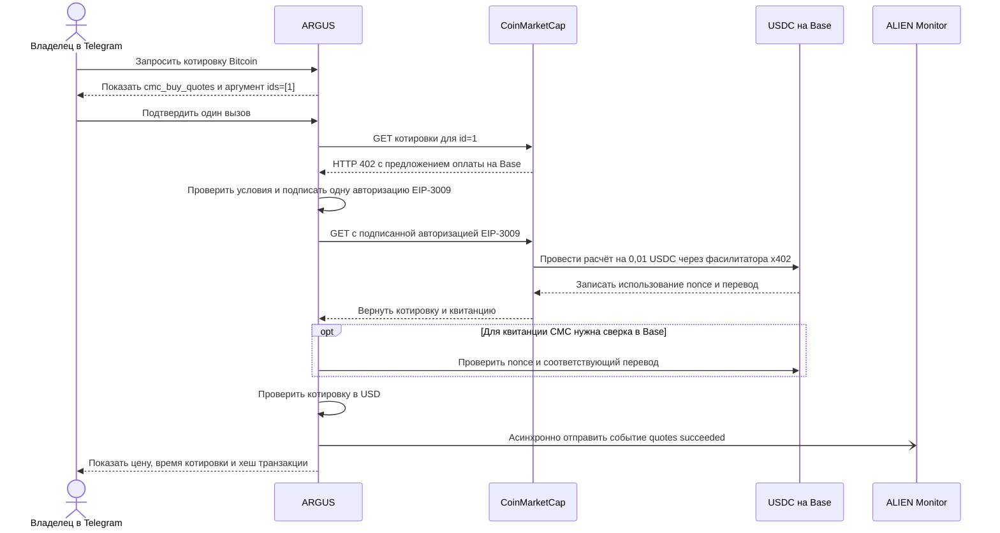

# Покупка котировки CoinMarketCap из Telegram

> 🌐 [English](use-case-cmc-telegram.md) · **Русский** · [Español](use-case-cmc-telegram-es.md) · [Français](use-case-cmc-telegram-fr.md) · [中文](use-case-cmc-telegram-zh.md)

13 ноября 2026 года владелец @Argis3Bot подтвердил в личном чате один запрос котировки Bitcoin, CoinMarketCap ID `1`. ARGUS заплатил **0,01 USDC на Base** с выделенного кошелька. Бот показал котировку CoinMarketCap **68 831,48 USD за BTC** и время котировки **20:56:04 UTC**. [Настройка платных инструментов ARGUS](personal-assistant.md) · [Документация CoinMarketCap по x402](https://coinmarketcap.com/api/documentation/ai-agent-hub/x402)

## От подтверждения до котировки



1. Кнопка подтверждает вызов с точными аргументами `{"ids":[1]}`. Первый GET к `/x402/v3/cryptocurrency/quotes/latest?id=1` возвращает `402` с предложением оплаты. До подписи ARGUS проверяет ресурс, сеть Base, нативный USDC, настроенного получателя и лимит 0,01 USDC.
2. ARGUS подписывает одну авторизацию EIP-3009 офчейн и передаёт её в заголовке повторного GET. Средства переводятся, когда фасилитатор x402 отправляет авторизацию в Base. В цепочке фиксируется одна успешная транзакция с событиями `AuthorizationUsed` и `Transfer` на **10 000 минимальных единиц USDC**. Баланс выделенного кошелька изменился с 0,01 до 0 USDC. [Квитанция транзакции в BaseScan](https://basescan.org/tx/0x9ad76626d4ad1505363ecec1f4005e7840abdb516a3877fca39f736d81098ecc)
3. ARGUS извлекает котировку в USD и отметку времени из ответа поставщика. Если CoinMarketCap возвращает свой формат квитанции, адаптер подтверждает хеш по каноническому блоку Base, одноразовому nonce и соответствующему переводу USDC. При неопределённом исходе после подписи ARGUS сообщает о необходимости сверки перед повтором. [Проверка расчёта CMC в ARGUS](../src/economy/cmc-settlement.ts)
4. В Alien Monitor счётчик успешных вызовов `coinmarketcap/argus/quotes` за 24 часа вырос с 0 до 1, счётчик ошибок остался на нуле. Событие содержит результат вызова без хеша транзакции или nonce. [События поставщиков в Alien Monitor](https://monitor.modelmarket.dev/api/provider-events)

## Сверка платежа

Три публичных RPC Base подтвердили один и тот же канонический блок **57 065 273**, успешную квитанцию и перевод на настроенный адрес. В контрольном блоке **57 063 721** nonce ещё не использовался. После перевода контракт USDC отметил его использованным. PublicNode нашёл ровно одну новую авторизацию кошелька в проверенном диапазоне. Два других RPC подтвердили авторизацию по хешу транзакции после ошибок HTTP при выборке логов. [Квитанция и баланс](../../artifacts/cmc-telegram-live-2026-11-13/verified.json) · [Сверка диапазона авторизаций](../../artifacts/cmc-telegram-live-2026-11-13/authorization-window.json)

При первой сверке блок ожидал финализации. При повторной сверке 14 ноября 2026 года все три RPC подтвердили финализацию того же блока и платежа. [Сверка финализации](../../artifacts/cmc-telegram-live-2026-11-13/finalized.json)

Из корня репозитория запустите проверку для известного хеша с Node.js 22 или новее и доступом к публичным API. Скрипт читает данные Base и Alien Monitor, сверяет квитанцию, блок, сумму, nonce и баланс. Поле `finalized_rpc_confirmations` показывает, сколько RPC уже включили этот блок в финализированную часть цепочки. Счётчики Monitor меняются по мере поступления событий и истечения 24-часового окна.

```sh
node artifacts/cmc-telegram-live-2026-11-13/check.mjs \
  0x9ad76626d4ad1505363ecec1f4005e7840abdb516a3877fca39f736d81098ecc
```

## Отдельная проверка покупки иконок

В @Argis3Bot команда «купи иконки» или `/buy_itch` использует настроенный адрес для чека. При отсутствии адреса бот спрашивает его в личном чате. Запись адреса позволяет указать получателя чека при оформлении. Доступ к письмам включается отдельно через подключение почтового ящика. [Сценарий покупки иконок](personal-assistant.md#buy-the-itchio-icon-pack-from-telegram) · [Подключение почты](mail-ru.md)

В живой проверке короткоживущий сеанс Laso обновили и сверили доступные $5. itch.io перенаправил браузер на главную до открытия Stripe. Платёж не отправлялся, списания не было, чек и ZIP не получены. После оплаченной покупки в браузере команда `/recover_itch` запрашивает приватную ссылку из чека, проверяет товар, сумму и архив, затем доставляет ZIP в личный Telegram. Эта команда восстанавливает доставку по существующей покупке. [Ход проверки itch.io](../../artifacts/argus-itch-live-2026-11-13/README.md)
