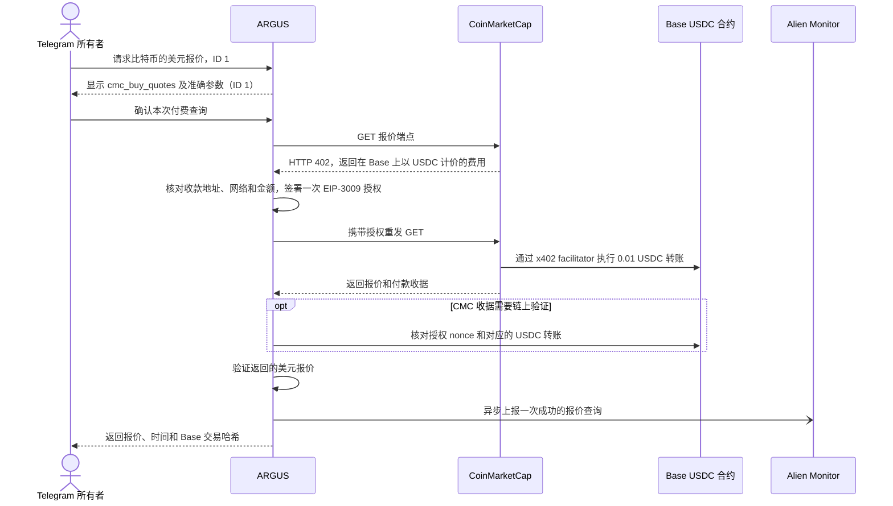

# 在 Telegram 中用 0.01 USDC 查询 CoinMarketCap 报价

> [English](./use-case-cmc-telegram.md) · [Русский](./use-case-cmc-telegram-ru.md) · [Español](./use-case-cmc-telegram-es.md) · [Français](./use-case-cmc-telegram-fr.md) · **简体中文**

2026 年 11 月 13 日，所有者在 `@Argis3Bot` 的私聊中批准了一次 CoinMarketCap 付费报价查询。查询使用比特币的 CoinMarketCap ID `1`。机器人返回了 **68,831.48 美元** 的价格、**2026 年 11 月 13 日 20:56:04 UTC** 的报价时间和 Base 交易哈希。这是机器人当时返回的历史报价。 [CoinMarketCap x402 API](https://coinmarketcap.com/api/documentation/ai-agent-hub/x402)

## 从确认到 Base 结算



确认按钮授权的是参数为 `{"ids":[1]}` 的 `cmc_buy_quotes` 调用。ARGUS 首次向 `/x402/v3/cryptocurrency/quotes/latest?id=1` 发送 GET 获取付款条件。钱包在链下签署 EIP-3009 授权前，ARGUS 会验证资源、Base 网络、USDC 合约、已配置的 CMC 收款地址和 **0.01 USDC** 的费用上限。x402 facilitator 提交链上交易后，USDC 才会转账。授权发出后若结果不明确，应先验证钱包和付款收据，再发起查询。 [付费工具配置](./personal-assistant.md#optional-paid-tools)

| 核验项 | 结果 |
| --- | --- |
| 金额 | Base 原生 USDC `0.01`，即 `10,000` 个最小单位。专用钱包的 USDC 余额由 `0.01` 降至 `0`。 |
| 授权 | 收据中的 `AuthorizationUsed` 事件之后紧接一条对应的 USDC `Transfer`。该 nonce 在测试前的区块 `57,063,721` 尚未使用，在转账后标记为已使用。PublicNode 在测试区间内仅发现一条新增授权，另外两个 RPC 的日志查询遇到 HTTP 错误，随后通过交易哈希验证了收据。 |
| 交易 | 三个公共 RPC 确认交易已纳入 Base 规范链的区块 `57,065,273`，并验证了余额减少和转账。 [BaseScan 交易](https://basescan.org/tx/0x9ad76626d4ad1505363ecec1f4005e7840abdb516a3877fca39f736d81098ecc) |
| 最终性 | 首次验证时，该区块尚未达到最终确认。2026 年 11 月 14 日复查时，三个 RPC 都确认了同一区块和付款的最终性。 [最终性验证](../../artifacts/cmc-telegram-live-2026-11-13/finalized.json) |

[链上核验记录](../../artifacts/cmc-telegram-live-2026-11-13/verified.json) · [授权窗口核验](../../artifacts/cmc-telegram-live-2026-11-13/authorization-window.json)

Alien Monitor 的 `coinmarketcap/argus/quotes` 统计中，24 小时成功次数从 `0` 增至 `1`，失败次数为 `0`。该事件提供操作级统计，事件数据不含交易哈希或授权 nonce。 [Alien Monitor 统计接口](https://monitor.modelmarket.dev/api/provider-events)

使用 Node.js 22 或更新版本，在仓库根目录运行以下命令。它通过公共 Base RPC 和 Alien Monitor 读取验证数据。Monitor 返回查询时的统计值，上面的记录保留了实测时的统计和链上状态。

```sh
node artifacts/cmc-telegram-live-2026-11-13/check.mjs \
  0x9ad76626d4ad1505363ecec1f4005e7840abdb516a3877fca39f736d81098ecc
```

## 单独进行的 Laso 结账测试

操作人员更新了 Laso 会话。卡片可用余额为 5 美元，未出现 itch.io 扣款。ARGUS 已配置收据邮箱。实测中，itch.io 在打开 Stripe 付款页以前把结账重定向到了首页。这次尝试没有扣款、已付款收据或 ZIP 交付。

所有者可以在自己的浏览器中完成购买，再在 `@Argis3Bot` 私聊中发送 `/recover_itch`。确认交付后，回复机器人发出的提示并附上收据里的私密下载链接。ARGUS 会核对商品、已付款金额和 ZIP，再将文件发到同一私聊。恢复交付不会产生付款。 [Laso 预付卡实测](./use-case-laso-prepaid-card-zh.md#telegram-购买流程) · [ARGUS 结账和恢复指南](./personal-assistant.md#buy-the-itchio-icon-pack-from-telegram)
