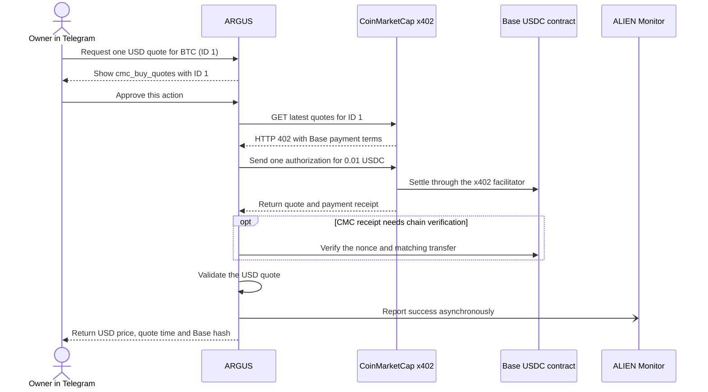

# Buying a CoinMarketCap quote from Telegram

> **English** · [Русский](use-case-cmc-telegram-ru.md) · [Español](use-case-cmc-telegram-es.md) · [Français](use-case-cmc-telegram-fr.md) · [中文](use-case-cmc-telegram-zh.md)

On 13 November 2026, the owner approved one `cmc_buy_quotes` call for Bitcoin, CoinMarketCap ID `1`, in the private `@Argis3Bot` chat. The bot showed a historical quote of **$68,831.48 at 20:56:04 UTC** and returned the payment transaction hash. [CoinMarketCap x402 API](https://coinmarketcap.com/api/documentation/ai-agent-hub/x402)

## From approval to settlement



The approval button authorizes the exact tool arguments `{"ids":[1]}`. ARGUS checks that the offer uses Base USDC, matches the configured CMC recipient and stays within the **0.01 USDC** limit. The wallet signs an EIP-3009 authorization off chain. Funds move when the x402 facilitator submits it for settlement. ARGUS checks the payment response and can verify a CMC-specific receipt by matching the signed nonce and transfer on Base. [Tool configuration](personal-assistant.md#optional-paid-tools)

## How the run was verified

| Evidence | Result |
| --- | --- |
| Telegram | The owner requested and approved one call. ARGUS returned one BTC/USD quote and a Base transaction hash. |
| Base | The receipt recorded one `AuthorizationUsed` event, followed immediately by one transfer of **10,000 USDC atoms (0.01 USDC)** from the dedicated wallet to the configured CMC recipient. The wallet balance fell from **0.01 to 0 USDC**. Three public RPC endpoints agreed on the canonical receipt in block **57,065,273**. The scan from the preflight block found one new wallet authorization. The block was still awaiting finality when the results were recorded. [BaseScan transaction](https://basescan.org/tx/0x9ad76626d4ad1505363ecec1f4005e7840abdb516a3877fca39f736d81098ecc) |
| ALIEN Monitor | `coinmarketcap / argus / quotes` went from **0 to 1 success** with **0 failures**. The public endpoint shows 24-hour aggregates. The event has no transaction hash, so the chain receipt independently proves the transfer. [Public counts](https://monitor.modelmarket.dev/api/provider-events) |

From the repository root, run this command with Node.js 22 or later and access to public Base RPC and ALIEN Monitor. It reads public evidence and performs no payment. The Monitor counts reflect the time of the query. The evidence files preserve the original before-and-after observation.

```sh
node artifacts/cmc-telegram-live-2026-11-13/check.mjs \
  0x9ad76626d4ad1505363ecec1f4005e7840abdb516a3877fca39f736d81098ecc
```

[Receipt verification](../../artifacts/cmc-telegram-live-2026-11-13/verified.json) · [Wallet authorization scan](../../artifacts/cmc-telegram-live-2026-11-13/authorization-window.json)

## The separate itch.io attempt

The ARGUS checkout had a receipt address configured and the refreshed Laso session verified **$5 available** with no itch.io debit. itch.io redirected the browser to its homepage before Stripe opened. The checkout sent no card payment and returned no receipt or ZIP. After a completed purchase in the owner's browser, `/recover_itch` can verify the receipt link and deliver the ZIP in Telegram without submitting another charge. [Laso pilot and checkout recovery](use-case-laso-prepaid-card.md#telegram-purchase-pilot) · [Checkout setup](personal-assistant.md#buy-the-itchio-icon-pack-from-telegram)
