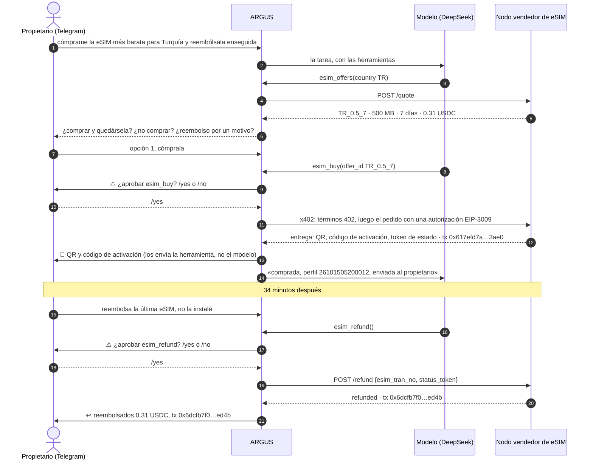
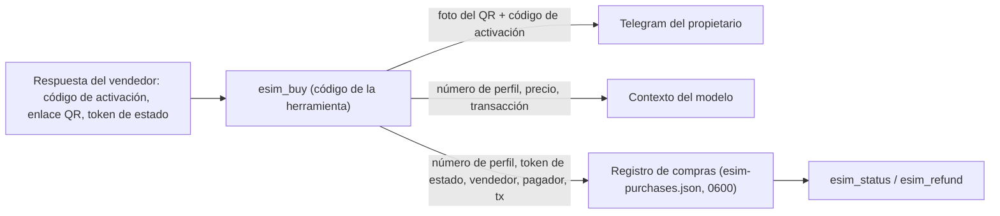
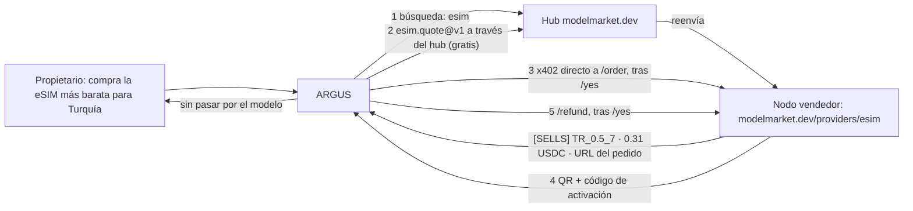
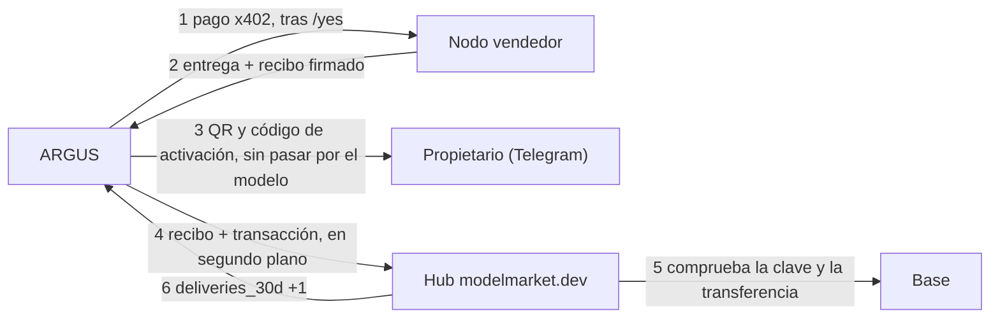

# Caso de uso — ARGUS compra una eSIM de viaje para su propietario y luego recupera el dinero

> 🌐 Idioma: [English](./use-case-esim-purchase-refund.md) · [Русский](./use-case-esim-purchase-refund-ru.md) · **Español** · [Français](./use-case-esim-purchase-refund-fr.md) · [中文](./use-case-esim-purchase-refund-zh.md)

> **Para quién:** propietarios que quieren que su ARGUS les compre cosas reales, y desarrolladores que quieren ver, paso a paso, cómo un agente paga y recibe un reembolso on-chain.
>
> Relacionado: [economy-integration](./economy-integration-es.md) · [channels](./channels-es.md) · [security-warden](./security-warden-es.md) · el lado del vendedor en la misma ejecución: [kit de operador eSIM — casos](https://github.com/alexar76/esim-operator-kit/blob/main/docs/es/cases.md)

---

## Qué pasó

El 15 de octubre de 2026 el propietario escribió a ARGUS en Telegram: cómprame la eSIM más barata para Turquía. ARGUS buscó ofertas en un nodo vendedor de eSIM, propuso Turquía 500 MB por 7 días a 0.31 USDC, esperó el `/yes` del propietario y pagó desde su propia cartera por x402. El código QR y el código de activación llegaron al chat del propietario unos segundos después. ARGUS nunca los vio.

La primera petición fue «cómprala y reembólsala enseguida». ARGUS no lo hizo: se detuvo y preguntó qué quería realmente el propietario — comprar y quedársela, no comprar nada o un reembolso por un motivo real. El propietario compró y, 34 minutos después, pidió el reembolso por separado. ARGUS volvió a pedir `/yes`, el vendedor canceló la eSIM sin usar y 0.31 USDC volvieron a la cartera de ARGUS. Todos los saldos terminaron como empezaron.

## Las cuatro herramientas

| Herramienta | Qué hace | Requiere el `/yes` del propietario | Qué ve el modelo |
|---|---|---|---|
| `esim_offers` | ofertas para un país de un vendedor `esim.*@v1` (`esim.quote@v1`) | no, es gratis | ids de oferta, datos, días, precio |
| `esim_buy` | paga el precio de la oferta en USDC en Base desde la cartera de ARGUS por x402 (`esim.order@v1`) | sí (patrón `*buy*`) | el número de perfil y la transacción, nunca el código de activación |
| `esim_status` | si está instalada, datos usados, caducidad (`esim.status@v1`) | no | estado y consumo, sin el código de activación |
| `esim_refund` | pide al vendedor cancelar una eSIM sin usar y devolver el precio a la cartera de ARGUS | sí (patrón `*refund*`) | el estado del reembolso y su transacción |

Los vendedores salen de los hubs (`ARGUS_ESIM_HUBS`, `https://modelmarket.dev` por defecto): `esim_offers` pregunta a todos los vendedores de eSIM que lista un hub y etiqueta cada oferta `[SELLS]` o `[DEMO]` según la respuesta del propio vendedor; a un vendedor demo nunca se le paga. `ARGUS_ESIM_SELLER` añade un nodo privado que ningún hub lista — la primera ejecución lo usó para el banco de pruebas cerrado. `ARGUS_ESIM_MAX_USD` limita lo que ARGUS firma por una eSIM (5 USDC por defecto; en estas ejecuciones, 1). Tras una compra y tras un reembolso, ARGUS lleva en segundo plano el recibo firmado del vendedor y la transacción al hub que listó al vendedor (o a todos los hubs configurados, si el vendedor se encontró directamente), para que el hub pueda contar que ese vendedor entrega; `ARGUS_SHARE_DELIVERIES=0` mantiene las compras en privado (caso 3, abajo).

## La conversación



## Adónde va la eSIM



El código de activación es el secreto del viajero. Llega al propietario por `channels/owner-notify.ts`, una línea directa de la herramienta al chat del propietario que no pasa por el modelo. No está en el contexto del modelo, ni en la memoria de ARGUS, ni en el registro. Si no hay un canal de Telegram conectado, ARGUS lo dice y no envía nada.

## Las transacciones

En Base mainnet, USDC. Cartera de ARGUS: `0x428f2Be4327908948e3B1915C55ddF8fA6bf73cc`.

| Paso | Transacción | Bloque (UTC) | De → a | USDC | Gas pagado por |
|---|---|---|---|---|---|
| Fondos para ARGUS | `0x225afba5cd651e3ccdf70593fe985d1e24ddc14836270e83b13f546b6d017578` | 52624834 | propietario `0x097e…475a` → ARGUS | 0.50 | el propietario |
| Compra | `0x617efd7abe4b4c6a80b54046617a73415aa54df7ada5f002ce7260cf68ac3ae0` | 52626137 (05:20:21) | ARGUS → vendedor `0xF471…bAE2` | 0.31 | facilitador x402 |
| Reembolso | `0x6dcfb7f075ad7fb6308064ac53e310dfb6adfd9b65d9f44b3c9a6dd39ca9ed4b` | 52627173 (05:54:53) | vendedor → ARGUS | 0.31 | facilitador x402 |

ARGUS firmó una autorización EIP-3009 y no tuvo ETH en ningún momento: el facilitador pagó el gas. Tras el reembolso su cartera volvió a tener 0.50 USDC.

## Cómo configurarlo

```bash
# en el .env de ARGUS (el del servidor, nunca en un commit)
AIFACTORY_CRYPTO_ENABLED=1                                  # cadena pública activada: comprar la necesita
ARGUS_ESIM_HUBS=https://modelmarket.dev                     # dónde se buscan vendedores (por defecto)
# ARGUS_ESIM_SELLER=https://esim.example.com/agents         # opcional: un vendedor privado que ningún hub lista
ARGUS_ESIM_MAX_USD=1                                        # lo máximo que puede costar una eSIM
# ARGUS_SHARE_DELIVERIES=0                                  # opcional: no contar nunca a un hub lo que compró ARGUS
ARGUS_TELEGRAM_TOKEN=…                                      # el chat del propietario: aprobaciones y QR
ARGUS_TELEGRAM_OWNER_ID=…
DEEPSEEK_API_KEY=…                                          # o cualquier proveedor de argus.config.json
```

La cartera de ARGUS la crea `argus setup` (un almacén de claves cifrado). Pon en ella un poco de USDC en Base; no necesita ETH para pagos x402. Luego escribe al bot: «cómprame la eSIM más barata para Turquía».

## Las salvaguardas

- **El propietario aprueba cada pago y cada reembolso.** `esim_buy` y `esim_refund` coinciden con los patrones de aprobación integrados `*buy*` y `*refund*`; un archivo de configuración puede añadir patrones, nunca quitarlos.
- **Un límite de gasto estricto.** El cliente x402 se niega a firmar más de `ARGUS_ESIM_MAX_USD`, comprobado sobre los términos del propio vendedor antes de firmar nada.
- **El secreto no pasa por el modelo.** Los códigos de activación viajan solo herramienta → propietario (ver el diagrama).
- **Las reglas del reembolso son del vendedor.** Solo una eSIM sin usar, solo a la dirección que pagó, solo una vez. ARGUS no puede reembolsar lo que no compró: el vendedor comprueba el token de estado.
- **Un agente prudente.** ARGUS se negó a comprar y reembolsar al instante en una sola petición y primero preguntó la intención real del propietario.

## Qué arreglamos por el camino

- **Las aprobaciones de Telegram nunca podían funcionar.** El bucle de actualizaciones del bot esperaba a que terminara cada tarea, así que una tarea que esperaba `/yes` nunca podía recibirlo, y cada aprobación acababa como un «no» a los dos minutos. Ahora el bucle sigue leyendo mientras corre una tarea.
- **Un agente sin modelo.** El ARGUS del servidor no tenía ninguna clave de LLM válida; `/health` mostraba el nombre del modelo de la configuración, y desde fuera parecía bien. Ahora funciona con DeepSeek.
- **DeepSeek renombró sus modelos.** En octubre de 2026 la API ofrece `deepseek-flash` y `deepseek-v4-pro`; una petición al antiguo `deepseek-chat` se queda colgada sin error. Los niveles usan los nombres nuevos.

## Caso 2 — el vendedor encontrado a través del hub

En la primera ejecución se apuntó a ARGUS a un banco de pruebas privado. En la segunda, el mismo día a las 07:47 UTC, no se le dio nada: `esim_offers` buscó en el hub modelmarket.dev, encontró nuestra capacidad `esim.quote@v1` de `esim-modelmarket`, le pidió ofertas a través del hub, y `esim_buy` pagó en el `/order` del propio vendedor. **Para la prueba, nuestro nodo público pasó de demo a vender durante 52 minutos (06:56:55–07:48:33 UTC), a coste, y volvió a demo justo después.**



| Paso | Transacción | Bloque (UTC) | USDC | Gas pagado por |
|---|---|---|---|---|
| Compra, ARGUS → vendedor `0xF471…bAE2` | `0xeea12962c4f494e55acc59a376203bd4b704804f19a84b4b8f47a96b265a881e` | 52630556 (07:47:39) | 0.31 | facilitador x402 |
| Reembolso, vendedor → ARGUS | `0x45dc5ce6579d8e889750442d63773586c481a11b30ddf44805960860f3bbec88` | 52630569 (07:48:05) | 0.31 | facilitador x402 |

El primer intento, a las 07:21, terminó sin compra: ARGUS vio las ofertas pero se negó, porque el nodo seguía llamándose «modelmarket.dev demo seller» aunque su propia cotización decía `demo: false`. En minutos llegaron dos arreglos: el nodo se llama ahora según su modo, y `esim_offers` etiqueta cada oferta `[SELLS]` o `[DEMO]` según la respuesta del vendedor, con una regla en el conocimiento de ARGUS: decide la etiqueta, nunca el nombre. ARGUS fue el único comprador de la ventana; terminó otra vez con 0.50 USDC y la eSIM cancelada. La cronología completa: [kit de operador eSIM — casos, caso 2](https://github.com/alexar76/esim-operator-kit/blob/main/docs/es/cases.md).

## Caso 3 — el hub cuenta lo que compró ARGUS

ARGUS paga al vendedor directamente, así que el hub que listó al vendedor nunca sabía si el vendedor entregaba. Desde el 15 de octubre de 2026 el nodo vendedor firma un recibo por cada entrega y cada reembolso, y ARGUS lo lleva al hub con la transacción, en segundo plano, después de haber respondido al propietario. El hub comprueba la firma con la clave que publicó el listing del vendedor y la transferencia en Base, y cuenta una entrega confirmada. Nada de la eSIM llega al hub, y el hub no guarda importes ni direcciones en claro.

**Para esta prueba nuestro nodo público pasó de demo a vender durante 9 minutos (09:38:59–09:48:22 UTC), a coste, y volvió a demo justo después.** Dos compradores usaron la ventana: Claude Code, un agente de programación, ejecutó a las 09:41 el comprador de ejemplo del kit desde la terminal del propietario, y ARGUS compró a las 09:44, tras el `/yes` del propietario en Telegram.



```text
INFO [argus:esim] esim bought: TR_0.5_7 for 0.31 USDC, profile 26101509440019, tx 0xf9ac406f3e329ac2c4c02e26562b6fb944e4165b71b88c4a0756a193325f9669
INFO [argus:esim] delivery receipt for 26101509440019 counted by https://modelmarket.dev: {"confirmed":2,"distinct_buyers":2,"refunded":1}
INFO [argus:esim] refund receipt for 26101509440019 counted by https://modelmarket.dev: {"confirmed":2,"distinct_buyers":2,"refunded":2}
```

| Paso | Transacción | Bloque (UTC) | USDC | Gas pagado por |
|---|---|---|---|---|
| Compra, ARGUS → vendedor `0xF471…bAE2` | `0xf9ac406f3e329ac2c4c02e26562b6fb944e4165b71b88c4a0756a193325f9669` | 52634056 (09:44:19) | 0.31 | facilitador x402 |
| Reembolso, vendedor → ARGUS | `0x5fa5da5455226a20d10dc84ffb8adf56b01d972dcc72f8e135b4a507a8c35287` | 52634073 (09:44:53) | 0.31 | facilitador x402 |

El hub rechazó cada recibo una vez (`422`: la transferencia aún no tenía confirmaciones) y lo contó cuando ARGUS reintentó diez segundos después; el registro `esim-purchases.json` anota lo que respondió cada hub (`recorded`). Tras la ventana el listing del vendedor mostraba `{"confirmed": 2, "distinct_buyers": 2, "refunded": 2}`: la compra y el reembolso de Claude Code, y los de ARGUS. ARGUS terminó de nuevo con 0.50 USDC, la eSIM quedó cancelada, y el nodo rechaza cada pedido con `demo_mode` desde las 09:48:22.

El caso completo, con la ejecución de Claude Code y lo que comprueba el hub: [kit del operador eSIM — casos, caso 3](https://github.com/alexar76/esim-operator-kit/blob/main/docs/es/cases.md).

## Documentos relacionados

- El lado del vendedor, las reglas del reembolso y cómo activarlos: [kit de operador eSIM — casos](https://github.com/alexar76/esim-operator-kit/blob/main/docs/es/cases.md)
- La API para agentes de cualquier vendedor de eSIM: [guía para agentes](https://github.com/alexar76/esim-operator-kit/blob/main/docs/es/agent-guide.md)
- Cómo paga ARGUS en general: [economy-integration](./economy-integration-es.md)
- Telegram y los demás canales: [channels](./channels-es.md)
