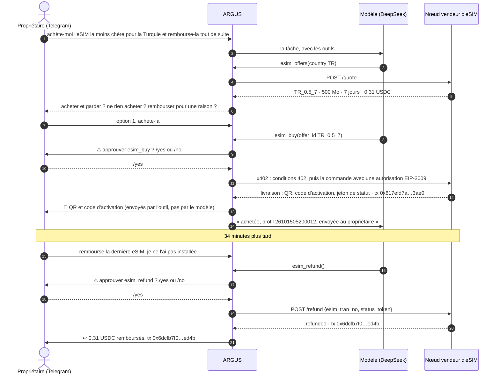
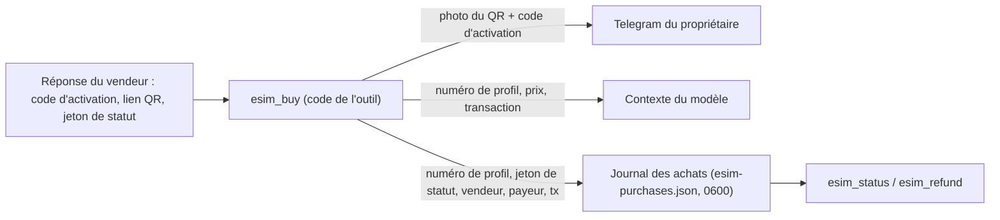
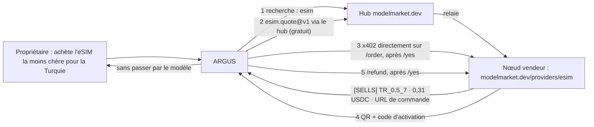
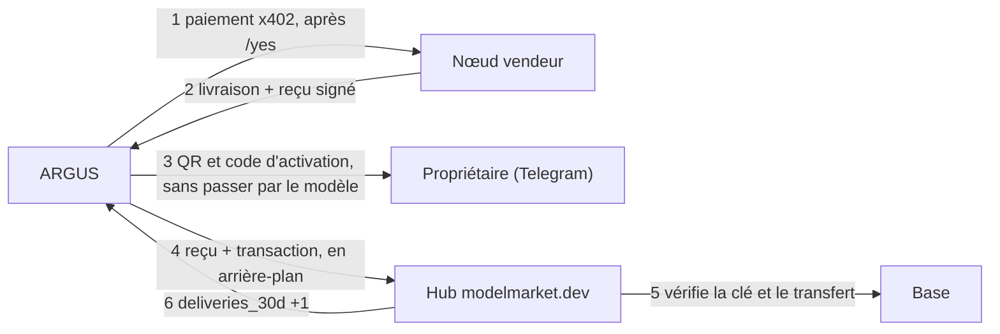

# Cas d'usage — ARGUS achète une eSIM de voyage pour son propriétaire, puis récupère l'argent

> 🌐 Langue : [English](./use-case-esim-purchase-refund.md) · [Русский](./use-case-esim-purchase-refund-ru.md) · [Español](./use-case-esim-purchase-refund-es.md) · **Français** · [中文](./use-case-esim-purchase-refund-zh.md)

> **Pour qui :** les propriétaires qui veulent que leur ARGUS leur achète de vraies choses, et les développeurs qui veulent voir, étape par étape, un agent payer et se faire rembourser on-chain.
>
> Voir aussi : [economy-integration](./economy-integration.md) · [channels](./channels.md) · [security-warden](./security-warden.md) · le côté vendeur de la même exécution : [kit d'opérateur eSIM — cas réels](https://github.com/alexar76/esim-operator-kit/blob/main/docs/fr/cases.md)

---

## Ce qui s'est passé

Le 15 octobre 2026, le propriétaire a écrit à ARGUS sur Telegram : achète-moi l'eSIM la moins chère pour la Turquie. ARGUS a cherché des offres sur un nœud vendeur d'eSIM, a proposé Turquie 500 Mo pour 7 jours à 0,31 USDC, a attendu le `/yes` du propriétaire et a payé depuis son propre portefeuille via x402. Le QR code et le code d'activation sont arrivés dans la conversation du propriétaire quelques secondes plus tard. ARGUS lui-même ne les a jamais vus.

La première demande était « achète-la et rembourse-la tout de suite ». ARGUS ne l'a pas fait : il s'est arrêté et a demandé ce que le propriétaire voulait vraiment — acheter et garder, ne rien acheter, ou un remboursement pour une vraie raison. Le propriétaire a acheté, puis, 34 minutes plus tard, a demandé le remboursement à part. ARGUS a de nouveau demandé `/yes`, le vendeur a annulé l'eSIM inutilisée et 0,31 USDC sont revenus sur le portefeuille d'ARGUS. Tous les soldes sont revenus à leur point de départ.

## Les quatre outils

| Outil | Ce qu'il fait | Requiert le `/yes` du propriétaire | Ce que voit le modèle |
|---|---|---|---|
| `esim_offers` | offres pour un pays chez un vendeur `esim.*@v1` (`esim.quote@v1`) | non, c'est gratuit | ids d'offres, données, jours, prix |
| `esim_buy` | paie le prix de l'offre en USDC sur Base depuis le portefeuille d'ARGUS via x402 (`esim.order@v1`) | oui (motif `*buy*`) | le numéro de profil et la transaction, jamais le code d'activation |
| `esim_status` | installée ou non, données utilisées, expiration (`esim.status@v1`) | non | état et consommation, sans le code d'activation |
| `esim_refund` | demande au vendeur d'annuler une eSIM inutilisée et de rendre le prix au portefeuille d'ARGUS | oui (motif `*refund*`) | l'état du remboursement et sa transaction |

Les vendeurs viennent des hubs (`ARGUS_ESIM_HUBS`, `https://modelmarket.dev` par défaut) : `esim_offers` interroge tous les vendeurs d'eSIM qu'un hub liste et étiquette chaque offre `[SELLS]` ou `[DEMO]` d'après la réponse du vendeur lui-même ; un vendeur de démo n'est jamais payé. `ARGUS_ESIM_SELLER` ajoute un nœud privé qu'aucun hub ne liste — la première exécution l'a utilisé pour le banc d'essai fermé. `ARGUS_ESIM_MAX_USD` plafonne ce qu'ARGUS signe pour une eSIM (5 USDC par défaut ; 1 dans ces exécutions). Après un achat et après un remboursement, ARGUS apporte en arrière-plan le reçu signé du vendeur et la transaction au hub qui a listé le vendeur (ou à tous les hubs configurés, pour un vendeur trouvé directement), afin que le hub puisse compter que ce vendeur livre ; `ARGUS_SHARE_DELIVERIES=0` garde les achats privés (cas 3 ci-dessous).

## La conversation



## Où va l'eSIM



Le code d'activation est le secret du voyageur. Il parvient au propriétaire par `channels/owner-notify.ts`, une ligne directe de l'outil vers la conversation du propriétaire qui contourne le modèle. Il n'est ni dans le contexte du modèle, ni dans la mémoire d'ARGUS, ni dans le journal. Si aucun canal Telegram n'est connecté, ARGUS le dit et n'envoie rien.

## Les transactions

Sur Base mainnet, en USDC. Portefeuille d'ARGUS : `0x428f2Be4327908948e3B1915C55ddF8fA6bf73cc`.

| Étape | Transaction | Bloc (UTC) | De → à | USDC | Gas payé par |
|---|---|---|---|---|---|
| Approvisionnement d'ARGUS | `0x225afba5cd651e3ccdf70593fe985d1e24ddc14836270e83b13f546b6d017578` | 52624834 | propriétaire `0x097e…475a` → ARGUS | 0,50 | le propriétaire |
| Achat | `0x617efd7abe4b4c6a80b54046617a73415aa54df7ada5f002ce7260cf68ac3ae0` | 52626137 (05:20:21) | ARGUS → vendeur `0xF471…bAE2` | 0,31 | facilitateur x402 |
| Remboursement | `0x6dcfb7f075ad7fb6308064ac53e310dfb6adfd9b65d9f44b3c9a6dd39ca9ed4b` | 52627173 (05:54:53) | vendeur → ARGUS | 0,31 | facilitateur x402 |

ARGUS a signé une autorisation EIP-3009 et n'a détenu d'ETH à aucun moment : le facilitateur a payé le gas. Après le remboursement, son portefeuille contenait de nouveau 0,50 USDC.

## Mise en place

```bash
# dans le .env d'ARGUS (celui du serveur, jamais dans un commit)
AIFACTORY_CRYPTO_ENABLED=1                                  # chaîne publique activée : l'achat en a besoin
ARGUS_ESIM_HUBS=https://modelmarket.dev                     # où chercher les vendeurs (par défaut)
# ARGUS_ESIM_SELLER=https://esim.example.com/agents         # facultatif : un vendeur privé qu'aucun hub ne liste
ARGUS_ESIM_MAX_USD=1                                        # le maximum pour une eSIM
# ARGUS_SHARE_DELIVERIES=0                                  # facultatif : ne jamais dire à un hub ce qu'ARGUS a acheté
ARGUS_TELEGRAM_TOKEN=…                                      # la conversation du propriétaire : approbations et QR
ARGUS_TELEGRAM_OWNER_ID=…
DEEPSEEK_API_KEY=…                                          # ou n'importe quel fournisseur d'argus.config.json
```

Le portefeuille d'ARGUS vient de `argus setup` (un coffre de clés chiffré). Mettez-y un peu d'USDC sur Base ; il n'a pas besoin d'ETH pour les paiements x402. Écrivez ensuite au bot : « achète-moi l'eSIM la moins chère pour la Turquie ».

## Les garde-fous

- **Le propriétaire approuve chaque paiement et chaque remboursement.** `esim_buy` et `esim_refund` correspondent aux motifs d'approbation intégrés `*buy*` et `*refund*` ; un fichier de configuration peut ajouter des motifs, jamais en retirer.
- **Un plafond de dépense strict.** Le client x402 refuse de signer plus que `ARGUS_ESIM_MAX_USD`, vérifié sur les conditions du vendeur lui-même avant toute signature.
- **Le secret contourne le modèle.** Les codes d'activation ne vont que de l'outil au propriétaire (voir le schéma ci-dessus).
- **Les règles du remboursement sont celles du vendeur.** Seulement une eSIM inutilisée, seulement vers l'adresse qui a payé, une seule fois. ARGUS ne peut pas rembourser ce qu'il n'a pas acheté : le vendeur vérifie le jeton de statut.
- **Un agent prudent.** ARGUS a refusé d'acheter et de rembourser aussitôt dans une même demande, et a d'abord demandé l'intention réelle du propriétaire.

## Ce que nous avons corrigé en chemin

- **Les approbations Telegram ne pouvaient jamais aboutir.** La boucle de mises à jour du bot attendait la fin de chaque tâche : une tâche qui attendait `/yes` ne pouvait donc jamais le recevoir, et chaque approbation finissait en « non » au bout de deux minutes. La boucle continue désormais de lire pendant qu'une tâche s'exécute.
- **Un agent sans modèle.** L'ARGUS du serveur n'avait aucune clé LLM valide ; `/health` affichait le nom du modèle de la configuration, ce qui semblait correct de l'extérieur. Il tourne maintenant sur DeepSeek.
- **DeepSeek a renommé ses modèles.** En octobre 2026, l'API propose `deepseek-flash` et `deepseek-v4-pro` ; une requête vers l'ancien `deepseek-chat` reste bloquée sans erreur. Les niveaux utilisent les nouveaux noms.

## Cas 2 — le vendeur trouvé via le hub

Lors de la première exécution, ARGUS avait été dirigé vers un banc d'essai privé. Lors de la seconde, le même jour à 07:47 UTC, on ne lui a rien donné : `esim_offers` a cherché sur le hub modelmarket.dev, a trouvé notre capacité `esim.quote@v1` de `esim-modelmarket`, lui a demandé des offres via le hub, et `esim_buy` a payé sur le `/order` du vendeur lui-même. **Pour le test, notre nœud public est passé de la démo à la vente pendant 52 minutes (06:56:55–07:48:33 UTC), à prix coûtant, puis est revenu en démo juste après.**



| Étape | Transaction | Bloc (UTC) | USDC | Gas payé par |
|---|---|---|---|---|
| Achat, ARGUS → vendeur `0xF471…bAE2` | `0xeea12962c4f494e55acc59a376203bd4b704804f19a84b4b8f47a96b265a881e` | 52630556 (07:47:39) | 0,31 | facilitateur x402 |
| Remboursement, vendeur → ARGUS | `0x45dc5ce6579d8e889750442d63773586c481a11b30ddf44805960860f3bbec88` | 52630569 (07:48:05) | 0,31 | facilitateur x402 |

La première tentative, à 07:21, s'est terminée sans achat : ARGUS voyait les offres mais a refusé, car le nœud s'appelait encore « modelmarket.dev demo seller » alors que son propre devis indiquait `demo: false`. Deux correctifs ont suivi en quelques minutes : le nœud est désormais nommé d'après son mode, et `esim_offers` étiquette chaque offre `[SELLS]` ou `[DEMO]` d'après la réponse du vendeur, avec une règle dans les connaissances d'ARGUS : l'étiquette décide, jamais le nom. ARGUS a été le seul acheteur de la fenêtre ; il a terminé de nouveau avec 0,50 USDC et l'eSIM annulée. La chronologie complète : [kit d'opérateur eSIM — cas réels, cas 2](https://github.com/alexar76/esim-operator-kit/blob/main/docs/fr/cases.md).

## Cas 3 — le hub compte ce qu'ARGUS a acheté

ARGUS paie le vendeur directement, si bien que le hub qui a listé le vendeur ne savait jamais si celui-ci livrait. Depuis le 15 octobre 2026, le nœud vendeur signe un reçu pour chaque livraison et chaque remboursement, et ARGUS l'apporte au hub avec la transaction, en arrière-plan, après avoir répondu au propriétaire. Le hub vérifie la signature avec la clé publiée par le listing du vendeur et le transfert sur Base, puis compte une livraison confirmée. Rien de l'eSIM ne va au hub, et le hub ne garde ni montant ni adresse en clair.

**Pour ce test, notre nœud public est passé de la démo à la vente pendant 9 minutes (09:38:59–09:48:22 UTC), à prix coûtant, puis est revenu en démo juste après.** Deux acheteurs ont utilisé la fenêtre : Claude Code, un agent de programmation, a lancé à 09:41 l'acheteur d'exemple du kit depuis le terminal du propriétaire, et ARGUS a acheté à 09:44, après le `/yes` du propriétaire dans Telegram.



```text
INFO [argus:esim] esim bought: TR_0.5_7 for 0.31 USDC, profile 26101509440019, tx 0xf9ac406f3e329ac2c4c02e26562b6fb944e4165b71b88c4a0756a193325f9669
INFO [argus:esim] delivery receipt for 26101509440019 counted by https://modelmarket.dev: {"confirmed":2,"distinct_buyers":2,"refunded":1}
INFO [argus:esim] refund receipt for 26101509440019 counted by https://modelmarket.dev: {"confirmed":2,"distinct_buyers":2,"refunded":2}
```

| Étape | Transaction | Bloc (UTC) | USDC | Gas payé par |
|---|---|---|---|---|
| Achat, ARGUS → vendeur `0xF471…bAE2` | `0xf9ac406f3e329ac2c4c02e26562b6fb944e4165b71b88c4a0756a193325f9669` | 52634056 (09:44:19) | 0,31 | facilitateur x402 |
| Remboursement, vendeur → ARGUS | `0x5fa5da5455226a20d10dc84ffb8adf56b01d972dcc72f8e135b4a507a8c35287` | 52634073 (09:44:53) | 0,31 | facilitateur x402 |

Le hub a refusé chaque reçu une fois (`422` : le transfert n'avait pas encore de confirmations) puis l'a compté au nouvel essai d'ARGUS dix secondes plus tard ; le registre `esim-purchases.json` note ce que chaque hub a répondu (`recorded`). Après la fenêtre, le listing du vendeur affichait `{"confirmed": 2, "distinct_buyers": 2, "refunded": 2}` : l'achat et le remboursement de Claude Code, et ceux d'ARGUS. ARGUS a terminé de nouveau avec 0,50 USDC, l'eSIM a été annulée, et le nœud refuse chaque commande avec `demo_mode` depuis 09:48:22.

Le cas complet, avec l'exécution de Claude Code et ce que vérifie le hub : [kit de l'opérateur eSIM — cas réels, cas 3](https://github.com/alexar76/esim-operator-kit/blob/main/docs/fr/cases.md).

## Documents liés

- Le côté vendeur, les règles du remboursement et comment l'activer : [kit d'opérateur eSIM — cas réels](https://github.com/alexar76/esim-operator-kit/blob/main/docs/fr/cases.md)
- L'API pour les agents de n'importe quel vendeur d'eSIM : [guide pour les agents](https://github.com/alexar76/esim-operator-kit/blob/main/docs/fr/agent-guide.md)
- Comment ARGUS paie en général : [economy-integration](./economy-integration.md)
- Telegram et les autres canaux : [channels](./channels.md)
