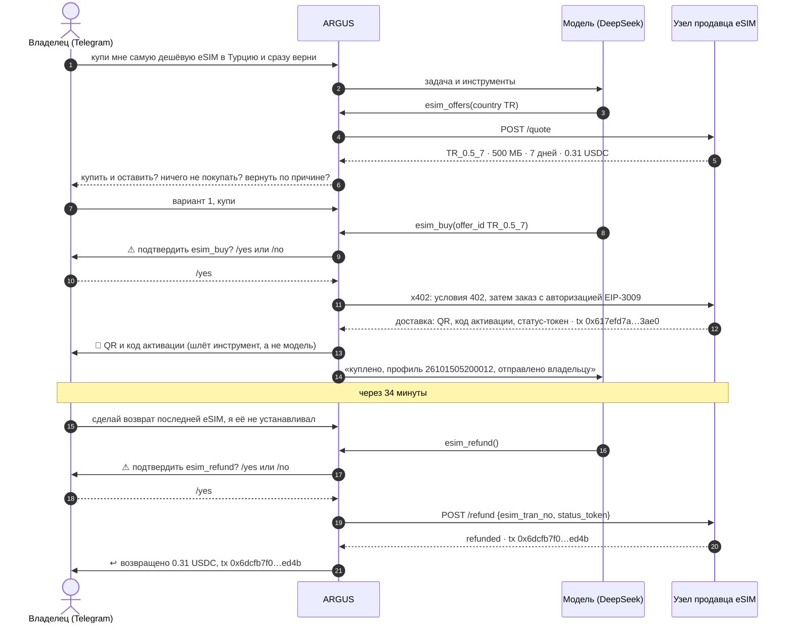
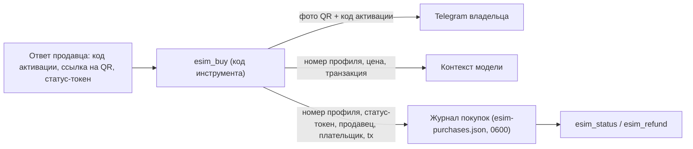
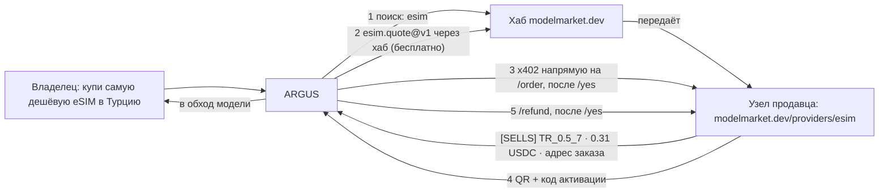
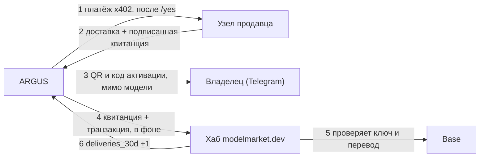

# Use case — ARGUS покупает владельцу eSIM для поездки, а потом возвращает деньги

> 🌐 Язык: [English](./use-case-esim-purchase-refund.md) · **Русский** · [Español](./use-case-esim-purchase-refund-es.md) · [Français](./use-case-esim-purchase-refund-fr.md) · [中文](./use-case-esim-purchase-refund-zh.md)

> **Для кого:** владельцы, которые хотят, чтобы их ARGUS покупал им реальные вещи, и разработчики, которым интересно по шагам увидеть, как агент платит и получает возврат ончейн.
>
> Связанное: [economy-integration](./economy-integration-ru.md) · [channels](./channels-ru.md) · [security-warden](./security-warden-ru.md) · сторона продавца в том же прогоне: [кит eSIM-оператора — кейсы](https://github.com/alexar76/esim-operator-kit/blob/main/docs/ru/cases.md)

---

## Что произошло

15 октября 2026 года владелец написал ARGUS в Telegram: купи мне самую дешёвую eSIM в Турцию. ARGUS нашёл предложения на узле продавца eSIM, предложил «Турция, 500 МБ на 7 дней» за 0.31 USDC, дождался `/yes` владельца и заплатил из своего кошелька по x402. QR-код и код активации пришли в чат владельца через несколько секунд. Сам ARGUS их не видел.

Первая просьба была «купи и сразу верни». ARGUS этого не сделал: остановился и спросил, чего владелец хочет на самом деле — купить и оставить, ничего не покупать или вернуть по реальной причине. Владелец купил, а через 34 минуты отдельно попросил возврат. ARGUS снова попросил `/yes`, продавец отменил неиспользованную eSIM, и 0.31 USDC вернулись на кошелёк ARGUS. Все балансы вернулись к исходным.

## Четыре инструмента

| Инструмент | Что делает | Нужен `/yes` владельца | Что видит модель |
|---|---|---|---|
| `esim_offers` | предложения по стране от продавца `esim.*@v1` (`esim.quote@v1`) | нет, бесплатно | id предложений, объём, дни, цена |
| `esim_buy` | платит цену предложения в USDC в Base из кошелька ARGUS по x402 (`esim.order@v1`) | да (шаблон `*buy*`) | номер профиля и транзакцию, но никогда не код активации |
| `esim_status` | установлена ли, расход данных, срок (`esim.status@v1`) | нет | состояние и расход, без кода активации |
| `esim_refund` | просит продавца отменить неиспользованную eSIM и вернуть цену на кошелёк ARGUS | да (шаблон `*refund*`) | статус возврата и его транзакцию |

Продавцы берутся из хабов (`ARGUS_ESIM_HUBS`, по умолчанию `https://modelmarket.dev`): `esim_offers` опрашивает всех продавцов eSIM, которых показывает хаб, и помечает каждое предложение `[SELLS]` или `[DEMO]` по ответу самого продавца; демо-продавцу ARGUS никогда не платит. `ARGUS_ESIM_SELLER` добавляет закрытый узел, которого нет в хабах, — первый прогон использовал его для закрытого тестового стенда. `ARGUS_ESIM_MAX_USD` ограничивает, на сколько ARGUS подписывает за одну eSIM (по умолчанию 5 USDC; в этих прогонах — 1). После покупки и после возврата ARGUS в фоне относит подписанную квитанцию продавца и транзакцию в хаб, который показал этого продавца (или во все настроенные хабы, если продавец найден напрямую), чтобы хаб мог засчитать, что продавец доставляет; `ARGUS_SHARE_DELIVERIES=0` держит покупки в тайне (кейс 3 ниже).

## Разговор



## Куда идёт eSIM



Код активации — секрет путешественника. Он доходит до владельца через `channels/owner-notify.ts` — прямую линию от инструмента в чат владельца в обход модели. Его нет ни в контексте модели, ни в памяти ARGUS, ни в журнале. Если канал Telegram не подключён, ARGUS так и говорит и ничего не отправляет.

## Транзакции

Base mainnet, USDC. Кошелёк ARGUS: `0x428f2Be4327908948e3B1915C55ddF8fA6bf73cc`.

| Шаг | Транзакция | Блок (UTC) | Откуда → куда | USDC | Газ оплатил |
|---|---|---|---|---|---|
| Пополнение ARGUS | `0x225afba5cd651e3ccdf70593fe985d1e24ddc14836270e83b13f546b6d017578` | 52624834 | владелец `0x097e…475a` → ARGUS | 0.50 | владелец |
| Покупка | `0x617efd7abe4b4c6a80b54046617a73415aa54df7ada5f002ce7260cf68ac3ae0` | 52626137 (05:20:21) | ARGUS → продавец `0xF471…bAE2` | 0.31 | фасилитатор x402 |
| Возврат | `0x6dcfb7f075ad7fb6308064ac53e310dfb6adfd9b65d9f44b3c9a6dd39ca9ed4b` | 52627173 (05:54:53) | продавец → ARGUS | 0.31 | фасилитатор x402 |

ARGUS подписал одну авторизацию EIP-3009 и ни в какой момент не держал ETH: газ оплатил фасилитатор. После возврата на кошельке снова 0.50 USDC.

## Как настроить

```bash
# в .env ARGUS (серверном, никогда не в коммите)
AIFACTORY_CRYPTO_ENABLED=1                                  # публичная сеть включена: для покупок нужна
ARGUS_ESIM_HUBS=https://modelmarket.dev                     # где искать продавцов (по умолчанию)
# ARGUS_ESIM_SELLER=https://esim.example.com/agents         # необязательно: закрытый продавец, которого нет в хабах
ARGUS_ESIM_MAX_USD=1                                        # максимум за одну eSIM
# ARGUS_SHARE_DELIVERIES=0                                  # необязательно: не сообщать хабам, что купил ARGUS
ARGUS_TELEGRAM_TOKEN=…                                      # чат владельца: подтверждения и QR
ARGUS_TELEGRAM_OWNER_ID=…
DEEPSEEK_API_KEY=…                                          # или любой провайдер из argus.config.json
```

Кошелёк ARGUS создаёт `argus setup` (зашифрованное хранилище ключей). Пополните его на немного USDC в Base; ETH для платежей x402 не нужен. Затем напишите боту: «купи мне самую дешёвую eSIM в Турцию».

## Ограничители безопасности

- **Каждый платёж и каждый возврат подтверждает владелец.** `esim_buy` и `esim_refund` подпадают под встроенные шаблоны подтверждения `*buy*` и `*refund*`; файл конфигурации может добавить шаблоны, но не убрать.
- **Жёсткий лимит трат.** Клиент x402 отказывается подписывать больше `ARGUS_ESIM_MAX_USD`; проверка идёт по условиям самого продавца до любой подписи.
- **Секрет минует модель.** Код активации идёт только инструмент → владелец (см. схему выше).
- **Правила возврата — продавца.** Только неиспользованная eSIM, только на адрес плательщика, только один раз. ARGUS не может вернуть то, чего не покупал: продавец проверяет статус-токен.
- **Осторожный агент.** ARGUS отказался купить и сразу вернуть в одном запросе и сначала выяснил настоящее намерение владельца.

## Что мы исправили по ходу

- **Подтверждения в Telegram не могли пройти.** Цикл обновлений бота ждал окончания каждой задачи, поэтому задача, ожидающая `/yes`, не могла его получить, и любое подтверждение через две минуты засчитывалось как «нет». Теперь цикл продолжает читать сообщения, пока задача работает.
- **Агент без модели.** У ARGUS на сервере не было ни одного рабочего ключа LLM; `/health` показывал имя модели из конфигурации, и снаружи всё выглядело нормально. Теперь он работает на DeepSeek.
- **DeepSeek переименовал модели.** В октябре 2026 API отдаёт `deepseek-flash` и `deepseek-v4-pro`; запрос к старому `deepseek-chat` зависает без ошибки. Уровни теперь используют новые имена.

## Кейс 2 — продавец найден через хаб

В первом прогоне ARGUS направили на закрытый тестовый стенд. Во втором, в тот же день в 07:47 UTC, ему не дали ничего: `esim_offers` поискал в хабе modelmarket.dev, нашёл нашу капабилити `esim.quote@v1` продавца `esim-modelmarket`, запросил у неё предложения через хаб, а `esim_buy` заплатил на собственный `/order` продавца. **Для теста наш публичный узел на 52 минуты перевели из демо в продажи (06:56:55–07:48:33 UTC), по себестоимости, и сразу после вернули в демо.**



| Шаг | Транзакция | Блок (UTC) | USDC | Газ оплатил |
|---|---|---|---|---|
| Покупка, ARGUS → продавец `0xF471…bAE2` | `0xeea12962c4f494e55acc59a376203bd4b704804f19a84b4b8f47a96b265a881e` | 52630556 (07:47:39) | 0.31 | фасилитатор x402 |
| Возврат, продавец → ARGUS | `0x45dc5ce6579d8e889750442d63773586c481a11b30ddf44805960860f3bbec88` | 52630569 (07:48:05) | 0.31 | фасилитатор x402 |

Первая попытка, в 07:21, закончилась без покупки: ARGUS видел предложения, но отказался, потому что узел всё ещё назывался «modelmarket.dev demo seller», хотя его собственный ответ говорил `demo: false`. За несколько минут последовали два исправления: имя узла теперь следует его режиму, а `esim_offers` помечает каждое предложение `[SELLS]` или `[DEMO]` по ответу продавца, и в знаниях ARGUS есть правило: решает метка, а не имя. ARGUS был единственным покупателем в это окно; в конце у него снова 0.50 USDC, а eSIM отменена. Полная хронология: [кит eSIM-оператора — кейсы, кейс 2](https://github.com/alexar76/esim-operator-kit/blob/main/docs/ru/cases.md).

## Кейс 3 — хаб засчитывает покупки ARGUS

ARGUS платит продавцу напрямую, поэтому хаб, который показал продавца, никогда не узнавал, доставил ли тот. С 15 октября 2026 года узел продавца подписывает квитанцию на каждую доставку и каждый возврат, а ARGUS в фоне, уже ответив владельцу, относит её в хаб вместе с транзакцией. Хаб проверяет подпись по ключу, опубликованному в листинге продавца, и перевод в Base, и засчитывает одну подтверждённую доставку. Ничего об eSIM в хаб не уходит, а сумм и адресов в открытом виде хаб не хранит.

**Для этого теста наш публичный узел перевели из демо в режим продаж на 9 минут (09:38:59–09:48:22 UTC), по себестоимости, и сразу после вернули в демо.** В это окно было два покупателя: Claude Code, агент для разработки, в 09:41 запустил из терминала владельца пример покупателя из кита, а ARGUS купил в 09:44, после `/yes` владельца в Telegram.



```text
INFO [argus:esim] esim bought: TR_0.5_7 for 0.31 USDC, profile 26101509440019, tx 0xf9ac406f3e329ac2c4c02e26562b6fb944e4165b71b88c4a0756a193325f9669
INFO [argus:esim] delivery receipt for 26101509440019 counted by https://modelmarket.dev: {"confirmed":2,"distinct_buyers":2,"refunded":1}
INFO [argus:esim] refund receipt for 26101509440019 counted by https://modelmarket.dev: {"confirmed":2,"distinct_buyers":2,"refunded":2}
```

| Шаг | Транзакция | Блок (UTC) | USDC | Газ оплатил |
|---|---|---|---|---|
| Покупка, ARGUS → продавец `0xF471…bAE2` | `0xf9ac406f3e329ac2c4c02e26562b6fb944e4165b71b88c4a0756a193325f9669` | 52634056 (09:44:19) | 0.31 | фасилитатор x402 |
| Возврат, продавец → ARGUS | `0x5fa5da5455226a20d10dc84ffb8adf56b01d972dcc72f8e135b4a507a8c35287` | 52634073 (09:44:53) | 0.31 | фасилитатор x402 |

Каждую квитанцию хаб один раз отклонил (`422`: у перевода ещё не было подтверждений) и засчитал при повторе ARGUS через десять секунд; журнал `esim-purchases.json` записывает, что ответил каждый хаб (`recorded`). После окна в листинге продавца было `{"confirmed": 2, "distinct_buyers": 2, "refunded": 2}`: покупка и возврат Claude Code и такие же у ARGUS. У ARGUS в конце снова 0.50 USDC, eSIM отменена, а узел с 09:48:22 снова отклоняет каждый заказ с `demo_mode`.

Весь кейс, с запуском Claude Code и тем, что проверяет хаб: [кит eSIM-оператора — кейсы, кейс 3](https://github.com/alexar76/esim-operator-kit/blob/main/docs/ru/cases.md).

## Связанные документы

- Сторона продавца, правила возврата и как включить возвраты: [кит eSIM-оператора — кейсы](https://github.com/alexar76/esim-operator-kit/blob/main/docs/ru/cases.md)
- API для агентов любого продавца eSIM: [гайд для агентов](https://github.com/alexar76/esim-operator-kit/blob/main/docs/ru/agent-guide.md)
- Как ARGUS платит в целом: [economy-integration](./economy-integration-ru.md)
- Telegram и другие каналы: [channels](./channels-ru.md)
