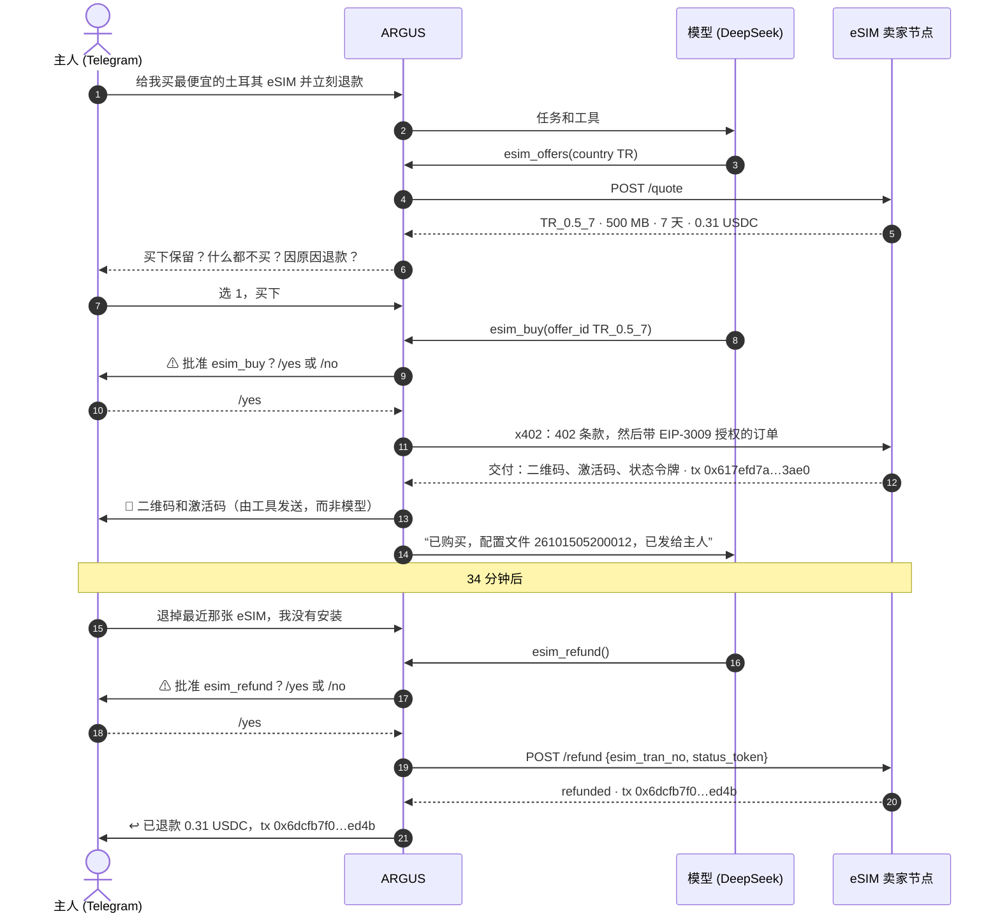
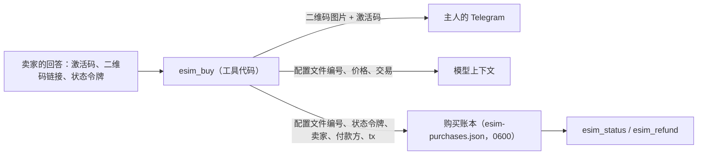
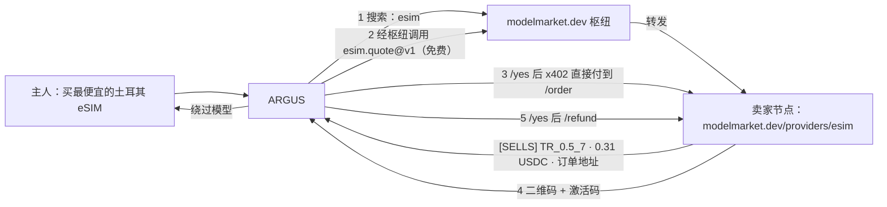
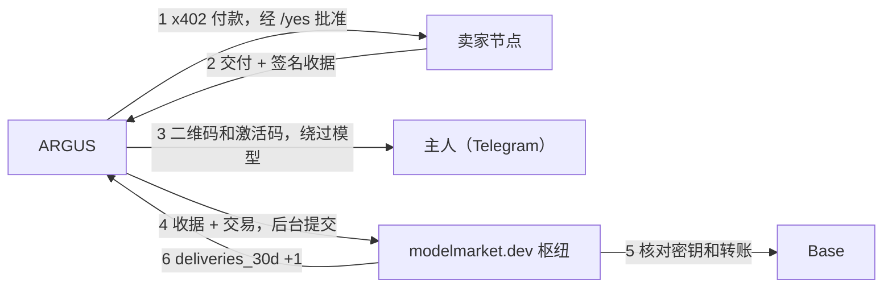

# 使用案例 — ARGUS 为主人购买旅行 eSIM，随后拿回退款

> 🌐 语言：[English](./use-case-esim-purchase-refund.md) · [Русский](./use-case-esim-purchase-refund-ru.md) · [Español](./use-case-esim-purchase-refund-es.md) · [Français](./use-case-esim-purchase-refund-fr.md) · **中文**

> **适合谁：** 希望自己的 ARGUS 替自己购买真实商品的主人，以及想逐步了解智能体如何在链上付款并获得退款的开发者。
>
> 相关：[economy-integration](./economy-integration.md) · [channels](./channels.md) · [security-warden](./security-warden.md) · 同一次运行的卖家视角：[eSIM 运营商套件 — 案例](https://github.com/alexar76/esim-operator-kit/blob/main/docs/zh/cases.md)

---

## 发生了什么

2026 年 10 月 15 日，主人在 Telegram 里对 ARGUS 说：给我买最便宜的土耳其 eSIM。ARGUS 在一个 eSIM 卖家节点上查找报价，提出“土耳其 500 MB 7 天”，价格 0.31 USDC，等待主人的 `/yes` 后，通过 x402 用自己的钱包付款。几秒钟后，二维码和激活码出现在主人的聊天里。ARGUS 本身从未看到它们。

第一次的请求是“买下并立刻退款”。ARGUS 没有照做：它停下来询问主人的真实意图——买下保留、什么都不买，还是因真实原因退款。主人选择购买，34 分钟后单独申请退款。ARGUS 再次请求 `/yes`，卖家取消了未使用的 eSIM，0.31 USDC 退回了 ARGUS 的钱包。所有余额都回到了起点。

## 四个工具

| 工具 | 作用 | 需要主人的 `/yes` | 模型能看到什么 |
|---|---|---|---|
| `esim_offers` | 向 `esim.*@v1` 卖家查询某国报价（`esim.quote@v1`） | 不需要，免费 | 报价 id、流量、天数、价格 |
| `esim_buy` | 通过 x402 用 ARGUS 的钱包在 Base 上以 USDC 支付报价（`esim.order@v1`） | 需要（模式 `*buy*`） | 配置文件编号和交易，绝不包括激活码 |
| `esim_status` | 是否已安装、已用流量、到期时间（`esim.status@v1`） | 不需要 | 状态和用量，不含激活码 |
| `esim_refund` | 请卖家取消未使用的 eSIM，并把价款退回 ARGUS 的钱包 | 需要（模式 `*refund*`） | 退款状态及其交易 |

卖家来自枢纽（`ARGUS_ESIM_HUBS`，默认 `https://modelmarket.dev`）：`esim_offers` 询问枢纽列出的所有 eSIM 卖家，并根据卖家自己的回答为每个报价标注 `[SELLS]` 或 `[DEMO]`；ARGUS 绝不向演示卖家付款。`ARGUS_ESIM_SELLER` 用于添加不在任何枢纽中的私有节点——第一次运行就用它指向了封闭的测试台。`ARGUS_ESIM_MAX_USD` 限制 ARGUS 为一张 eSIM 签署的最高金额（默认 5 USDC；这两次运行为 1）。每次购买和退款之后，ARGUS 会在后台把卖家签名的收据和交易交给列出该卖家的枢纽（如果卖家是直接找到的，则交给所有已配置的枢纽），让枢纽可以统计这个卖家确实会交付；`ARGUS_SHARE_DELIVERIES=0` 可以让购买保持私密（见下文案例 3）。

## 对话



## eSIM 去了哪里



激活码是旅行者的秘密。它通过 `channels/owner-notify.ts` 送达主人——这是一条从工具直达主人聊天、绕过模型的通道。它不在模型上下文里，不在 ARGUS 的记忆里，也不在账本里。如果没有连接 Telegram 通道，ARGUS 会如实说明，并且不发送任何内容。

## 交易

Base 主网，USDC。ARGUS 的钱包：`0x428f2Be4327908948e3B1915C55ddF8fA6bf73cc`。

| 步骤 | 交易 | 区块（UTC） | 从 → 到 | USDC | Gas 费支付方 |
|---|---|---|---|---|---|
| 给 ARGUS 充值 | `0x225afba5cd651e3ccdf70593fe985d1e24ddc14836270e83b13f546b6d017578` | 52624834 | 主人 `0x097e…475a` → ARGUS | 0.50 | 主人 |
| 购买 | `0x617efd7abe4b4c6a80b54046617a73415aa54df7ada5f002ce7260cf68ac3ae0` | 52626137（05:20:21） | ARGUS → 卖家 `0xF471…bAE2` | 0.31 | x402 facilitator |
| 退款 | `0x6dcfb7f075ad7fb6308064ac53e310dfb6adfd9b65d9f44b3c9a6dd39ca9ed4b` | 52627173（05:54:53） | 卖家 → ARGUS | 0.31 | x402 facilitator |

ARGUS 只签了一个 EIP-3009 授权，全程没有持有 ETH：Gas 费由 facilitator 支付。退款后，钱包里重新有 0.50 USDC。

## 如何配置

```bash
# 在 ARGUS 的 .env 中（服务器上的，绝不提交）
AIFACTORY_CRYPTO_ENABLED=1                                  # 开启公链：购买需要
ARGUS_ESIM_HUBS=https://modelmarket.dev                     # 在哪里查找卖家（默认）
# ARGUS_ESIM_SELLER=https://esim.example.com/agents         # 可选：不在任何枢纽中的私有卖家
ARGUS_ESIM_MAX_USD=1                                        # 一张 eSIM 的最高价格
# ARGUS_SHARE_DELIVERIES=0                                  # 可选：从不告诉枢纽 ARGUS 买了什么
ARGUS_TELEGRAM_TOKEN=…                                      # 主人的聊天：批准和二维码
ARGUS_TELEGRAM_OWNER_ID=…
DEEPSEEK_API_KEY=…                                          # 或 argus.config.json 中的任意提供方
```

ARGUS 的钱包由 `argus setup` 创建（加密的密钥库）。在 Base 上给它充一点 USDC；x402 付款不需要 ETH。然后给机器人发消息：“给我买最便宜的土耳其 eSIM”。

## 安全护栏

- **每笔付款和每次退款都由主人批准。** `esim_buy` 和 `esim_refund` 匹配内置批准模式 `*buy*` 和 `*refund*`；配置文件可以增加模式，但不能删除。
- **硬性消费上限。** x402 客户端拒绝签署超过 `ARGUS_ESIM_MAX_USD` 的金额，在签名前按卖家自己的条款检查。
- **秘密绕过模型。** 激活码只走工具 → 主人这一条路（见上图）。
- **退款规则由卖家执行。** 只限未使用的 eSIM，只退付款地址，只退一次。ARGUS 无法退掉不是它买的东西：卖家会核验状态令牌。
- **谨慎的智能体。** ARGUS 拒绝在同一个请求里买下并立即退款，先询问了主人的真实意图。

## 我们顺带修复了什么

- **Telegram 批准永远无法成功。** 机器人的更新循环会等待每个任务结束，因此等待 `/yes` 的任务永远收不到它，每次批准都会在两分钟后被当作“否”。现在任务运行时，循环会继续读取消息。
- **没有模型的智能体。** 服务器上的 ARGUS 没有任何可用的 LLM 密钥；`/health` 显示的是配置中的模型名称，从外部看一切正常。现在它运行在 DeepSeek 上。
- **DeepSeek 更改了模型名称。** 2026 年 10 月，API 提供 `deepseek-flash` 和 `deepseek-v4-pro`；请求旧的 `deepseek-chat` 会挂起且不报错。各层级已改用新名称。

## 案例 2 — 通过枢纽找到卖家

第一次运行时，ARGUS 被指向一个私有测试台。第二次运行在同一天 07:47 UTC，没有给它任何地址：`esim_offers` 在 modelmarket.dev 枢纽中搜索，找到我们 `esim-modelmarket` 的能力 `esim.quote@v1`，经枢纽向它询价，然后 `esim_buy` 付款到卖家自己的 `/order`。**为了测试，我们的公开节点从演示切换为销售 52 分钟（06:56:55–07:48:33 UTC），按成本价，测试后立即切回演示模式。**



| 步骤 | 交易 | 区块（UTC） | USDC | Gas 费支付方 |
|---|---|---|---|---|
| 购买，ARGUS → 卖家 `0xF471…bAE2` | `0xeea12962c4f494e55acc59a376203bd4b704804f19a84b4b8f47a96b265a881e` | 52630556（07:47:39） | 0.31 | x402 facilitator |
| 退款，卖家 → ARGUS | `0x45dc5ce6579d8e889750442d63773586c481a11b30ddf44805960860f3bbec88` | 52630569（07:48:05） | 0.31 | x402 facilitator |

07:21 的第一次尝试没有成交：ARGUS 看到了报价却拒绝购买，因为节点名称仍是“modelmarket.dev demo seller”，尽管它自己的报价写着 `demo: false`。几分钟内上线了两项修复：节点名称随模式变化；`esim_offers` 根据卖家的回答为每个报价标注 `[SELLS]` 或 `[DEMO]`，ARGUS 的知识中加入规则：以标签为准，绝不看名称。ARGUS 是这一窗口期内唯一的买家；最终它重新持有 0.50 USDC，eSIM 已取消。完整时间线：[eSIM 运营商套件 — 案例，案例 2](https://github.com/alexar76/esim-operator-kit/blob/main/docs/zh/cases.md)。

## 案例 3 — 枢纽统计 ARGUS 的购买

ARGUS 直接向卖家付款，因此列出卖家的枢纽从来不知道卖家是否交付。从 2026 年 10 月 15 日起，卖家节点为每一次交付和每一次退款签发收据，ARGUS 在答复主人之后，于后台把收据连同交易交给枢纽。枢纽用卖家上架条目公布的密钥核对签名，并核对 Base 上的转账，然后记一次已确认交付。关于 eSIM 的任何信息都不会发给枢纽，枢纽也不保存明文的金额或地址。

**为了这次测试，我们的公开节点从演示模式切换为销售模式 9 分钟（09:38:59–09:48:22 UTC），按成本价，测试后立即切回演示模式。** 这一窗口期有两个买家：编程智能体 Claude Code 在 09:41 从主人的终端运行了套件自带的示例买家，ARGUS 在 09:44 经主人在 Telegram 中 `/yes` 批准后购买。



```text
INFO [argus:esim] esim bought: TR_0.5_7 for 0.31 USDC, profile 26101509440019, tx 0xf9ac406f3e329ac2c4c02e26562b6fb944e4165b71b88c4a0756a193325f9669
INFO [argus:esim] delivery receipt for 26101509440019 counted by https://modelmarket.dev: {"confirmed":2,"distinct_buyers":2,"refunded":1}
INFO [argus:esim] refund receipt for 26101509440019 counted by https://modelmarket.dev: {"confirmed":2,"distinct_buyers":2,"refunded":2}
```

| 步骤 | 交易 | 区块（UTC） | USDC | Gas 费支付方 |
|---|---|---|---|---|
| 购买，ARGUS → 卖家 `0xF471…bAE2` | `0xf9ac406f3e329ac2c4c02e26562b6fb944e4165b71b88c4a0756a193325f9669` | 52634056（09:44:19） | 0.31 | x402 facilitator |
| 退款，卖家 → ARGUS | `0x5fa5da5455226a20d10dc84ffb8adf56b01d972dcc72f8e135b4a507a8c35287` | 52634073（09:44:53） | 0.31 | x402 facilitator |

枢纽把每张收据都拒绝过一次（`422`：转账尚无确认），十秒后 ARGUS 重试时计入；记录文件 `esim-purchases.json` 会记下每个枢纽的回答（`recorded`）。窗口结束后，卖家的上架条目显示 `{"confirmed": 2, "distinct_buyers": 2, "refunded": 2}`：Claude Code 的购买和退款，以及 ARGUS 的购买和退款。ARGUS 最终重新持有 0.50 USDC，eSIM 已取消，节点自 09:48:22 起再次以 `demo_mode` 拒绝所有订单。

完整案例，包括 Claude Code 的运行和枢纽核对的内容：[eSIM 运营者套件 — 案例，案例 3](https://github.com/alexar76/esim-operator-kit/blob/main/docs/zh/cases.md)。

## 相关文档

- 卖家视角、退款规则以及如何开启退款：[eSIM 运营商套件 — 案例](https://github.com/alexar76/esim-operator-kit/blob/main/docs/zh/cases.md)
- 任意 eSIM 卖家面向智能体的 API：[智能体指南](https://github.com/alexar76/esim-operator-kit/blob/main/docs/zh/agent-guide.md)
- ARGUS 的一般付款方式：[economy-integration](./economy-integration.md)
- Telegram 和其他通道：[channels](./channels.md)
