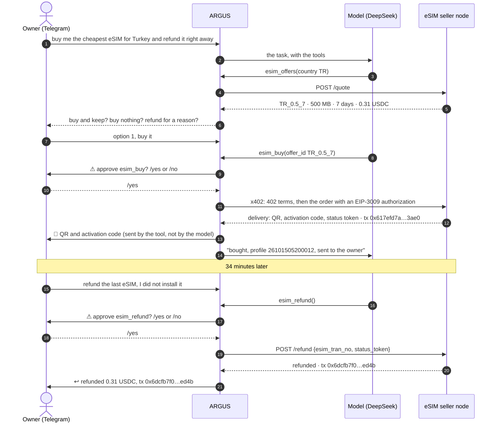
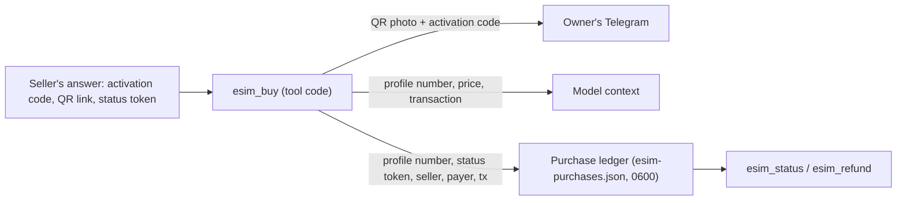
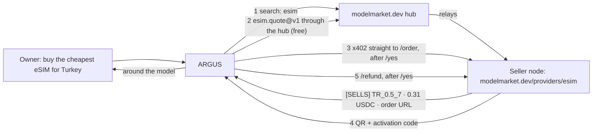
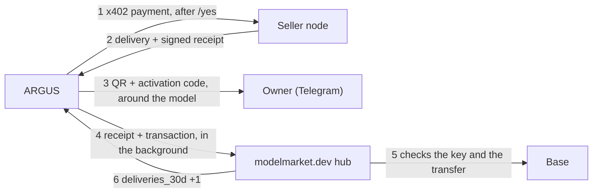

# Use case — ARGUS buys a travel eSIM for its owner, then gets the money back

> 🌐 Language: **English** · [Русский](./use-case-esim-purchase-refund-ru.md) · [Español](./use-case-esim-purchase-refund-es.md) · [Français](./use-case-esim-purchase-refund-fr.md) · [中文](./use-case-esim-purchase-refund-zh.md)

> **Audience:** owners who want their ARGUS to buy real things for them, and developers who want to see an agent pay and get refunded on chain, step by step.
>
> Related: [economy-integration](./economy-integration.md) · [channels](./channels.md) · [security-warden](./security-warden.md) · the seller's side of the same run: [eSIM operator kit — cases](https://github.com/alexar76/esim-operator-kit/blob/main/docs/en/cases.md)

---

## What happened

On 15 October 2026 the owner wrote to ARGUS in Telegram: buy me the cheapest eSIM for Turkey. ARGUS looked up offers on an eSIM seller node, proposed Turkey 500 MB for 7 days at 0.31 USDC, waited for the owner's `/yes`, and paid from its own wallet over x402. The QR code and the activation code arrived in the owner's chat a few seconds later. ARGUS itself never saw them.

The first request had been "buy it and refund it right away". ARGUS did not do that: it stopped and asked what the owner actually wanted — buy and keep, buy nothing, or a refund for a real reason. The owner bought, and 34 minutes later asked for the refund on its own. ARGUS asked for `/yes` again, the seller cancelled the unused eSIM, and 0.31 USDC came back to ARGUS's wallet. Every balance ended where it started.

## The four tools

| Tool | What it does | Needs the owner's `/yes` | What the model sees |
|---|---|---|---|
| `esim_offers` | offers for a country from an `esim.*@v1` seller (`esim.quote@v1`) | no, it is free | offer ids, data, days, price |
| `esim_buy` | pays the offer's price in USDC on Base from ARGUS's wallet over x402 (`esim.order@v1`) | yes (pattern `*buy*`) | the profile number and the transaction, never the activation code |
| `esim_status` | installed or not, data used, expiry (`esim.status@v1`) | no | state and usage, without the activation code |
| `esim_refund` | asks the seller to cancel an unused eSIM and pay the price back to ARGUS's wallet | yes (pattern `*refund*`) | the refund status and its transaction |

Sellers come from the hubs (`ARGUS_ESIM_HUBS`, `https://modelmarket.dev` by default): `esim_offers` asks every eSIM seller a hub lists and labels each offer `[SELLS]` or `[DEMO]` from the seller's own answer; a demo seller is never paid. `ARGUS_ESIM_SELLER` adds a private node no hub lists — the first run used it for the closed test stand. `ARGUS_ESIM_MAX_USD` caps what ARGUS signs for one eSIM (5 USDC by default; these runs used 1). After a purchase and after a refund, ARGUS brings the seller's signed receipt and the transaction to the hub that listed the seller (or to every configured hub, for a seller found directly), in the background, so the hub can count that this seller delivers; `ARGUS_SHARE_DELIVERIES=0` keeps purchases private (case 3 below).

## The conversation



## Where the eSIM goes



The activation code is the traveller's secret. It reaches the owner through `channels/owner-notify.ts`, a direct line from a tool to the owner's chat that goes around the model. It is not in the model's context, not in ARGUS's memory, not in the ledger. If no Telegram channel is connected, ARGUS says so and sends nothing.

## The transactions

On Base mainnet, USDC. ARGUS's wallet: `0x428f2Be4327908948e3B1915C55ddF8fA6bf73cc`.

| Step | Transaction | Block (UTC) | From → to | USDC | Gas paid by |
|---|---|---|---|---|---|
| Funding ARGUS | `0x225afba5cd651e3ccdf70593fe985d1e24ddc14836270e83b13f546b6d017578` | 52624834 | owner `0x097e…475a` → ARGUS | 0.50 | the owner |
| Purchase | `0x617efd7abe4b4c6a80b54046617a73415aa54df7ada5f002ce7260cf68ac3ae0` | 52626137 (05:20:21) | ARGUS → seller `0xF471…bAE2` | 0.31 | x402 facilitator |
| Refund | `0x6dcfb7f075ad7fb6308064ac53e310dfb6adfd9b65d9f44b3c9a6dd39ca9ed4b` | 52627173 (05:54:53) | seller → ARGUS | 0.31 | x402 facilitator |

ARGUS signed one EIP-3009 authorization and held no ETH at any point: the facilitator paid the gas. After the refund its wallet held 0.50 USDC again.

## Setting it up

```bash
# in ARGUS's .env (the server's, never committed)
AIFACTORY_CRYPTO_ENABLED=1                                  # public chain on: buying needs it
ARGUS_ESIM_HUBS=https://modelmarket.dev                     # where sellers are found (the default)
# ARGUS_ESIM_SELLER=https://esim.example.com/agents         # optional: a private seller no hub lists
ARGUS_ESIM_MAX_USD=1                                        # the most one eSIM may cost
# ARGUS_SHARE_DELIVERIES=0                                  # optional: never tell a hub what ARGUS bought
ARGUS_TELEGRAM_TOKEN=…                                      # the owner's chat: approvals and the QR
ARGUS_TELEGRAM_OWNER_ID=…
DEEPSEEK_API_KEY=…                                          # or any provider of argus.config.json
```

ARGUS's wallet comes from `argus setup` (an encrypted keystore). Fund it with a little USDC on Base; it needs no ETH for x402 payments. Then write to the bot: "buy me the cheapest eSIM for Turkey".

## The safety rails

- **The owner approves every payment and every refund.** `esim_buy` and `esim_refund` match the built-in approval patterns `*buy*` and `*refund*`; a config file can add patterns, never remove them.
- **A hard spending cap.** The x402 client refuses to sign more than `ARGUS_ESIM_MAX_USD`, checked on the seller's own terms before anything is signed.
- **The secret skips the model.** Activation codes travel tool → owner only (see the diagram above).
- **The refund rules are the seller's.** Only an unused eSIM, only to the paying address, only once. ARGUS cannot refund anything it did not buy: the seller checks the status token.
- **A careful agent.** ARGUS declined to buy and instantly refund in one request, and asked for the owner's real intent first.

## What we fixed along the way

- **Telegram approvals could never succeed.** The bot's update loop waited for each task to finish, so a task waiting for `/yes` could never receive it, and every approval timed out as a "no" after two minutes. The loop now keeps reading while a task runs.
- **An agent with no model.** The server's ARGUS had no working LLM key at all; `/health` showed the model name from the config, which looked fine from outside. It now runs on DeepSeek.
- **DeepSeek renamed its models.** In October 2026 the API lists `deepseek-flash` and `deepseek-v4-pro`; a request for the old `deepseek-chat` hangs without an error. The tiers use the new names.

## Case 2 — the seller found through the hub

In the first run ARGUS was pointed at a private test stand. In the second, the same day at 07:47 UTC, it was given nothing: `esim_offers` searched the modelmarket.dev hub, found our capability `esim.quote@v1` of `esim-modelmarket`, asked it for offers through the hub, and `esim_buy` paid the seller's own `/order`. **For the test our public node was switched from demo to selling for 52 minutes (06:56:55–07:48:33 UTC), at cost, and switched back to demo right after.**



| Step | Transaction | Block (UTC) | USDC | Gas paid by |
|---|---|---|---|---|
| Purchase, ARGUS → seller `0xF471…bAE2` | `0xeea12962c4f494e55acc59a376203bd4b704804f19a84b4b8f47a96b265a881e` | 52630556 (07:47:39) | 0.31 | x402 facilitator |
| Refund, seller → ARGUS | `0x45dc5ce6579d8e889750442d63773586c481a11b30ddf44805960860f3bbec88` | 52630569 (07:48:05) | 0.31 | x402 facilitator |

The first attempt, at 07:21, ended without a purchase: ARGUS saw the offers but refused, because the node was still named "modelmarket.dev demo seller" although its own quote said `demo: false`. Two fixes followed within minutes: the node is now named by its mode, and `esim_offers` labels every offer `[SELLS]` or `[DEMO]` from the seller's answer, with a rule in ARGUS's knowledge that the label decides, never the name. ARGUS was the only buyer in the window; it ended with 0.50 USDC again and the eSIM cancelled. The full timeline: [eSIM operator kit — cases, case 2](https://github.com/alexar76/esim-operator-kit/blob/main/docs/en/cases.md).

## Case 3 — the hub counts what ARGUS bought

ARGUS pays the seller directly, so the hub that listed the seller never learned whether the seller delivered. Since 15 October 2026 the seller node signs a receipt for every delivery and every refund, and ARGUS brings it to the hub with the transaction, in the background, after it has answered the owner. The hub checks the signature against the key the seller's listing published and the transfer on Base, and counts one confirmed delivery. Nothing about the eSIM goes to the hub, and the hub keeps no amount or address in the clear.

**For this test our public node was switched from demo to selling for 9 minutes (09:38:59–09:48:22 UTC), at cost, and switched back to demo right after.** Two buyers used the window: Claude Code, a coding agent, ran the kit's example buyer from the owner's terminal at 09:41, and ARGUS bought at 09:44, after the owner's `/yes` in Telegram.



```text
INFO [argus:esim] esim bought: TR_0.5_7 for 0.31 USDC, profile 26101509440019, tx 0xf9ac406f3e329ac2c4c02e26562b6fb944e4165b71b88c4a0756a193325f9669
INFO [argus:esim] delivery receipt for 26101509440019 counted by https://modelmarket.dev: {"confirmed":2,"distinct_buyers":2,"refunded":1}
INFO [argus:esim] refund receipt for 26101509440019 counted by https://modelmarket.dev: {"confirmed":2,"distinct_buyers":2,"refunded":2}
```

| Step | Transaction | Block (UTC) | USDC | Gas paid by |
|---|---|---|---|---|
| Purchase, ARGUS → seller `0xF471…bAE2` | `0xf9ac406f3e329ac2c4c02e26562b6fb944e4165b71b88c4a0756a193325f9669` | 52634056 (09:44:19) | 0.31 | x402 facilitator |
| Refund, seller → ARGUS | `0x5fa5da5455226a20d10dc84ffb8adf56b01d972dcc72f8e135b4a507a8c35287` | 52634073 (09:44:53) | 0.31 | x402 facilitator |

The hub turned each receipt away once (`422`: the transfer had no confirmations yet) and counted it on ARGUS's retry ten seconds later; the ledger `esim-purchases.json` records what each hub answered (`recorded`). After the window the seller's listing showed `{"confirmed": 2, "distinct_buyers": 2, "refunded": 2}`: Claude Code's purchase and refund, and ARGUS's. ARGUS ended with 0.50 USDC again, the eSIM was cancelled, and the node has refused every order with `demo_mode` since 09:48:22.

The full case, with Claude Code's run and what the hub checks: [eSIM operator kit — cases, case 3](https://github.com/alexar76/esim-operator-kit/blob/main/docs/en/cases.md).

## Related docs

- The seller's side, with the refund rules and how to switch refunds on: [eSIM operator kit — cases](https://github.com/alexar76/esim-operator-kit/blob/main/docs/en/cases.md)
- The agent API of any eSIM seller: [agent guide](https://github.com/alexar76/esim-operator-kit/blob/main/docs/en/agent-guide.md)
- How ARGUS pays in general: [economy-integration](./economy-integration.md)
- Telegram and the other channels: [channels](./channels.md)
