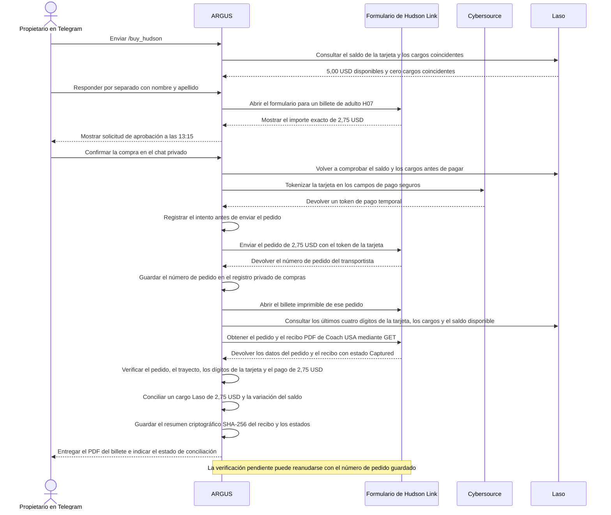

# Billete de Hudson Link desde Telegram con Laso

> [English](use-case-hudson-link.md) · [Русский](use-case-hudson-link-ru.md) · **Español** · [Français](use-case-hudson-link-fr.md) · [中文](use-case-hudson-link-zh.md)

El 14 de noviembre de 2026, ARGUS compró un billete sencillo de adulto de **2,75 USD** para la **H07**, desde **Palisades Center (Lot J), West Nyack** hasta **Depot Plaza (estación de tren), Tarrytown**, y envió el PDF al chat privado del propietario en Telegram. El mensaje de aprobación apareció a las **13:15** y el PDF a las **13:16**, hora de Ámsterdam (UTC+1). Hudson Link indica una validez de 365 días desde la compra y envía por correo un recibo separado con el enlace al billete. [Tarifas de Hudson Link](https://www.ridehudsonlink.com/fares) · [Datos de la comprobación](../../artifacts/argus-bus-preflight-2026-11-14/verified.json)

## De la tarifa al billete

El diagrama muestra el flujo actual en producción. La comprobación de la sección siguiente parte de un billete ya entregado.

## Comprobación en producción con el billete ya comprado

El 14 de noviembre de 2026, ARGUS vinculó en producción el registro anterior con el pedido del transportista mediante el enlace del propietario y la referencia del billete ya entregado. Después obtuvo los datos del pedido y el recibo PDF de Coach USA con dos consultas `GET`. El recibo mostraba el estado **Captured**, con un total y un importe pagado de **2,75 USD**. Los cuatro últimos dígitos de la tarjeta coincidían con los de Laso. El historial de Laso mostraba **un único cargo de 2,75 USD** y el saldo disponible pasó de **5,00 a 2,25 USD**. ARGUS guardó el número de pedido y el resumen criptográfico del recibo en el mismo registro `delivered`, con `receiptVerified: true` y `reconciled: true`.

Al repetir la comprobación, ARGUS devolvió el resultado guardado. La conciliación se basó en el PDF del transportista y se completó **sin repetir el pago**. En las compras nuevas, ARGUS obtiene el número de pedido directamente de la respuesta de Hudson Link. Laso no indica el estado de liquidación final de esta tarjeta. [Resultados de la conciliación en producción](../../artifacts/argus-bus-preflight-2026-11-14/verified.json)

## Registros de la compra original

| Operación | Resultado |
| --- | --- |
| Emisión de la tarjeta | Una transacción anterior en Base pagó **5 USDC** para emitir la tarjeta Laso. [Emisión de Laso en Base](use-case-laso-prepaid-card-es.md) |
| Compra del billete | Tras la aprobación, ARGUS registró el intento y envió un solo pedido de **2,75 USD** al transportista. Hudson Link confirmó el pedido y mostró el billete imprimible. El pago con tarjeta transcurrió en dólares, sin una transacción propia en Base. |
| Conciliación de Laso | Laso mostró un único cargo de **2,75 USD** cuyo concepto coincidía con Hudson Link o Coach USA. El saldo disponible pasó de **5,00 a 2,25 USD**. La primera versión de ARGUS omitía el importe porque Laso lo devolvía como texto. La corrección superó 27 pruebas y la imagen desplegada `aicom-security:argus-hudson-reconcile-20261114` pasó su comprobación de estado. ARGUS concilió la compra ya entregada, registró `reconciled: true` y no envió otro pedido. La respuesta de Laso no indicó el estado de contabilización ni de liquidación final. |
| Entrega del billete | El propietario recibió `hudson-link-ticket.pdf` en Telegram a las **13:16** y lo abrió para comprobar la ruta y el código de barras imprimible. El registro mostró `delivered`. |
| Recibo del transportista | El propietario mostró un recibo con estado **Captured** y un importe pagado de **2,75 USD**. En una comprobación puntual de solo lectura, Coach USA devolvió HTTP `200` tanto para el pedido en JSON como para el recibo PDF. La referencia del billete del pedido coincidió con la del PDF de Telegram. El recibo correspondía al mismo pedido y a la misma tarjeta Laso. El total y el importe pagado eran de **2,75 USD** por un único billete de ida para un adulto de West Nyack a Tarrytown. El resultado se guardó en el registro del pedido existente como `receiptVerified: true`. |

## Incidencias y correcciones previas

| Operación | Resultado observado |
| --- | --- |
| Abrir el formulario de pago | Chromium sin ventana recibió HTTP `403`. Chromium aislado con ventana en Attested recibió HTTP `200` y abrió el formulario. |
| Consultar el estado en Laso | El directorio no encontró una coincidencia exacta para Hudson Link y marcó Coach USA como `unknown`. Una sesión de Laso caducada devolvió HTTP `401`. Al restablecerla, la tarjeta mostraba **5,00 USD disponibles** y **cero** cargos coincidentes de 2,75 USD. |
| Validar el formato de caducidad | Laso devolvió el año con dos cifras. La primera versión se detuvo antes de enviar el pago. La versión corregida acepta años de dos o cuatro cifras. Se superaron cuatro pruebas simuladas con Chromium y 25 pruebas de compra y Telegram. El formulario en producción volvió a abrirse con un total de **2,75 USD**. |
| Mantener desactivado el consentimiento publicitario | El formulario de facturación del comercio marcaba por defecto la casilla de comunicaciones comerciales. ARGUS ahora la desmarca antes de enviar el pedido. La solicitud sigue exigiendo `marketingOptIn: false`. Cuatro pruebas simuladas con Chromium pasaron y la imagen actualizada superó su comprobación de estado en producción. |
| Probar la tokenización por separado | En una prueba independiente previa a la compra, el procesador devolvió HTTP `201` al tokenizar la tarjeta real. El token prepara los datos de la tarjeta para pagar. Esa prueba terminó antes de enviar el pedido. |
| Cargar la dirección de facturación | La lista inicial de solicitudes permitidas bloqueaba dos GET a los catálogos de Coach USA, `/countries` y `/countries/US/states`. El menú **Country** quedó vacío y el intento aprobado se detuvo antes de enviar el pedido. La corrección permite esas dos consultas. Se superaron cuatro pruebas simuladas con Chromium y la imagen desplegada `aicom-security:argus-hudson-billing-20261114` pasó su comprobación de estado. |
| Volver a verificar el formulario real en una sesión aislada | La prueba temporal usó el formulario real del comercio y un token sintético de pago. La solicitud de pedido superó todas las verificaciones, incluido el total de **2,75 USD**. La prueba interceptó el pedido antes de que llegara al comercio. |
| Investigar el fallo anterior a la aprobación | A las **13:04**, el bot aceptó las respuestas de nombre y apellido, pero el formulario falló antes de que apareciera la solicitud de aprobación. El registro mostró `no_submission` y Laso mostró **5,00 USD** y cero cargos coincidentes. Tres aperturas seguidas del formulario funcionaron. Otra prueba llegó al botón de aprobación y lo rechazó deliberadamente, sin enviar un pedido. No se determinó la causa del fallo. |

El registro bloquea un segundo cargo si la respuesta al pago es incierta. ARGUS guarda por separado el estado del billete, la verificación del recibo y la conciliación de Laso. [Configuración y recuperación en Telegram](personal-assistant.md#hudson-link-ticket-from-telegram)
