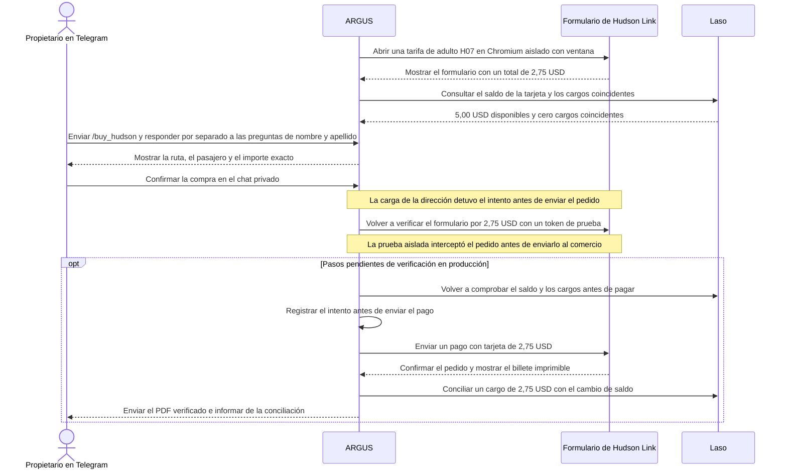

# Billete de Hudson Link desde Telegram con Laso

> [English](use-case-hudson-link.md) · [Русский](use-case-hudson-link-ru.md) · **Español** · [Français](use-case-hudson-link-fr.md) · [中文](use-case-hudson-link-zh.md)

El 14 de noviembre de 2026, el piloto de ARGUS en producción en Attested volvió a abrir el formulario de pago de Hudson Link para un viaje sencillo de adulto en la **H07**, desde **Palisades Center (Lot J), West Nyack** hasta **Depot Plaza (estación de tren), Tarrytown**. El importe final era de **2,75 USD**. Hudson Link indica una validez de 365 días desde la compra, un billete imprimible con código de barras y un recibo por correo con el enlace al billete. [Tarifas de Hudson Link](https://www.ridehudsonlink.com/fares) · [Datos de la comprobación](../../artifacts/argus-bus-preflight-2026-11-14/verified.json)

## De la tarifa al billete

## Resultados de la comprobación en producción

| Operación | Resultado observado |
| --- | --- |
| Abrir el formulario de pago | Chromium sin ventana recibió HTTP `403`. Chromium aislado con ventana en Attested recibió HTTP `200` y abrió el formulario. |
| Consultar el estado en Laso | El directorio no encontró una coincidencia exacta para Hudson Link y marcó Coach USA como `unknown`. Una sesión de Laso caducada devolvió HTTP `401`. Al restablecerla, la tarjeta mostraba **5,00 USD disponibles** y **cero** cargos coincidentes de 2,75 USD. |
| Validar el formato de caducidad | Laso devolvió el año con dos cifras. La primera versión se detuvo antes de enviar el pago. La versión corregida acepta años de dos o cuatro cifras. Se superaron cuatro pruebas simuladas con Chromium y 25 pruebas de compra y Telegram. El formulario en producción volvió a abrirse con un total de **2,75 USD**. |
| Mantener desactivado el consentimiento publicitario | El formulario de facturación del comercio marcaba por defecto la casilla de comunicaciones comerciales. ARGUS ahora la desmarca antes de enviar el pedido. La solicitud sigue exigiendo `marketingOptIn: false`. Cuatro pruebas simuladas con Chromium pasaron y la imagen actualizada superó su comprobación de estado en producción. |
| Verificar la aprobación y la tokenización | El propietario confirmó el billete de 2,75 USD en el chat privado de Telegram. En una prueba independiente, el procesador devolvió HTTP `201` al tokenizar la tarjeta real. El token prepara los datos de la tarjeta para pagar. Esa prueba terminó antes de enviar el pedido. |
| Cargar la dirección de facturación | La lista inicial de solicitudes permitidas bloqueaba dos GET a los catálogos de Coach USA, `/countries` y `/countries/US/states`. El menú **Country** quedó vacío y el intento aprobado se detuvo antes de enviar el pedido. La corrección permite esas dos consultas. Se superaron cuatro pruebas simuladas con Chromium y la imagen desplegada `aicom-security:argus-hudson-billing-20261114` pasó su comprobación de estado. |
| Volver a verificar el formulario real en una sesión aislada | La prueba temporal usó el formulario real del comercio y un token sintético de pago. La solicitud de pedido superó todas las verificaciones, incluido el total de **2,75 USD**. La prueba interceptó el pedido antes de que llegara al comercio. |
| Enviar y conciliar el pago | Tras el despliegue, el registro siguió en `no_submission`. La última consulta de Laso mostró **5,00 USD disponibles** y **cero** cargos coincidentes. Está pendiente una nueva confirmación del propietario. El cargo real, el recibo del transportista y la entrega del PDF en Telegram siguen sin confirmarse. |

La transacción de Base registrada anteriormente pagó **5 USDC** para emitir la tarjeta. El billete se paga en dólares a través de la red de tarjetas, sin una transacción propia en Base. Una vez confirmada la compra, la conciliación comprueba un único cargo coincidente de **2,75 USD** y un saldo previsto de **2,25 USD** a partir de los 5,00 USD iniciales. ARGUS controla por separado el billete, el recibo del transportista y el cargo de Laso. Si la respuesta al pago es incierta, el registro bloquea un cargo repetido. [Emisión de Laso en Base](use-case-laso-prepaid-card-es.md) · [Configuración y recuperación en Telegram](personal-assistant.md#hudson-link-ticket-from-telegram)
