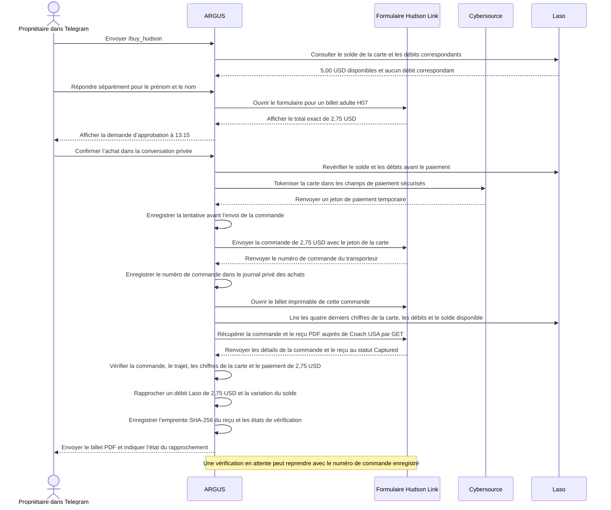

# Un billet Hudson Link depuis Telegram avec Laso

> [English](use-case-hudson-link.md) · [Русский](use-case-hudson-link-ru.md) · [Español](use-case-hudson-link-es.md) · **Français** · [中文](use-case-hudson-link-zh.md)

Le 14 novembre 2026, ARGUS a acheté un billet aller simple pour un adulte de **2,75 USD** sur la ligne **H07**, de **Palisades Center (Lot J), West Nyack** à **Depot Plaza (gare ferroviaire), Tarrytown**, puis a envoyé le PDF au propriétaire dans sa conversation privée Telegram. La demande d’approbation est apparue à **13:15** et le PDF à **13:16**, heure d’Amsterdam (UTC+1). Hudson Link indique une validité de 365 jours à compter de l’achat et envoie par e-mail un reçu distinct contenant le lien vers le billet. [Tarifs Hudson Link](https://www.ridehudsonlink.com/fares) · [Relevé de la vérification](../../artifacts/argus-bus-preflight-2026-11-14/verified.json)

## Du tarif au billet

Le diagramme montre le parcours actuellement en production. La vérification ci-dessous part d’un billet déjà livré.

## Vérification en production sur le billet déjà acheté

Le 14 novembre 2026, en production, ARGUS a rattaché l’ancienne entrée du journal à la commande du transporteur à l’aide du lien fourni par le propriétaire et de la référence du billet déjà livré. Il a ensuite récupéré les détails de la commande et le reçu PDF auprès de Coach USA avec deux requêtes `GET`. Le reçu portait le statut **Captured**, avec un total et un montant payé de **2,75 USD**. Les quatre derniers chiffres de la carte correspondaient à ceux de Laso. L’historique Laso indiquait **un seul débit de 2,75 USD**, et le solde disponible est passé de **5,00 à 2,25 USD**. ARGUS a enregistré le numéro de commande et l’empreinte du reçu dans la même entrée `delivered`, avec `receiptVerified: true` et `reconciled: true`.

Une nouvelle vérification a renvoyé le résultat enregistré. Le rapprochement s’est appuyé sur le PDF du transporteur et s’est terminé **sans nouveau paiement**. Pour les nouveaux achats, ARGUS récupère directement le numéro de commande dans la réponse de Hudson Link. Laso ne fournit pas l’état du règlement final pour cette carte. [Résultats du rapprochement en production](../../artifacts/argus-bus-preflight-2026-11-14/verified.json)

## Traces de l’achat initial

| Opération | Résultat |
| --- | --- |
| Émission de la carte | Une transaction antérieure sur Base a payé **5 USDC** pour émettre la carte Laso. [Émission de la carte Laso sur Base](use-case-laso-prepaid-card-fr.md) |
| Achat du billet | Après l’approbation, ARGUS a consigné la tentative et envoyé une seule commande de **2,75 USD** au transporteur. Hudson Link a confirmé la commande et affiché le billet imprimable. Le paiement a emprunté le réseau de cartes en dollars, sans transaction propre sur Base. |
| Rapprochement Laso | Laso a affiché un seul débit de **2,75 USD** dont le libellé correspondait à Hudson Link ou Coach USA. Le solde disponible est passé de **5,00 à 2,25 USD**. La première version d’ARGUS ignorait le montant renvoyé sous forme de texte. Le correctif a passé 27 tests et l’image déployée `aicom-security:argus-hudson-reconcile-20261114` a passé sa vérification d’état. ARGUS a rapproché l’achat déjà livré, enregistré `reconciled: true` et n’a envoyé aucune nouvelle commande. La réponse Laso ne précisait pas l’état de comptabilisation ni de règlement final. |
| Livraison du billet | Le propriétaire a reçu `hudson-link-ticket.pdf` dans Telegram à **13:16** et l’a ouvert pour vérifier le trajet et le code-barres imprimable. Le journal a enregistré l’état `delivered`. |
| Reçu du transporteur | Le propriétaire a montré un reçu portant le statut **Captured** et un montant payé de **2,75 USD**. Lors d’une vérification ponctuelle en lecture seule, Coach USA a renvoyé HTTP `200` pour la commande au format JSON et pour le reçu PDF. La référence du billet dans la commande correspondait à celle du PDF Telegram. Le reçu correspondait à la même commande et à la même carte Laso. Le total et le montant payé étaient de **2,75 USD** pour un seul billet aller simple pour un adulte de West Nyack à Tarrytown. Le résultat a été consigné dans le journal de la commande existante sous `receiptVerified: true`. |

## Incidents et correctifs précédents

| Opération | Résultat observé |
| --- | --- |
| Ouvrir le formulaire de paiement | Chromium sans fenêtre a reçu HTTP `403`. Chromium isolé avec fenêtre sur Attested a reçu HTTP `200` et ouvert le formulaire. |
| Consulter l’état de la carte Laso | L’annuaire ne proposait aucune correspondance exacte pour Hudson Link et indiquait `unknown` pour Coach USA. Une session Laso expirée a ensuite renvoyé HTTP `401`. Après reconnexion, la carte affichait **5,00 USD disponibles** et **aucun** débit correspondant à 2,75 USD. |
| Valider le format de la date d’expiration | Laso a renvoyé l’année sur deux chiffres. La première version s’est arrêtée avant l’envoi du paiement. La version corrigée accepte les années sur deux ou quatre chiffres. Quatre scénarios simulés dans Chromium et 25 tests du parcours d’achat et de Telegram sont passés. Le formulaire en production s’est rouvert avec un total de **2,75 USD**. |
| Garder le consentement publicitaire désactivé | Le formulaire de facturation du commerçant cochait par défaut la case de consentement aux communications commerciales. ARGUS la décoche désormais avant l’envoi. La requête de commande exige toujours `marketingOptIn: false`. Quatre scénarios simulés dans Chromium ont réussi et la nouvelle image a passé sa vérification d’état en production. |
| Tester la tokenisation séparément | Lors d’un essai distinct précédant l’achat, le prestataire de paiement a renvoyé HTTP `201` en tokenisant la carte réelle. Le jeton prépare la carte au paiement. Cet essai s’est achevé avant l’envoi de la commande. |
| Charger l’adresse de facturation | La liste initiale des requêtes autorisées bloquait deux GET vers les référentiels Coach USA, `/countries` et `/countries/US/states`. Le menu **Country** était vide, ce qui a arrêté la tentative approuvée avant l’envoi de la commande. Le correctif autorise ces deux requêtes. Quatre scénarios simulés dans Chromium ont réussi, et l’image déployée `aicom-security:argus-hudson-billing-20261114` a passé sa vérification d’état. |
| Revérifier le formulaire réel en session isolée | L’essai temporaire a utilisé le formulaire réel du commerçant et un jeton de paiement synthétique. La requête de commande a passé toutes les vérifications, dont le total de **2,75 USD**. Le test l’a interceptée avant qu’elle atteigne le commerçant. |
| Examiner l’échec avant l’approbation | À **13:04**, le bot a accepté les réponses de prénom et de nom, puis le formulaire a échoué avant l’affichage de la demande d’approbation. Le journal indiquait `no_submission` et Laso affichait **5,00 USD** sans débit correspondant. Le formulaire s’est ensuite ouvert trois fois de suite. Un autre essai a atteint le bouton d’approbation et a décliné l’action volontairement, sans envoyer de commande. La cause de l’échec reste indéterminée. |

Le journal bloque un second débit si l’issue du paiement reste incertaine. ARGUS conserve séparément l’état du billet, celui de la vérification du reçu et celui du rapprochement Laso. [Configuration et reprise dans Telegram](personal-assistant.md#hudson-link-ticket-from-telegram)
