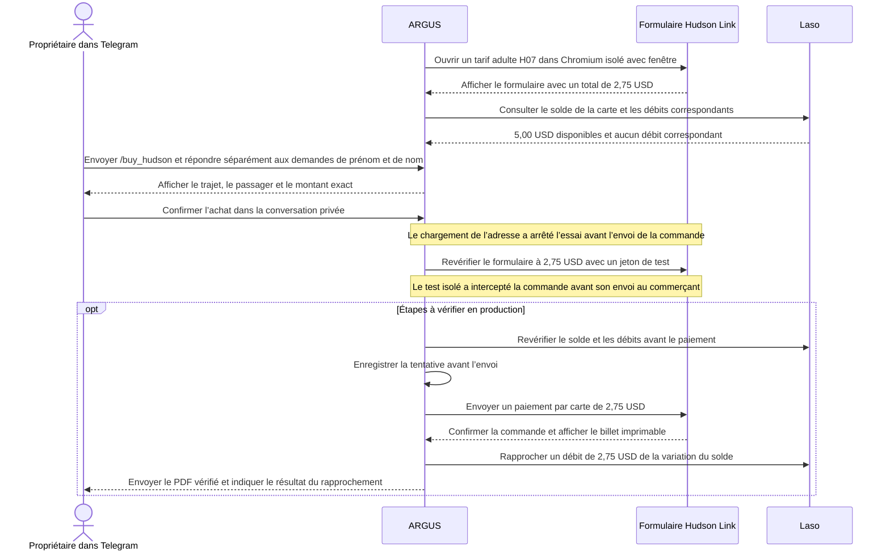

# Un billet Hudson Link depuis Telegram avec Laso

> [English](use-case-hudson-link.md) · [Русский](use-case-hudson-link-ru.md) · [Español](use-case-hudson-link-es.md) · **Français** · [中文](use-case-hudson-link-zh.md)

Le 14 novembre 2026, le pilote ARGUS en production sur Attested a rouvert le formulaire de paiement Hudson Link pour un trajet adulte sur la ligne **H07**, de **Palisades Center (Lot J), West Nyack** à **Depot Plaza (gare ferroviaire), Tarrytown**. Le total était de **2,75 USD**. Hudson Link indique une durée de validité de 365 jours à compter de l’achat, un billet imprimable avec code-barres et un reçu envoyé par e-mail avec un lien vers le billet. [Tarifs Hudson Link](https://www.ridehudsonlink.com/fares) · [Relevé de la vérification](../../artifacts/argus-bus-preflight-2026-11-14/verified.json)

## Du tarif au billet

## Résultats des vérifications en production

| Opération | Résultat observé |
| --- | --- |
| Ouvrir le formulaire de paiement | Chromium sans fenêtre a reçu HTTP `403`. Chromium isolé avec fenêtre sur Attested a reçu HTTP `200` et ouvert le formulaire. |
| Consulter l’état de la carte Laso | L’annuaire ne proposait aucune correspondance exacte pour Hudson Link et indiquait `unknown` pour Coach USA. Une session Laso expirée a ensuite renvoyé HTTP `401`. Après reconnexion, la carte affichait **5,00 USD disponibles** et **aucun** débit correspondant à 2,75 USD. |
| Valider le format de la date d’expiration | Laso a renvoyé l’année sur deux chiffres. La première version s’est arrêtée avant l’envoi du paiement. La version corrigée accepte les années sur deux ou quatre chiffres. Quatre scénarios simulés dans Chromium et 25 tests du parcours d’achat et de Telegram sont passés. Le formulaire en production s’est rouvert avec un total de **2,75 USD**. |
| Garder le consentement publicitaire désactivé | Le formulaire de facturation du commerçant cochait par défaut la case de consentement aux communications commerciales. ARGUS la décoche désormais avant l’envoi. La requête de commande exige toujours `marketingOptIn: false`. Quatre scénarios simulés dans Chromium ont réussi et la nouvelle image a passé sa vérification d’état en production. |
| Vérifier l’approbation et la tokenisation | Le propriétaire a confirmé le billet à 2,75 USD dans la conversation Telegram privée. Lors d’un essai distinct, le prestataire de paiement a renvoyé HTTP `201` en tokenisant la carte réelle. Le jeton prépare la carte au paiement. Cet essai s’est achevé avant l’envoi de la commande. |
| Charger l’adresse de facturation | La liste initiale des requêtes autorisées bloquait deux GET vers les référentiels Coach USA, `/countries` et `/countries/US/states`. Le menu **Country** était vide, ce qui a arrêté la tentative approuvée avant l’envoi de la commande. Le correctif autorise ces deux requêtes. Quatre scénarios simulés dans Chromium ont réussi, et l’image déployée `aicom-security:argus-hudson-billing-20261114` a passé sa vérification d’état. |
| Revérifier le formulaire réel en session isolée | L’essai temporaire a utilisé le formulaire réel du commerçant et un jeton de paiement synthétique. La requête de commande a passé toutes les vérifications, dont le total de **2,75 USD**. Le test l’a interceptée avant qu’elle atteigne le commerçant. |
| Envoyer et rapprocher le paiement | Après le déploiement, le journal indiquait toujours `no_submission`. La dernière consultation Laso a montré **5,00 USD disponibles** et **aucun** débit correspondant. Une nouvelle confirmation du propriétaire est attendue. Le débit réel, le reçu du transporteur et la livraison du PDF dans Telegram restent à vérifier. |

La transaction Base enregistrée précédemment a payé **5 USDC** pour l’émission de la carte. Le billet se paie en dollars sur le réseau de cartes, sans transaction propre sur Base. Après confirmation de l’achat, le rapprochement vérifie un seul débit correspondant de **2,75 USD** et un solde attendu de **2,25 USD** à partir des 5,00 USD initiaux. ARGUS suit séparément le billet, le reçu du transporteur et le débit Laso. Lorsque l’issue du paiement reste incertaine, le journal bloque un second débit. [Émission de la carte Laso sur Base](use-case-laso-prepaid-card-fr.md) · [Configuration et reprise dans Telegram](personal-assistant.md#hudson-link-ticket-from-telegram)
