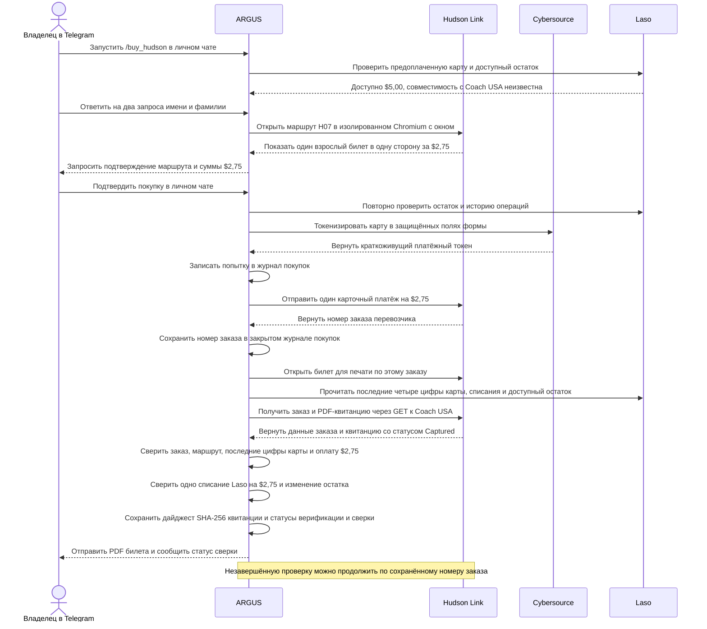

# Билет Hudson Link из Telegram с оплатой картой Laso

> [English](use-case-hudson-link.md) · **Русский** · [Español](use-case-hudson-link-es.md) · [Français](use-case-hudson-link-fr.md) · [中文](use-case-hudson-link-zh.md)

14 ноября 2026 года ARGUS купил один взрослый билет в одну сторону за **$2,75** на маршрут Hudson Link **H07** от **Palisades Center (Lot J), West Nyack** до **Depot Plaza, Tarrytown**. Владелец увидел запрос на подтверждение в **13:15**, а в **13:16** получил `hudson-link-ticket.pdf` в личном чате @Argis3Bot (время Амстердама). Владелец открыл PDF и увидел маршрут и штрихкод для посадки. В рабочем журнале зафиксирован статус `delivered`. [Данные проверки на проде](../../artifacts/argus-bus-preflight-2026-11-14/verified.json)

## От команды в Telegram до билета

Диаграмма показывает текущий сценарий в проде. Проверка ниже начинается с уже доставленного билета.

## Проверка на уже купленном билете

14 ноября 2026 года на проде ARGUS привязал старую запись в журнале к заказу перевозчика по ссылке владельца и номеру уже доставленного билета. Затем двумя запросами `GET` он получил у Coach USA данные заказа и PDF-квитанцию. В квитанции указан статус **Captured**. Итог заказа и сумма оплаты составили **$2,75**. Последние четыре цифры карты совпали с данными Laso. В истории Laso было **одно списание на $2,75**, доступный остаток снизился с **$5,00 до $2,25**. ARGUS сохранил номер заказа и дайджест квитанции в той же записи `delivered` со статусами `receiptVerified: true` и `reconciled: true`.

Повторная проверка вернула сохранённый результат. Сверка использовала PDF перевозчика и прошла **без повторной оплаты**. При новых покупках ARGUS берёт номер заказа напрямую из ответа Hudson Link. Laso не сообщает статус окончательного расчёта по этой карте. [Результаты сверки на проде](../../artifacts/argus-bus-preflight-2026-11-14/verified.json) · [Настройка и восстановление в Telegram](personal-assistant.md#hudson-link-ticket-from-telegram)

## Данные исходной покупки

| Операция | Что подтвердилось |
| --- | --- |
| Выпуск карты Laso | Ранее оплата по x402 на **5 USDC** в Base выпустила предоплаченную карту на **$5,00**. [Выпуск карты и транзакция Base](use-case-laso-prepaid-card-ru.md) |
| Подтверждение заказа Hudson Link | Платёжная форма и запрос в Telegram показывали **2,75 USD** за один взрослый билет в одну сторону. До покупки в справочнике Laso совместимость с Coach USA была указана как `unknown`. |
| Токенизация и оплата | Защищённые поля Cybersource передали платёжный токен. В отдельной проверке реальной карты токенизация вернула HTTP `201` при заблокированной отправке заказа. В живом запуске ARGUS записал попытку в журнал и отправил один заказ на **$2,75**. Оплата прошла через карточную сеть в долларах, без отдельной транзакции Base. [Cybersource Microform](https://developer.cybersource.com/demo/doc/microform_doc.html) |
| Верификация и доставка билета | ARGUS сверил маршрут и тип пассажира, проверил наличие штрихкода в версии для печати и отправил PDF. Доставку подтверждают скриншоты владельца и статус `delivered` в журнале. |
| Сверка с Laso | Laso показал **одно списание на $2,75** с совпадающим названием Hudson Link или Coach USA. Доступный остаток снизился с **$5,00 до $2,25**. Первая версия ARGUS пропускала сумму, которую Laso вернул строкой. Исправление прошло 27 тестов, а образ `aicom-security:argus-hudson-reconcile-20261114` прошёл проверку состояния после развёртывания. ARGUS сверил уже доставленный заказ, записал `reconciled: true` и не отправил новый заказ. Ответ Laso не содержал статуса проведения операции или окончательного расчёта. [Как авторизация влияет на доступный остаток](https://help.laso.finance/en/articles/12421793-i-was-waiting-on-a-refund-on-a-transaction-authorization-now-it-s-gone-what-happened) |
| Квитанция перевозчика | Владелец показал квитанцию со статусом **Captured** и суммой оплаты **$2,75**. При разовой проверке Coach USA вернул HTTP `200` на запросы чтения заказа в JSON и квитанции в PDF. Номер билета в заказе совпал с номером в PDF из Telegram. Квитанция относится к тому же заказу и карте Laso. Итог заказа и сумма оплаты составили **$2,75** за один взрослый билет в одну сторону из West Nyack в Tarrytown. Результат проверки записали в журнал существующего заказа как `receiptVerified: true`. [Билеты и квитанции Hudson Link](https://www.ridehudsonlink.com/fares) · [Настройка и восстановление в Telegram](personal-assistant.md#hudson-link-ticket-from-telegram) |

При ранних проверках сеанс Laso истёк (HTTP `401`), а Chromium без окна получил HTTP `403`. Форму удалось открыть после восстановления сеанса Laso и перехода на изолированный Chromium с окном. ARGUS теперь принимает год срока действия карты из двух или четырёх цифр, загружает справочники стран и штатов США из Coach USA и снимает предварительно выбранное согласие на рекламу. После отдельного сбоя до подтверждения ARGUS записывает этап и HTTP-статус ошибки и один раз заново открывает форму при обрыве браузерного соединения до подтверждения покупки. [Проверки и результаты деплоя](../../artifacts/argus-bus-preflight-2026-11-14/verified.json)
