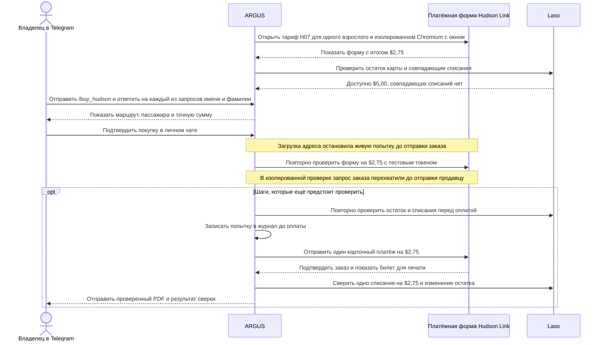

# Билет Hudson Link из Telegram с оплатой картой Laso

> [English](use-case-hudson-link.md) · **Русский** · [Español](use-case-hudson-link-es.md) · [Français](use-case-hudson-link-fr.md) · [中文](use-case-hudson-link-zh.md)

14 ноября 2026 года в рабочем ARGUS на Attested повторно открылась платёжная форма Hudson Link для одной взрослой поездки по маршруту **H07** от **Palisades Center (Lot J), West Nyack** до **Depot Plaza (железнодорожная станция), Tarrytown**. Итоговая сумма составила **$2,75**. Hudson Link указывает срок действия 365 дней с момента покупки, билет со штрихкодом для печати и электронную квитанцию со ссылкой на билет. [Тарифы Hudson Link](https://www.ridehudsonlink.com/fares) · [Данные проверки](../../artifacts/argus-bus-preflight-2026-11-14/verified.json)

## От тарифа до билета

## Результаты проверки

| Операция | Что наблюдали |
| --- | --- |
| Открытие платёжной формы | Chromium без окна получил HTTP `403`. Изолированный Chromium с окном на Attested получил HTTP `200` и открыл форму. |
| Запрос состояния карты | Laso не нашёл точного совпадения для Hudson Link, а для Coach USA вернул `unknown`. После истечения сеанса Laso вернул HTTP `401`. После восстановления сеанса доступны **$5,00**, совпадающих списаний на $2,75 **нет**. |
| Проверка формата срока действия | Laso вернул год двумя цифрами. Первая версия остановилась до отправки платежа. Обновлённая версия принимает год из двух или четырёх цифр. Прошли четыре сценария с имитацией ответов в Chromium и 25 тестов оформления и Telegram. На обновлённой версии живая форма открылась с итогом **$2,75**. |
| Согласие на рекламу | В платёжной форме продавца согласие на рекламу было выбрано по умолчанию. ARGUS теперь снимает этот флажок перед отправкой. Проверка запроса заказа по-прежнему требует `marketingOptIn: false`. Прошли четыре сценария с имитацией ответов в Chromium. Обновлённый образ прошёл проверку состояния на Attested. |
| Подтверждение покупки и токенизация | Владелец подтвердил билет за $2,75 в личном чате Telegram. В отдельной проверке процессор ответил HTTP `201` при токенизации реальной карты. Токен используется для подготовки карточной оплаты. Запрос заказа в этой проверке не отправляли. |
| Загрузка платёжного адреса | Исходный список разрешённых запросов блокировал два GET к справочникам Coach USA, `/countries` и `/countries/US/states`. Меню **Country** не содержало вариантов, и подтверждённая попытка остановилась до отправки заказа. Исправление разрешает запросы к этим двум справочникам. Прошли четыре сценария с имитацией ответов в Chromium. Развёрнутый образ `aicom-security:argus-hudson-billing-20261114` прошёл проверку состояния. |
| Повторная проверка формы продавца в изоляции | Во временном изолированном сеансе использовали реальную форму перевозчика и тестовый платёжный токен. Запрос заказа прошёл все проверки, включая итог **$2,75**. Проверка перехватила запрос до его отправки продавцу. |
| Отправка и сверка платежа | После деплоя журнал по-прежнему показывал `no_submission`. При последней проверке Laso подтвердил **$5,00 доступного остатка** и **ноль** совпадающих списаний. Новое подтверждение владельца ещё ожидается. Фактическое списание, квитанция перевозчика и доставка PDF в Telegram ещё не подтверждены. |

Записанная ранее транзакция Base оплатила выпуск карты на **5 USDC**. Оплата билета проходит через карточную сеть в долларах, без отдельной транзакции Base. После подтверждения покупки сверка проверяет одно совпадающее списание на **$2,75** и ожидаемый остаток **$2,25** при исходных $5,00. ARGUS отдельно отслеживает билет, квитанцию перевозчика и списание Laso. Если результат оплаты неизвестен, журнал блокирует повторное списание. [Выпуск карты на Base](use-case-laso-prepaid-card-ru.md) · [Настройка и восстановление в Telegram](personal-assistant.md#hudson-link-ticket-from-telegram)
