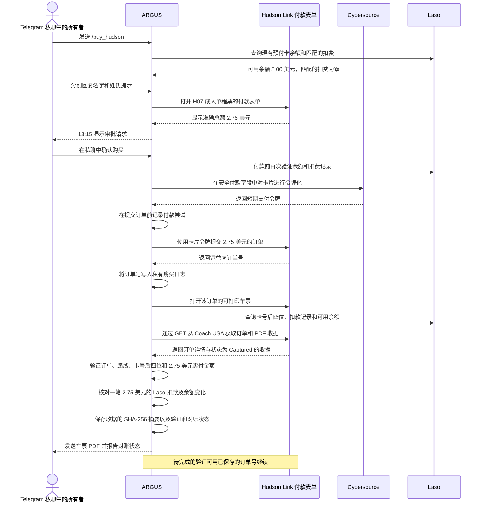

# 通过 Telegram 使用 Laso 购买 Hudson Link 车票

> [English](use-case-hudson-link.md) · [Русский](use-case-hudson-link-ru.md) · [Español](use-case-hudson-link-es.md) · [Français](use-case-hudson-link-fr.md) · **简体中文**

2026 年 11 月 14 日，ARGUS 以 **2.75 美元**购买了一张 **H07** 成人单程票，从 **West Nyack 的 Palisades Center（Lot J）** 到 **Tarrytown 的 Depot Plaza（火车站）**，并把 PDF 发到所有者的 Telegram 私聊。按阿姆斯特丹当地时间（UTC+1），审批请求于 **13:15** 显示，PDF 于 **13:16** 送达。Hudson Link 说明车票自购买之日起有效 365 天，并会通过电子邮件发送包含车票链接的单独收据。 [Hudson Link 票价](https://www.ridehudsonlink.com/fares) · [实测记录](../../artifacts/argus-bus-preflight-2026-11-14/verified.json)

## 从票价到车票

下图展示当前的生产流程。下一节的验证从已交付的车票开始。

## 在生产环境验证已购车票

2026 年 11 月 14 日，ARGUS 在生产环境用所有者提供的链接和已交付车票的编号，将旧日志条目关联到运营商订单。随后，ARGUS 通过两次 `GET` 直接从 Coach USA 获取订单详情和 PDF 收据。收据状态为 **Captured**，订单总额和实付金额均为 **2.75 美元**。卡号后四位与 Laso 一致。Laso 显示**一笔 2.75 美元的扣款**，可用余额从 **5.00 美元降到 2.25 美元**。ARGUS 将订单号和收据摘要保存在同一条 `delivered` 记录中，并记录 `receiptVerified: true` 和 `reconciled: true`。

再次验证时，ARGUS 返回了已保存的结果。此次对账以运营商的 PDF 为凭证，**没有重复付款**。新购买的订单号直接取自 Hudson Link 的响应。Laso 未提供这张卡的最终结算状态。 [生产环境对账记录](../../artifacts/argus-bus-preflight-2026-11-14/verified.json)

## 首次购买的记录

| 操作 | 结果 |
| --- | --- |
| 发行预付卡 | 此前通过一笔 Base 交易支付了 **5 USDC**，Laso 发行了一张面额为 **5.00 美元**的预付卡。 [Laso 在 Base 上发卡](use-case-laso-prepaid-card-zh.md) |
| 购买车票 | 所有者批准后，ARGUS 记录了付款尝试，并向运营商提交了一笔 **2.75 美元**的订单。Hudson Link 确认订单并显示可打印车票。卡片付款通过银行卡网络以美元处理，不会产生单独的 Base 交易。 |
| Laso 对账 | Laso 显示一笔 **2.75 美元**的扣费，交易描述与 Hudson Link 或 Coach USA 匹配，可用余额从 **5.00 美元降至 2.25 美元**。早期版本的 ARGUS 跳过了 Laso 以字符串返回的金额。修复通过了 27 项测试，已部署镜像 `aicom-security:argus-hudson-reconcile-20261114` 通过健康检查。ARGUS 对已交付的订单完成对账，记录 `reconciled: true`，且未发送新订单。Laso 的响应未提供入账或最终结算状态。 |
| 交付车票 | 所有者于 **13:16** 在 Telegram 收到并打开 `hudson-link-ticket.pdf`，看到了路线和可打印的条形码。日志显示 `delivered`。 |
| 运营商收据 | 所有者展示的收据显示 **Captured**，已支付 **2.75 美元**。在一次单独的只读验证中，Coach USA 的订单 JSON 和收据 PDF 都返回 HTTP `200`。订单中的车票编号与 Telegram PDF 中的编号一致，收据也对应同一订单和同一张 Laso 卡。订单总额和实付金额均为 **2.75 美元**，对应一张从 West Nyack 到 Tarrytown 的成人单程票。验证结果记录在现有订单的日志中，状态为 `receiptVerified: true`。 |

## 此前的故障与修复

| 操作 | 实测结果 |
| --- | --- |
| 打开付款表单 | 无界面 Chromium 收到 HTTP `403`。Attested 上隔离的有界面 Chromium 收到 HTTP `200`，并打开了付款表单。 |
| 查询 Laso 卡片状态 | 商家目录没有 Hudson Link 的精确匹配，Coach USA 的状态为 `unknown`。Laso 会话过期后返回 HTTP `401`。重新连接后，卡片显示**可用余额 5.00 美元**，匹配的 2.75 美元扣费为**零笔**。 |
| 验证卡片到期年份格式 | Laso 返回两位数年份。第一个版本在提交付款前停止。已部署的修复支持两位数和四位数年份。四个 Chromium 模拟场景和 25 项购买及 Telegram 测试通过。修复后的生产付款表单重新打开，显示总额 **2.75 美元**。 |
| 保持营销同意关闭 | 商家结账表单默认勾选了接收营销信息。ARGUS 现在会在提交前取消勾选，订单请求仍要求 `marketingOptIn: false`。四个 Chromium 模拟场景通过，更新后的镜像也通过了生产环境健康检查。 |
| 单独测试令牌化 | 在实际购买前的单独探测中，支付处理方对真实卡片进行令牌化时返回 HTTP `201`。令牌用于准备付款。该探测在提交订单前结束。 |
| 加载账单地址 | 原有请求允许列表拦截了 Coach USA 的两个地址目录 GET 请求 `/countries` 和 `/countries/US/states`。**Country** 菜单没有选项，已确认的尝试在提交订单前停止。修复后允许访问这两个目录。四个 Chromium 模拟场景及已部署镜像 `aicom-security:argus-hudson-billing-20261114` 的健康检查均已通过。 |
| 在隔离会话中复查真实表单 | 临时隔离测试使用了商家的真实表单和合成支付令牌。订单请求通过了所有检查，包括 **2.75 美元**的总额。测试在请求发给商家前将其拦截。 |
| 排查审批前故障 | **13:04**，机器人接受了名字和姓氏回复，表单随后在显示审批请求前出错。日志显示 `no_submission`，Laso 可用余额为 **5.00 美元**且没有匹配扣费。之后连续三次打开表单成功。另一次诊断抵达审批步骤后主动拒绝，未发送订单。故障原因仍不明确。 |

付款结果不明确时，购买日志会阻止重复扣费。ARGUS 分别记录车票交付、收据验证和 Laso 对账状态。 [Telegram 配置与恢复](personal-assistant.md#hudson-link-ticket-from-telegram)
