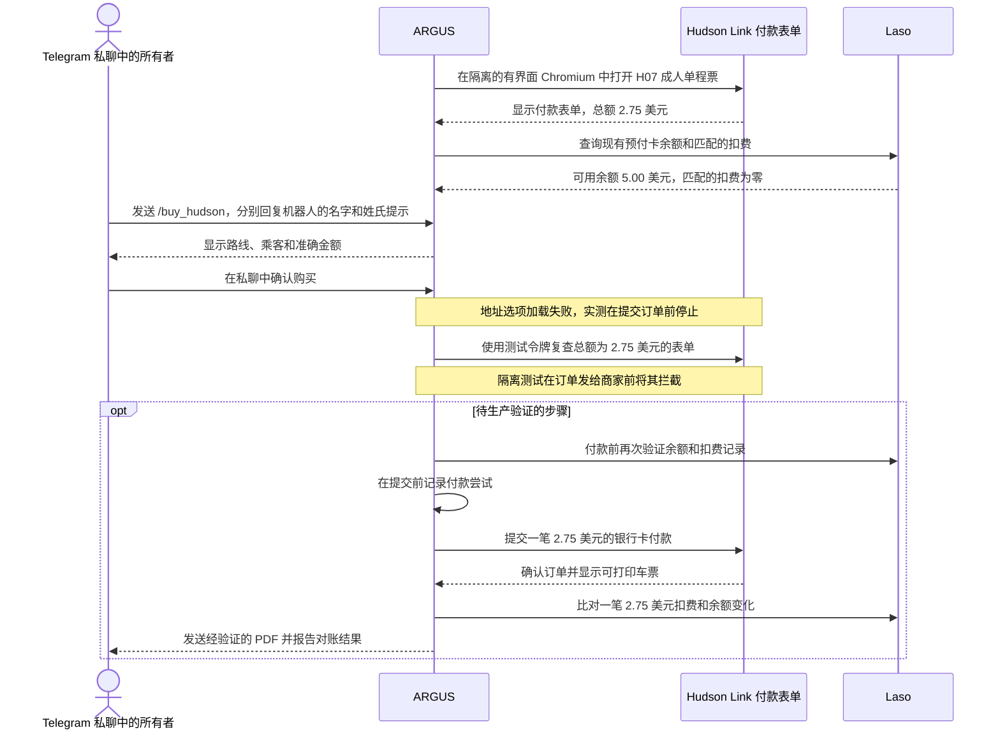

# 通过 Telegram 使用 Laso 购买 Hudson Link 车票

> [English](use-case-hudson-link.md) · [Русский](use-case-hudson-link-ru.md) · [Español](use-case-hudson-link-es.md) · [Français](use-case-hudson-link-fr.md) · **简体中文**

2026 年 11 月 14 日，Attested 生产环境中的 ARGUS 重新打开了 Hudson Link 的付款表单。测试选取一张 **H07** 成人单程票，从 **West Nyack 的 Palisades Center（Lot J）** 到 **Tarrytown 的 Depot Plaza（火车站）**，结账总额为 **2.75 美元**。Hudson Link 说明车票自购买日起有效 365 天，可打印带条形码的车票，电子邮件收据中包含车票链接。 [Hudson Link 票价](https://www.ridehudsonlink.com/fares) · [实测记录](../../artifacts/argus-bus-preflight-2026-11-14/verified.json)

## 从票价到车票

## 生产环境检查结果

| 操作 | 实测结果 |
| --- | --- |
| 打开付款表单 | 无界面 Chromium 收到 HTTP `403`。Attested 上隔离的有界面 Chromium 收到 HTTP `200`，并打开了付款表单。 |
| 查询 Laso 卡片状态 | 商家目录没有 Hudson Link 的精确匹配，Coach USA 的状态为 `unknown`。Laso 会话过期后返回 HTTP `401`。重新连接后，卡片显示**可用余额 5.00 美元**，匹配的 2.75 美元扣费为**零笔**。 |
| 验证卡片到期年份格式 | Laso 返回两位数年份。第一个版本在提交付款前停止。已部署的修复支持两位数和四位数年份。四个 Chromium 模拟场景和 25 项购买及 Telegram 测试通过。修复后的生产付款表单重新打开，显示总额 **2.75 美元**。 |
| 保持营销同意关闭 | 商家结账表单默认勾选了接收营销信息。ARGUS 现在会在提交前取消勾选，订单请求仍要求 `marketingOptIn: false`。四个 Chromium 模拟场景通过，更新后的镜像也通过了生产环境健康检查。 |
| 验证确认与令牌化 | 所有者在 Telegram 私聊中确认了 2.75 美元的车票。在单独的探测中，支付处理方对真实卡片进行令牌化时返回 HTTP `201`。令牌用于准备付款。该探测在提交订单前结束。 |
| 加载账单地址 | 原有请求允许列表拦截了 Coach USA 的两个地址目录 GET 请求 `/countries` 和 `/countries/US/states`。**Country** 菜单没有选项，已确认的尝试在提交订单前停止。修复后允许访问这两个目录。四个 Chromium 模拟场景及已部署镜像 `aicom-security:argus-hudson-billing-20261114` 的健康检查均已通过。 |
| 在隔离会话中复查真实表单 | 临时隔离测试使用了商家的真实表单和合成支付令牌。订单请求通过了所有检查，包括 **2.75 美元**的总额。测试在请求发给商家前将其拦截。 |
| 提交付款并对账 | 部署后日志仍显示 `no_submission`。Laso 最新查询显示**可用余额 5.00 美元**，匹配扣费为**零笔**。目前正在等待所有者重新确认。实际扣费、运营商收据和 Telegram 中的 PDF 送达仍待验证。 |

此前记录的 Base 交易以 **5 USDC** 支付发卡费用。车票通过银行卡网络以美元支付，不会产生单独的 Base 交易。订单确认后，对账应验证一笔金额为 **2.75 美元**的匹配扣费，以及初始余额 5.00 美元扣费后的预期余额 **2.25 美元**。ARGUS 分别跟踪车票、运营商收据和 Laso 扣费。付款结果不明确时，购买日志会阻止重复扣费。 [Laso 在 Base 上发卡](use-case-laso-prepaid-card-zh.md) · [Telegram 配置与恢复](personal-assistant.md#hudson-link-ticket-from-telegram)
