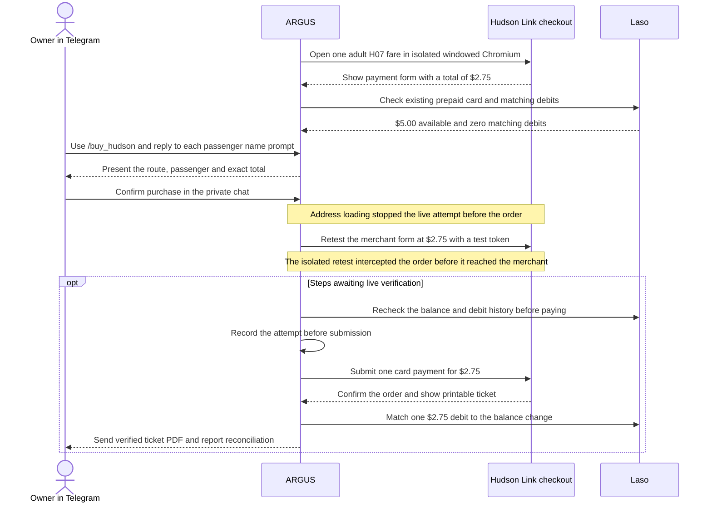

# Hudson Link ticket from Telegram with Laso

> **English** · [Русский](use-case-hudson-link-ru.md) · [Español](use-case-hudson-link-es.md) · [Français](use-case-hudson-link-fr.md) · [中文](use-case-hudson-link-zh.md)

On 14 November 2026, the live ARGUS pilot on Attested reopened the Hudson Link payment form for one adult single ride on **H07** from **Palisades Center (Lot J), West Nyack** to **Depot Plaza (train station), Tarrytown**. The checkout total was **$2.75**. Hudson Link lists a 365-day validity period from purchase and describes a printable barcode ticket and an emailed receipt with a ticket link. [Hudson Link fares](https://www.ridehudsonlink.com/fares) · [Live check](../../artifacts/argus-bus-preflight-2026-11-14/verified.json)

## From fare to ticket

## What the live checks established

| Operation | Observed result |
| --- | --- |
| Open checkout | Headless Chromium received HTTP `403`. Isolated windowed Chromium on Attested received HTTP `200` and opened the payment form. |
| Read Laso status | The directory returned no exact Hudson Link entry and marked Coach USA `unknown`. An expired Laso session later returned HTTP `401`. After reconnecting the session, the existing card showed **$5.00** and **zero** matching $2.75 debits. |
| Validate the card expiry format | The live Laso response supplied a two-digit expiry year. The first implementation stopped before payment submission. The deployed fix accepts two- or four-digit years. Four Chromium fixture cases and 25 checkout and Telegram tests passed. The patched live checkout reopened at **$2.75**. |
| Keep marketing consent off | The merchant’s billing form selected its marketing opt-in by default. ARGUS now clears that checkbox before submission, and the order request still requires `marketingOptIn: false`. Four Chromium fixture cases passed and the updated image passed its production health check. |
| Verify approval and tokenization | The owner approved the $2.75 ticket in the private Telegram chat. In a separate probe, the processor returned HTTP `201` when tokenizing the real card. Tokenization prepares card credentials for the order. The probe sent no order. |
| Load the billing address | The initial allowlist blocked two Coach USA GETs, `/countries` and `/countries/US/states`. The **Country** menu had no options, which stopped the approved attempt before submission. The fix allows those two address catalogs. Four Chromium fixture cases passed, and the deployed image `aicom-security:argus-hudson-billing-20261114` passed its health check. |
| Recheck the real merchant form in isolation | The temporary isolated retest used the real merchant form and a synthetic payment token. The proposed order passed every guard check, including the **$2.75** total. The test intercepted the order before it reached the merchant. |
| Submit and reconcile | After deployment, the journal still showed `no_submission`, with **$5.00 available** and **zero** matching Laso debits in the latest card check. A new owner confirmation is pending. A live charge, merchant receipt and delivery of the ticket PDF in Telegram remain unverified. |

The previously recorded Base transaction paid **5 USDC** to issue the card. The card payment for this ticket runs through the card network in dollars and has no Base transaction of its own. Once a purchase is confirmed, the reconciliation checks one matching **$2.75** debit and an expected balance of **$2.25** from the $5.00 starting balance. ARGUS tracks the ticket, the separate merchant receipt and the Laso debit, and it blocks a repeat charge after an uncertain payment response. [Laso issuance on Base](use-case-laso-prepaid-card.md) · [Telegram setup and recovery](personal-assistant.md#hudson-link-ticket-from-telegram)
