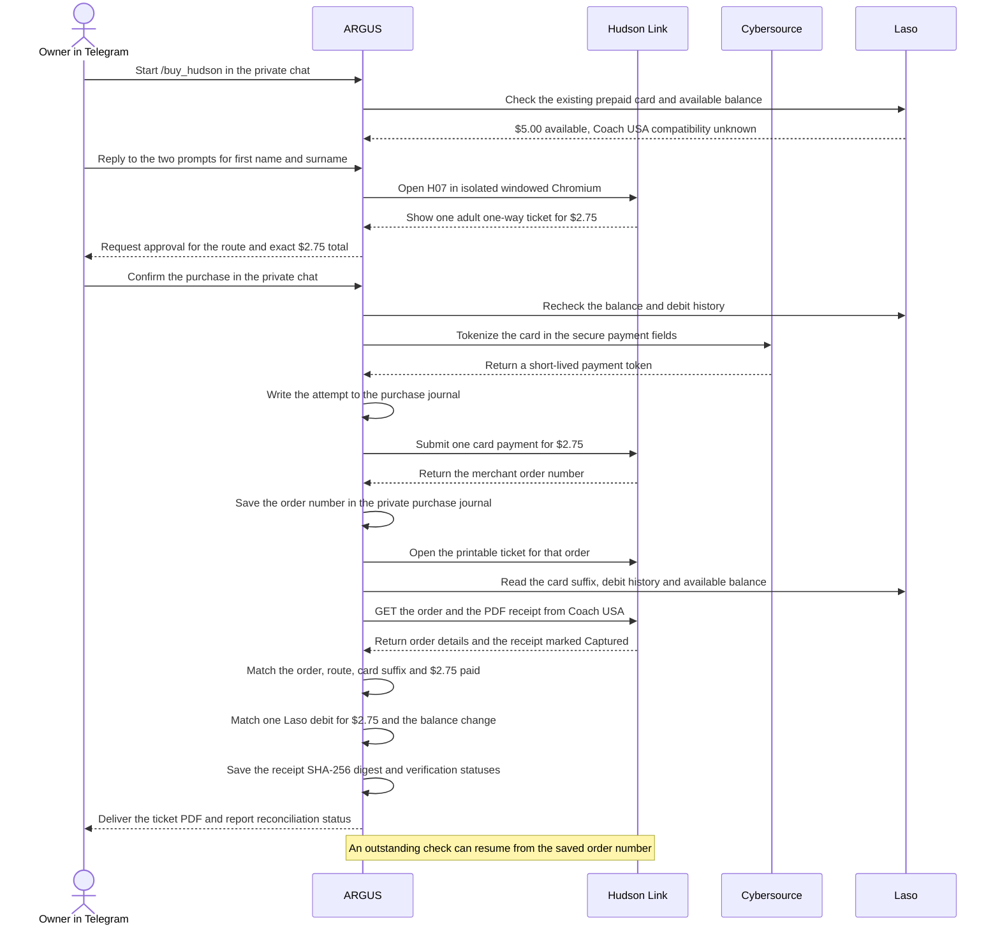

# Hudson Link ticket from Telegram with Laso

> **English** · [Русский](use-case-hudson-link-ru.md) · [Español](use-case-hudson-link-es.md) · [Français](use-case-hudson-link-fr.md) · [中文](use-case-hudson-link-zh.md)

On 14 November 2026, ARGUS bought one **$2.75** adult one-way ticket on Hudson Link route **H07**, from **Palisades Center (Lot J), West Nyack** to **Depot Plaza, Tarrytown**. The owner saw the approval request at **13:15** and received `hudson-link-ticket.pdf` in the private @Argis3Bot chat at **13:16** (Europe/Amsterdam). The owner opened the PDF and saw the route and printable boarding barcode. The production journal recorded `delivered`. [Production evidence](../../artifacts/argus-bus-preflight-2026-11-14/verified.json)

## From Telegram to the ticket

The diagram shows the current production flow. The verification in the next section starts from an already delivered ticket.

## Production check on the existing ticket

On 14 November 2026, the production check used the owner’s ticket link and the ticket reference from the original delivery to link the older journal entry to the merchant order. ARGUS then fetched the order and PDF receipt directly from Coach USA with two `GET` requests. The receipt showed **Captured** with **$2.75** as both the order total and amount paid. The card suffix matched Laso, which showed **one $2.75 debit** and **$2.25 available**, down from **$5.00**. ARGUS saved the order number and receipt digest on the same `delivered` entry, with `receiptVerified: true` and `reconciled: true`.

Repeating the check returned the saved result. The production test made no payment request and used the carrier’s PDF as receipt evidence. For new purchases, ARGUS takes the order number directly from Hudson Link’s response. Laso does not expose the final settlement status for this card. [Production reconciliation evidence](../../artifacts/argus-bus-preflight-2026-11-14/verified.json) · [Telegram setup and recovery](personal-assistant.md#hudson-link-ticket-from-telegram)

## Evidence from the original purchase

| Operation | What we verified |
| --- | --- |
| Issue the Laso card | An earlier x402 payment of **5 USDC** on Base issued the **$5.00** prepaid card. [Card issuance and Base transaction](use-case-laso-prepaid-card.md) |
| Approve the Hudson Link order | The checkout and the Telegram approval both showed **$2.75 USD** for one adult one-way ticket. The Laso directory still reported Coach USA compatibility as `unknown` before the purchase. |
| Tokenize and pay | Cybersource's secure fields provided the payment token. A separate preflight received HTTP `201` for real-card tokenization with order submission blocked. In the live run, ARGUS recorded the attempt before sending one card order for **$2.75**. The ticket payment used the card network in USD, with no additional Base transaction. [Cybersource Microform](https://developer.cybersource.com/demo/doc/microform_doc.html) |
| Verify and deliver the ticket | ARGUS checked the returned ticket against the route and passenger type, verified that the printable view showed a barcode and sent the PDF. The owner's screenshots and the `delivered` journal entry confirm delivery. |
| Reconcile Laso activity | Laso reported **one $2.75 debit entry** matching the Hudson Link or Coach USA descriptor. The available balance fell from **$5.00 to $2.25**. The original matcher skipped the amount because Laso returned it as a string. The fix passed 27 tests and the deployed image `aicom-security:argus-hudson-reconcile-20261114` passed its health check. ARGUS reconciled the delivered purchase, recorded `reconciled: true` and sent no new order. Laso’s response exposed no posting or final settlement status. [How authorizations affect the available balance](https://help.laso.finance/en/articles/12421793-i-was-waiting-on-a-refund-on-a-transaction-authorization-now-it-s-gone-what-happened) |
| Verify the merchant receipt | The owner showed a receipt marked **Captured** with **$2.75 paid**. A one-off read-only check fetched the order JSON and receipt PDF from Coach USA, both HTTP `200`. The order’s ticket reference matched the PDF sent to Telegram. The receipt matched the order and Laso card, with **$2.75** as both order total and amount paid for one adult one-way ticket from West Nyack to Tarrytown. The verification result was recorded on the existing delivered purchase as `receiptVerified: true`. [Hudson Link ticket and receipt information](https://www.ridehudsonlink.com/fares) · [Telegram setup and recovery](personal-assistant.md#hudson-link-ticket-from-telegram) |

Early runs hit an expired Laso session (HTTP `401`) and received HTTP `403` in headless Chromium. Reconnecting Laso and using isolated windowed Chromium restored access to the payment form. The checkout now accepts two- or four-digit expiry years, loads the Coach USA country and U.S. state catalogs, and clears the preselected marketing checkbox. After a separate opening failure before approval, ARGUS began recording the failed stage and HTTP status and retrying once when the browser connection breaks before approval. [Checks and deployment evidence](../../artifacts/argus-bus-preflight-2026-11-14/verified.json)
