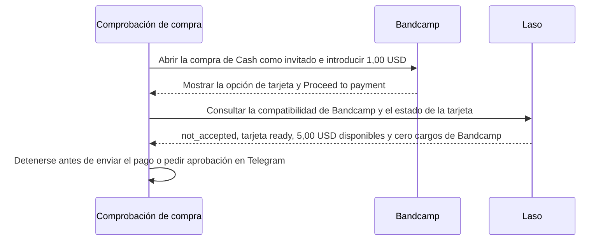

# Por qué se detuvo la comprobación de compra en Bandcamp con Laso

> [English](use-case-laso-bandcamp.md) · [Русский](use-case-laso-bandcamp-ru.md) · **Español** · [Français](use-case-laso-bandcamp-fr.md) · [中文](use-case-laso-bandcamp-zh.md)

El 14 de noviembre de 2026 comprobamos si la tarjeta prepago estadounidense no recargable de Laso, ya emitida, servía para comprar la canción **Cash** de Blockhead en Bandcamp. El proceso de compra como invitado mostró una opción de pago con tarjeta y permitió introducir **1,00 USD**, el mínimo indicado. El navegador llegó a **Proceed to payment**. El importe final quedó sin confirmar. [Canción en Bandcamp](https://blockheadnyc.bandcamp.com/track/cash) · [Registro de la comprobación](../../artifacts/argus-bandcamp-preflight-2026-11-14/verified.json)

## Comprobación de compatibilidad con el comercio

La consulta del comercio devolvió HTTP `200` y el resultado `not_accepted` para Bandcamp y el tipo de tarjeta `Non-Reloadable U.S.`. Laso usa ese estado cuando ese tipo de tarjeta ya ha sido rechazado por el comercio. La consulta independiente de la tarjeta devolvió HTTP `200`, estado `ready`, **5,00 USD disponibles** y **cero cargos de Bandcamp**. [Guía de compatibilidad de Laso](https://docs.laso.finance/guides/usa-prepaid-card#check-the-merchant-first) · [Resultados de las consultas](../../artifacts/argus-bandcamp-preflight-2026-11-14/verified.json)

La prueba terminó antes de enviar el pago. No se generó ningún recibo de compra ni archivo descargable. En Telegram no se envió ninguna solicitud de aprobación ni archivo. La transacción de Base del caso Laso corresponde a la emisión de la tarjeta. Esta comprobación en Bandcamp no generó ninguna transacción en Base. [Emisión de la tarjeta y transacciones de Base](use-case-laso-prepaid-card-es.md)
