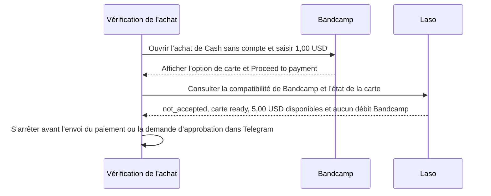

# Pourquoi la vérification de l’achat Bandcamp avec Laso s’est arrêtée

> [English](use-case-laso-bandcamp.md) · [Русский](use-case-laso-bandcamp-ru.md) · [Español](use-case-laso-bandcamp-es.md) · **Français** · [中文](use-case-laso-bandcamp-zh.md)

Le 14 novembre 2026, nous avons vérifié si la carte prépayée américaine non rechargeable déjà émise par Laso permettait d’acheter le morceau **Cash** de Blockhead sur Bandcamp. Le parcours d’achat sans compte affichait une option de paiement par carte et permettait de saisir **1,00 USD**, le minimum indiqué. Le navigateur a atteint le bouton **Proceed to payment**. Le montant final restait à confirmer. [Morceau sur Bandcamp](https://blockheadnyc.bandcamp.com/track/cash) · [Relevé de la vérification](../../artifacts/argus-bandcamp-preflight-2026-11-14/verified.json)

## Vérification de la compatibilité avec le commerçant

La recherche du commerçant a renvoyé HTTP `200` et le résultat `not_accepted` pour Bandcamp et le type de carte `Non-Reloadable U.S.`. Laso utilise ce statut lorsqu’une carte de ce type a déjà été refusée chez ce commerçant. La consultation distincte de la carte a renvoyé HTTP `200`, le statut `ready`, **5,00 USD disponibles** et **aucun débit Bandcamp**. [Guide de compatibilité de Laso](https://docs.laso.finance/guides/usa-prepaid-card#check-the-merchant-first) · [Résultats des deux consultations](../../artifacts/argus-bandcamp-preflight-2026-11-14/verified.json)

La vérification s’est arrêtée avant l’envoi d’un paiement. Elle n’a produit ni reçu d’achat ni fichier téléchargeable. Aucune demande d’approbation ni aucun fichier n’a été envoyé dans Telegram. La transaction Base du cas Laso correspond à l’émission de la carte. Cette vérification sur Bandcamp n’a généré aucune transaction sur Base. [Émission de la carte et transactions Base](use-case-laso-prepaid-card-fr.md)
