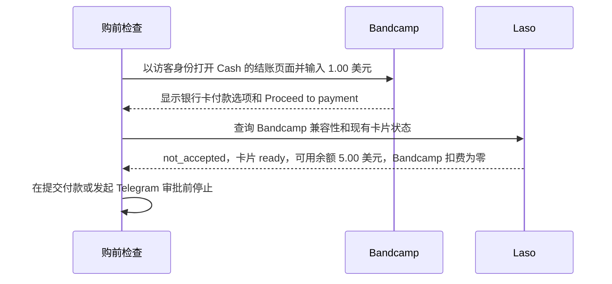

# Laso 卡在 Bandcamp 的购前检查为何停止

> [English](use-case-laso-bandcamp.md) · [Русский](use-case-laso-bandcamp-ru.md) · [Español](use-case-laso-bandcamp-es.md) · [Français](use-case-laso-bandcamp-fr.md) · **简体中文**

2026 年 11 月 14 日，我们检查了已发行的 Laso 美国不可充值预付卡能否在 Bandcamp 购买 Blockhead 的曲目 **Cash**。访客结账页面显示了银行卡付款选项，可以输入标示的最低金额 **1.00 美元**。浏览器到达 **Proceed to payment** 按钮所在的页面，最终金额尚未确认。 [Bandcamp 曲目](https://blockheadnyc.bandcamp.com/track/cash) · [结账检查记录](../../artifacts/argus-bandcamp-preflight-2026-11-14/verified.json)

## 验证商家兼容性

商家查询返回 HTTP `200`。对于 Bandcamp 和 `Non-Reloadable U.S.` 卡片类型，结果为 `not_accepted`。Laso 将这一状态用于曾拒绝该类型卡片的商家。单独的卡片查询同样返回 HTTP `200`，卡片状态为 `ready`，**可用余额为 5.00 美元**，**Bandcamp 扣费为零**。 [Laso 商家兼容性指南](https://docs.laso.finance/guides/usa-prepaid-card#check-the-merchant-first) · [商家和卡片查询记录](../../artifacts/argus-bandcamp-preflight-2026-11-14/verified.json)

检查在提交付款之前结束。此次检查没有生成购买收据或可下载文件，Telegram 中也未发送审批请求或文件。Laso 案例中的 Base 交易用于发行这张卡。本次 Bandcamp 检查未产生 Base 交易。 [Laso 发卡与 Base 交易记录](use-case-laso-prepaid-card-zh.md)
