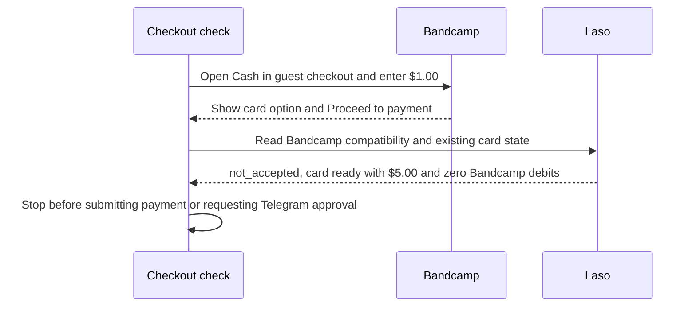

# Why the Laso purchase check stopped at Bandcamp

> **English** · [Русский](use-case-laso-bandcamp-ru.md) · [Español](use-case-laso-bandcamp-es.md) · [Français](use-case-laso-bandcamp-fr.md) · [中文](use-case-laso-bandcamp-zh.md)

On 14 November 2026, we checked whether the existing Laso U.S. non-reloadable prepaid card could pay for Blockhead’s track **Cash** on Bandcamp. The guest checkout displayed a card payment option and accepted an entered amount of **$1.00**, the listed minimum. The browser reached **Proceed to payment**. The final total was still unverified. [Track on Bandcamp](https://blockheadnyc.bandcamp.com/track/cash) · [Checkout evidence](../../artifacts/argus-bandcamp-preflight-2026-11-14/verified.json)

## Merchant compatibility stopped the purchase

Laso’s merchant lookup returned HTTP `200` and the Bandcamp result `not_accepted` for the `Non-Reloadable U.S.` card type. Laso documents that status as a prior decline for that card type at the merchant. The separate card lookup returned HTTP `200`, status `ready`, **$5.00 available** and **zero matching Bandcamp debits**. [Laso merchant compatibility guide](https://docs.laso.finance/guides/usa-prepaid-card#check-the-merchant-first) · [Observed compatibility and card state](../../artifacts/argus-bandcamp-preflight-2026-11-14/verified.json)

The check ended before card payment submission. It produced no purchase receipt or downloadable file, and no approval or file was sent through Telegram. The Base transaction in the Laso pilot funded the previously issued card. This Bandcamp check created no Base transaction. [Laso issuance and Base transaction ledger](use-case-laso-prepaid-card.md)
