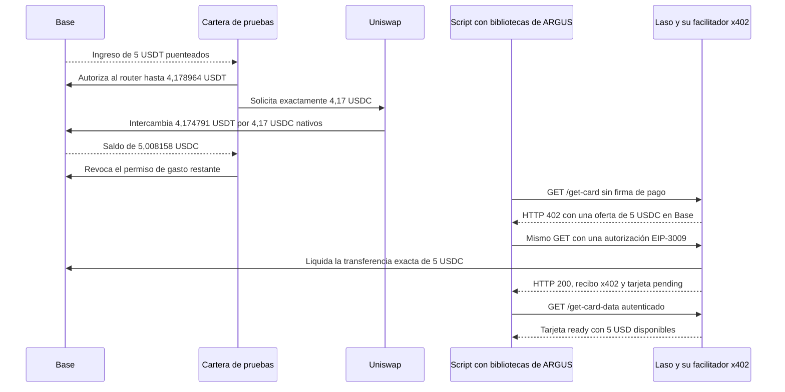
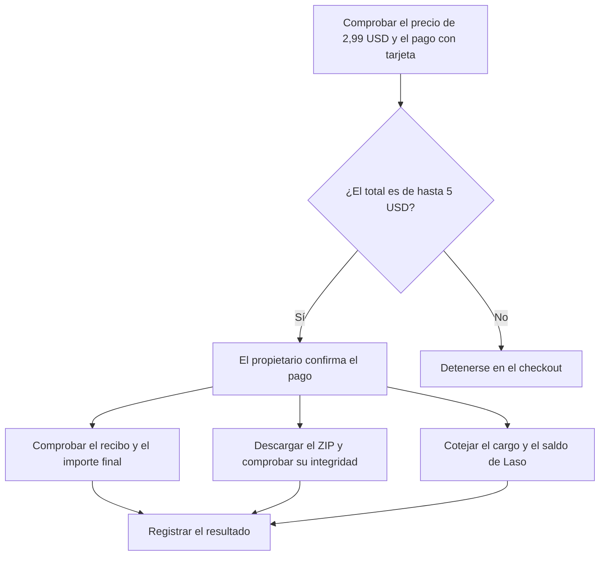

# Emisión de una tarjeta prepago Laso de 5 USD en Base

> 🌐 [English](./use-case-laso-prepaid-card.md) · [Русский](./use-case-laso-prepaid-card-ru.md) · **Español** · [Français](./use-case-laso-prepaid-card-fr.md) · [中文](./use-case-laso-prepaid-card-zh.md)

El 13 de noviembre de 2026, un script del operador que usa las bibliotecas de ARGUS pagó **5 USDC** en Base y verificó la emisión de una tarjeta prepago Laso estadounidense, no recargable, con **5 USD disponibles**. La prueba usó una cartera separada de la del bot. El siguiente paso, la compra en un comercio con la tarjeta emitida, sigue pendiente. [Guía de tarjetas Laso](https://docs.laso.finance/guides/usa-prepaid-card)

## De la financiación a la tarjeta

La cartera ya tenía 0,838158 USDC nativos. Con la aprobación del propietario, el intercambio de salida exacta completó el importe necesario y dejó un margen de 0,008158 USDC después del pago a Laso. El permiso temporal del router se limitó a 4,178964 USDT y se revocó tras el intercambio.

El primer intento se detuvo antes de enviar un pago porque el SDK de x402 aplicaba un límite predeterminado de 1 USD. El cliente de ARGUS pasó a configurar el SDK con el límite ya validado para la solicitud. Las pruebas con las imágenes de producción firmaron el importe exacto y rechazaron una oferta superior por una unidad mínima antes de enviar la solicitud firmada.

El script envió una sola autorización EIP-3009 para `GET /get-card?amount=5.00`. La verificación en Base encontró un único evento `AuthorizationUsed` con el `nonce` firmado, seguido de la transferencia de 5 USDC al destinatario cotizado. La consulta autenticada de la tarjeta confirmó `ready` por separado, sin emitir otra autorización. [Estados de la tarjeta](https://docs.laso.finance/guides/card-lifecycle)

## Transacciones en Base

| Paso | Bloque | Efecto | Comisión de red en ETH | Recibo público |
| --- | --- | --- | ---: | --- |
| Ingreso de USDT | 56 881 472 | La cartera recibió 5 USDT puenteados | 0,000007796120104268, pagados por el emisor de la transacción | [0x0907b080…1714b](https://basescan.org/tx/0x0907b080cfd921ea9e57cb8efa6a7b9aa88fa0375c2b564c90a396106c61714b) |
| Autorización del router | 56 889 403 | Permiso de gasto de hasta 4,178964 USDT | 0,000000278888454135 | [0xd122c5e7…229c](https://basescan.org/tx/0xd122c5e7bb899e8adc41a1fb71f583c157ea665e9376959816239190c29f229c) |
| Intercambio de salida exacta | 56 889 418 | 4,174791 USDT por 4,17 USDC nativos | 0,000000766704068047 | [0x11cb2591…0e3b](https://basescan.org/tx/0x11cb25913e76087a4b3ce744ec09212b645c2755f5e3e08a58bb54cdacc60e3b) |
| Revocación | 56 889 432 | El permiso de gasto del router quedó en cero | 0,000000147307564356 | [0xae597e68…6b1d](https://basescan.org/tx/0xae597e68aabc83612d488f3713e605b27c0bc74bda8ba0ad593e0a118a7b6b1d) |
| Liquidación x402 | 56 890 293 | Un pago de 5 USDC a Laso | 0,000000864119061217, pagados por el facilitador x402 | [0xc8bd81d9…9c68](https://basescan.org/tx/0xc8bd81d9d1d39327736bc7b7a8f490658b50362aca8e295ee8cd655f20099c68) |

Las cinco transacciones estaban finalizadas cuando la cabecera finalizada de Base alcanzó el bloque 56 894 431. Las comisiones incluyen el coste de los datos de L1. La cartera de pruebas pagó en total **0,000001192900086538 ETH** por la autorización del router, el intercambio y la revocación.

## Compra de prueba en itch.io

Se abrió el checkout del paquete digital **Co-Working & Startup Office Icon Pack**. Mostraba un precio base de **2,99 USD**, el archivo `Co_Working_Startup_Office_Icon_Pack.zip` de 268 kB y la opción de pagar con tarjeta. Laso marcó itch.io como `accepted` para este tipo de tarjeta estadounidense. El propietario introduce su correo y los datos de la tarjeta en el navegador y confirma una compra si el total con impuestos no supera **5 USD**. [Ficha del producto](https://aiimperium.itch.io/co-working-startup-office-icon-pack) · [Proceso de compra en itch.io](https://itch.io/docs/creators/how-buying-works)

El pago con tarjeta genera un recibo del comercio y un cargo en dólares registrado por el emisor. Ese cargo no tiene una transacción propia en Base. La prueba se completa al comprobar el recibo de itch.io, descargar y validar el ZIP, y cotejar el importe final con un único cargo en Laso y la variación del saldo inicial de 5 USD. Los datos de la tarjeta y el enlace privado de descarga quedan con el propietario. [Actividad de la tarjeta Laso](https://laso.finance/openapi.json)

Al entregar el checkout al propietario, Laso mostraba `ready`, un saldo de 5 USD y ningún cargo de itch.io. El recibo, la descarga y el cargo están pendientes de verificación.

## Qué incluye ARGUS

`laso_card_quote` comprueba el comercio configurado y prepara el importe exacto. `laso_buy_card` requiere la aprobación del propietario y un canal privado. Tras comprobar que la tarjeta estaba lista, el operador envió al chat privado verificado del propietario un enlace de un solo uso al panel de Laso. El enlace caduca a los 15 minutos. La tarjeta aparece en **Cards**. [Configuración de compras](./personal-assistant.md) · [Acceso al panel de Laso](https://docs.laso.finance/guides/authentication#getting-a-login-link-for-humans)

La corrección del cliente x402 se desplegó en las imágenes de ARGUS de Attested Live, Factory Live y Factory UNI. El bot privado de Attested activó `cmc_buy_quotes` con una cartera propia y aprobación por compra. El directorio público `GET /ai-market/v2/external-services` de ModelMarket enlaza a Laso, CoinMarketCap y Tavily para que el comprador pague directamente al proveedor con su propia cartera. El manifiesto firmado sigue describiendo las capacidades invocables del Hub. [Directorio externo](https://modelmarket.dev/ai-market/v2/external-services) · [Manifiesto del Hub](https://modelmarket.dev/ai-market/v2/manifest)

## Compra opcional desde Telegram

El código de ARGUS incluye `/buy_itch` para este único paquete. Requiere activación expresa y se ejecuta en el chat privado del propietario. Usa el correo configurado para el recibo o el de un buzón conectado. Si falta el correo o algún dato de facturación, pide solo los datos necesarios en privado. El propietario revisa el importe final con impuestos y lo aprueba con un botón de un solo uso. El límite es **5 USD**.

ARGUS registra el intento antes de enviar el único cargo. Si el resultado queda pendiente, puede recuperar el recibo y el ZIP sin volver a pagar. Verifica la integridad del archivo antes de enviarlo al chat privado y coteja el importe del recibo con el cargo de Laso y el saldo restante.

La prueba local usó un navegador con respuestas simuladas. El bot de producción de Attested ya tiene Chromium aislado y una dirección de correo para recibir el recibo. El buzón de Gmail sigue desconectado. En la prueba de compra automática, itch.io redirigió el navegador a su página de inicio antes de que ARGUS enviara la solicitud de pago. La consulta posterior a Laso confirmó un saldo disponible de 5 USD y cero cargos de itch.io.
