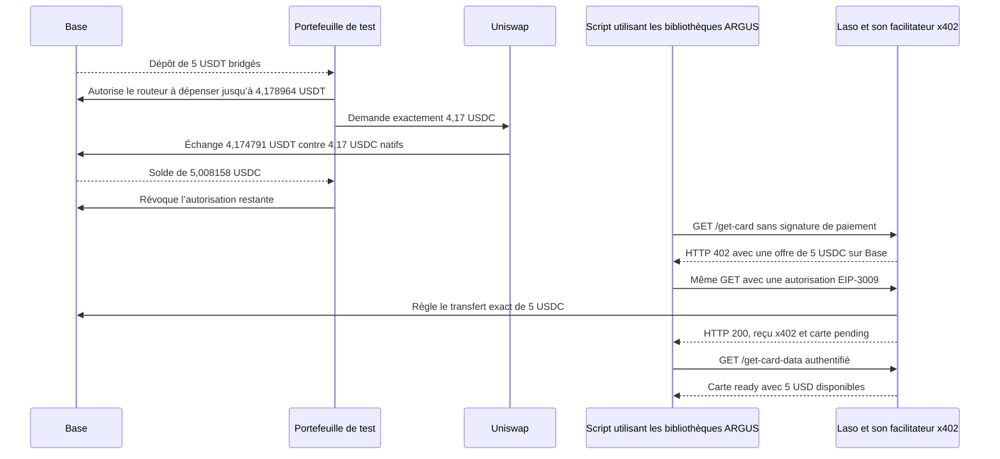
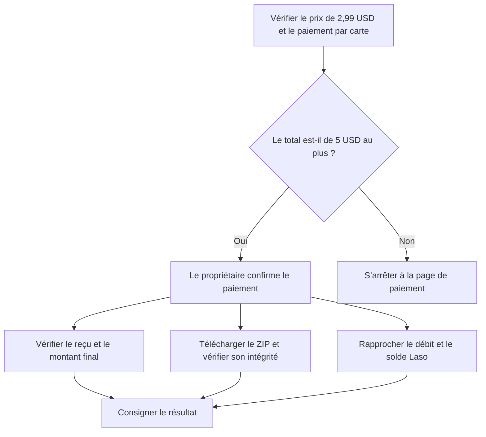
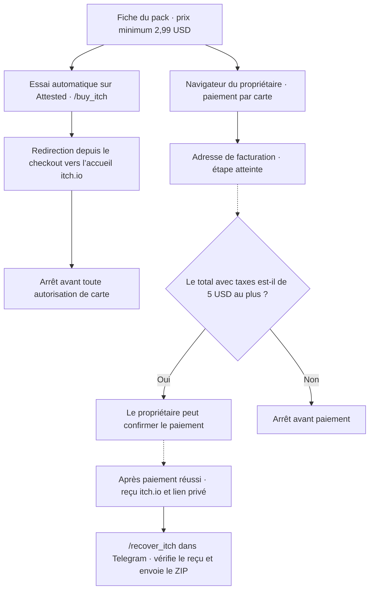

# Émission d’une carte prépayée Laso de 5 USD sur Base

> 🌐 [English](./use-case-laso-prepaid-card.md) · [Русский](./use-case-laso-prepaid-card-ru.md) · [Español](./use-case-laso-prepaid-card-es.md) · **Français** · [中文](./use-case-laso-prepaid-card-zh.md)

Le 13 novembre 2026, un script opérateur utilisant les bibliothèques d’ARGUS a payé **5 USDC** sur Base et vérifié l’émission d’une carte prépayée Laso américaine, non rechargeable, avec **5 USD disponibles**. L’essai utilisait un portefeuille de test distinct de celui du bot. L’étape suivante, l’achat chez un commerçant avec la carte émise, est en attente. [Guide des cartes Laso](https://docs.laso.finance/guides/usa-prepaid-card)

## Du financement à la carte

Le portefeuille détenait déjà 0,838158 USDC natifs. Avec l’accord du propriétaire, l’échange à montant de sortie fixe a complété le financement. Il restait 0,008158 USDC après le paiement à Laso. L’autorisation temporaire du routeur, plafonnée à 4,178964 USDT, a été révoquée après l’échange.

Le premier essai s’est arrêté avant l’envoi du paiement, car le SDK x402 appliquait un plafond par défaut de 1 USD. Le client ARGUS transmet désormais au SDK le plafond déjà validé pour la requête. Les tests sur les images de production ont signé le montant exact et rejeté une offre supérieure d’une unité minimale avant l’envoi de la requête signée.

Le script a envoyé une seule autorisation EIP-3009 pour `GET /get-card?amount=5.00`. La vérification sur Base a retrouvé un unique événement `AuthorizationUsed` portant le `nonce` signé, suivi du transfert de 5 USDC au destinataire prévu dans l’offre. La requête authentifiée de suivi a confirmé le statut `ready` sans émettre de nouvelle autorisation. [Cycle de vie de la carte](https://docs.laso.finance/guides/card-lifecycle)

## Transactions sur Base

| Étape | Bloc | Effet | Frais réseau en ETH | Reçu public |
| --- | --- | --- | ---: | --- |
| Dépôt d’USDT | 56 881 472 | Le portefeuille a reçu 5 USDT bridgés | 0,000007796120104268, payés par l’émetteur de la transaction | [0x0907b080…1714b](https://basescan.org/tx/0x0907b080cfd921ea9e57cb8efa6a7b9aa88fa0375c2b564c90a396106c61714b) |
| Autorisation du routeur | 56 889 403 | Autorisation de dépense de 4,178964 USDT au maximum | 0,000000278888454135 | [0xd122c5e7…229c](https://basescan.org/tx/0xd122c5e7bb899e8adc41a1fb71f583c157ea665e9376959816239190c29f229c) |
| Échange à montant de sortie fixe | 56 889 418 | 4,174791 USDT contre 4,17 USDC natifs | 0,000000766704068047 | [0x11cb2591…0e3b](https://basescan.org/tx/0x11cb25913e76087a4b3ce744ec09212b645c2755f5e3e08a58bb54cdacc60e3b) |
| Révocation | 56 889 432 | L’autorisation de dépense du routeur est revenue à zéro | 0,000000147307564356 | [0xae597e68…6b1d](https://basescan.org/tx/0xae597e68aabc83612d488f3713e605b27c0bc74bda8ba0ad593e0a118a7b6b1d) |
| Règlement x402 | 56 890 293 | Un paiement de 5 USDC à Laso | 0,000000864119061217, payés par le facilitateur x402 | [0xc8bd81d9…9c68](https://basescan.org/tx/0xc8bd81d9d1d39327736bc7b7a8f490658b50362aca8e295ee8cd655f20099c68) |

Les cinq transactions étaient finalisées quand le dernier bloc finalisé sur Base a atteint la hauteur 56 894 431. Les frais incluent le coût des données de L1. Le portefeuille de test a payé au total **0,000001192900086538 ETH** pour l’autorisation du routeur, l’échange et la révocation.

## Achat de test sur itch.io

La page de paiement du produit numérique **Co-Working & Startup Office Icon Pack** affichait un prix de base de **2,99 USD**, le fichier `Co_Working_Startup_Office_Icon_Pack.zip` de 268 ko et l’option de paiement par carte. Laso a signalé itch.io comme `accepted` pour ce type de carte américaine. Le propriétaire saisit son adresse e-mail et les coordonnées de la carte dans le navigateur, puis confirme un seul achat si le total, taxes comprises, ne dépasse pas **5 USD**. [Fiche du produit](https://aiimperium.itch.io/co-working-startup-office-icon-pack) · [Parcours d’achat itch.io](https://itch.io/docs/creators/how-buying-works)

Le paiement par carte produit un reçu du commerçant et un débit en dollars chez l’émetteur. Ce débit n’a pas de transaction propre sur Base. Pour terminer la vérification, il faut contrôler le reçu itch.io, télécharger et valider le ZIP, puis rapprocher le total du reçu d’un seul débit chez Laso et de la variation du solde initial de 5 USD. Les coordonnées de la carte et le lien privé de téléchargement restent entre les mains du propriétaire. [Activité de la carte Laso](https://laso.finance/openapi.json)

Au moment de passer la main au propriétaire, Laso affichait `ready`, un solde de 5 USD et aucun débit itch.io. Le reçu, le téléchargement et le débit restent à vérifier.

## Ce qu’ARGUS prend en charge

`laso_card_quote` vérifie le commerçant configuré et prépare le montant exact. `laso_buy_card` requiert l’accord du propriétaire et un canal privé. Après avoir vérifié que la carte était prête, l’opérateur a envoyé le lien à usage unique du tableau de bord Laso dans la conversation Telegram privée vérifiée du propriétaire. Le lien expire au bout de 15 minutes. La carte figure dans la rubrique **Cards**. [Configuration des achats](./personal-assistant.md) · [Accès au tableau de bord Laso](https://docs.laso.finance/guides/authentication#getting-a-login-link-for-humans)

La correction du client x402 a été déployée dans les images ARGUS d’Attested Live, de Factory Live et de Factory UNI. Le bot privé d’Attested a activé `cmc_buy_quotes` avec un portefeuille dédié et un accord pour chaque achat. L’annuaire public `GET /ai-market/v2/external-services` de ModelMarket référence Laso, CoinMarketCap et Tavily. L’acheteur paie le fournisseur directement avec son portefeuille. Le manifeste signé décrit les capacités invocables via le Hub. [Annuaire externe](https://modelmarket.dev/ai-market/v2/external-services) · [Manifeste du Hub](https://modelmarket.dev/ai-market/v2/manifest)

## Achat facultatif depuis Telegram

Le code d’ARGUS inclut `/buy_itch` pour ce seul pack. La commande doit être activée explicitement et s’exécute dans la conversation privée du propriétaire. Elle utilise l’adresse e-mail configurée pour le reçu ou celle d’une boîte mail connectée. Si l’adresse e-mail ou des données de facturation manquent, ARGUS demande uniquement les éléments nécessaires en privé. Le propriétaire vérifie le total, taxes comprises, et le confirme avec un bouton à usage unique. Le plafond est de **5 USD**.

ARGUS consigne la tentative avant d’envoyer la demande de paiement unique. Si le résultat reste incertain, il peut récupérer le reçu et le ZIP sans nouveau paiement. Il vérifie l’intégrité de l’archive avant de l’envoyer dans la conversation privée, puis rapproche le montant du reçu du débit Laso et du solde restant.

Les tests locaux ont utilisé un navigateur avec des réponses simulées. Le bot Attested en production dispose de Chromium isolé et d’une adresse e-mail configurée pour recevoir le reçu.

## Vérification du parcours d’achat le 13 novembre 2026

Le navigateur habituel du propriétaire a ouvert la fiche du **Co-Working & Startup Office Icon Pack**, proposé à partir de **2,99 USD** avec une archive ZIP de **268 ko**. Après avoir choisi le paiement par carte, il a atteint l’écran **Billing address** (adresse de facturation). Lors de l’essai automatisé sur Attested, l’ouverture de `/checkout/<opaque>` a renvoyé le navigateur vers la page d’accueil d’itch.io avant l’affichage du formulaire de carte. La consultation de Laso avec une session renouvelée a confirmé **5 USD disponibles** et aucun débit itch.io. À ce stade, aucun débit, reçu d’achat ni téléchargement du ZIP n’avait été confirmé. [Fiche du produit](https://aiimperium.itch.io/co-working-startup-office-icon-pack) · [Trace de l’essai Attested](../../artifacts/argus-itch-live-2026-11-13/live-preflight-referer.ndjson)

Les lignes en pointillés indiquent les étapes qui restaient à vérifier. Une fois l’achat effectué dans son navigateur, le propriétaire peut lancer `/recover_itch` dans sa conversation privée avec ARGUS, confirmer la récupération et répondre avec le lien privé figurant sur le reçu. [Guide de récupération](./personal-assistant.md#buy-the-itchio-icon-pack-from-telegram) · [Accéder à un achat itch.io](https://itch.io/docs/buying/already-bought)

| Étape | Effet sur le paiement |
| --- | --- |
| Émission de la carte | Le règlement x402 de **5 USDC sur Base** a déjà financé la carte Laso. [Transaction Base](https://basescan.org/tx/0xc8bd81d9d1d39327736bc7b7a8f490658b50362aca8e295ee8cd655f20099c68) |
| Calcul du total | Afficher le prix et les taxes ne déclenche ni autorisation de carte ni débit. |
| Achat par carte | Si le propriétaire confirme, Stripe traite une demande d’autorisation en USD. Le débit figure dans l’activité de la carte Laso si le paiement aboutit. Il ne crée pas de transaction sur Base. |
| Reçu et archive | La lecture du reçu, la vérification du ZIP et son envoi par Telegram ne déclenchent aucun paiement. |

[Résultats de la nouvelle vérification](../../artifacts/argus-itch-live-2026-11-13/checkout-followup.json)
