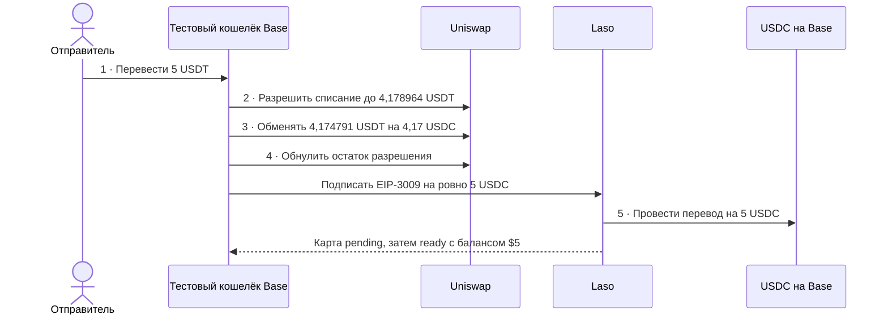
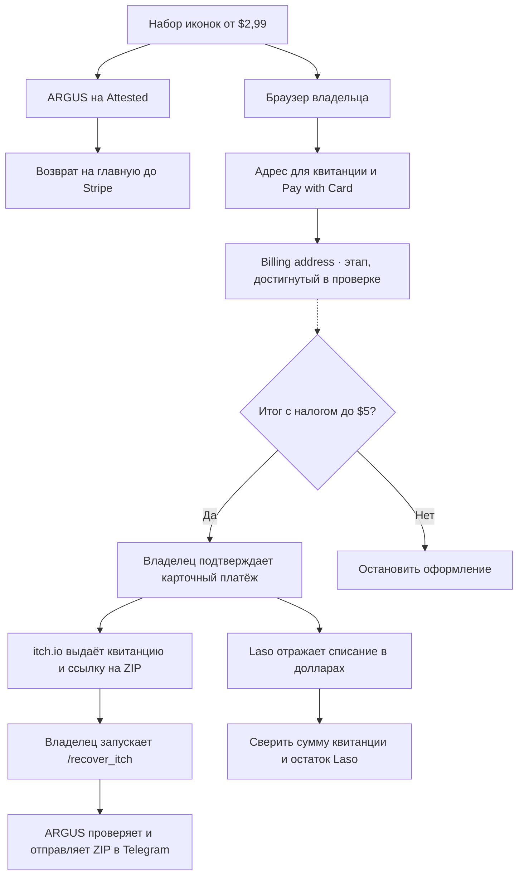

# Пилот предоплаченной карты Laso на Base

> 🌐 [English](use-case-laso-prepaid-card.md) · **Русский** · [Español](use-case-laso-prepaid-card-es.md) · [Français](use-case-laso-prepaid-card-fr.md) · [中文](use-case-laso-prepaid-card-zh.md)

13 ноября 2026 года оператор выпустил американскую непополняемую карту на $5 разовым скриптом на базе библиотек ARGUS для оплаты по x402 и входа в Laso. Отдельный запрос с авторизацией подтвердил статус `ready` и доступный баланс $5 в аккаунте тестового кошелька оператора. [Жизненный цикл карты Laso](https://docs.laso.finance/guides/card-lifecycle)

## Пополнение, оплата и сверка

На кошельке уже было 0,838158 нативных USDC. Пополнение пришло в USDT на Base. Обмен с фиксированной суммой получения довёл баланс до 5,008158 USDC перед оплатой Laso. Для всех квитанций ниже проверили успешный статус и совпадение хеша блока с канонической цепочкой. На момент сверки Base финализировал блок 56 894 431.

| Шаг | Транзакция на Base | Что произошло и кто заплатил за газ |
|---|---|---|
| 1. Пополнение | [Блок 56 881 472](https://basescan.org/tx/0x0907b080cfd921ea9e57cb8efa6a7b9aa88fa0375c2b564c90a396106c61714b) | Отправитель перевёл тестовому кошельку 5 USDT и заплатил 0,000007796120104268 ETH за газ. |
| 2. Разрешение | [Блок 56 889 403](https://basescan.org/tx/0xd122c5e7bb899e8adc41a1fb71f583c157ea665e9376959816239190c29f229c) | Тестовый кошелёк разрешил Uniswap списать до 4,178964 USDT. Токены остались на кошельке, комиссия составила 0,000000278888454135 ETH. |
| 3. Обмен | [Блок 56 889 418](https://basescan.org/tx/0x11cb25913e76087a4b3ce744ec09212b645c2755f5e3e08a58bb54cdacc60e3b) | Uniswap списал 4,174791 USDT и зачислил ровно 4,17 USDC. Тестовый кошелёк заплатил 0,000000766704068047 ETH. |
| 4. Сброс разрешения | [Блок 56 889 432](https://basescan.org/tx/0xae597e68aabc83612d488f3713e605b27c0bc74bda8ba0ad593e0a118a7b6b1d) | Остаток разрешения в 0,004173 USDT обнулили. Тестовый кошелёк заплатил 0,000000147307564356 ETH. |
| 5. Выпуск | [Блок 56 890 293](https://basescan.org/tx/0xc8bd81d9d1d39327736bc7b7a8f490658b50362aca8e295ee8cd655f20099c68) | Посредник x402 отправил транзакцию и заплатил 0,000000864119061217 ETH за газ. Base записал один совпадающий nonce EIP-3009 и один перевод на 5 USDC указанному в котировке получателю. Laso выпустил карту на $5. |

Тестовый кошелёк потратил 0,000001192900086538 ETH на разрешение, обмен и сброс с учётом платы за данные в L1. После выпуска на нём осталось 0,008158 USDC и 0,825209 USDT.

Первый запуск остановился до отправки платежа из-за стандартного лимита x402 SDK в $1. Клиент теперь передаёт SDK проверенный лимит конкретного запроса. Тесты подтвердили, что подмена получателя или расхождение в одну минимальную единицу USDC останавливают запрос до подписи. Вход в Laso, получение котировки и проверка состояния карты идут по HTTP. USDC списывается при исполнении подписанной авторизации на Base. [Как Laso проводит платежи x402](https://docs.laso.finance/guides/how-x402-works)

## Оформление покупки на itch.io

В диалоге itch.io показаны стартовая цена $2,99, кнопка **Pay with Card** и файл `Co_Working_Startup_Office_Icon_Pack.zip` размером 268 кБ. Laso вернул `accepted` для itch.io и этого типа американской карты. [Набор иконок](https://aiimperium.itch.io/co-working-startup-office-icon-pack) · [Как проходит покупка на itch.io](https://itch.io/docs/creators/how-buying-works)

13 ноября 2026 года отдельно повторили проверку оформления. В браузере владельца указали настроенный адрес для квитанций, выбрали **Pay with Card** и дошли до формы **Billing address**. Проверка закончилась на этой форме до отправки платежа. В изолированном браузере ARGUS на Attested itch.io сначала перенаправил запрос на страницу оформления, а затем на главную до открытия Stripe. После обновления сеанса Laso доступный остаток составил $5, списаний itch.io в истории не было. Квитанция и ZIP пока не получены. [Повторная проверка](../../artifacts/argus-itch-live-2026-11-13/checkout-followup.json)

Пунктир ведёт к шагам, которые ещё не прошли в живой проверке. Для завершения покупки владелец вводит платёжный адрес и проверяет итог с налогом. После подтверждённой оплаты продавец выдаёт квитанцию, а Laso отражает карточное списание в долларах. Транзакция Base в таблице выше относится к выпуску карты за 5 USDC. Карточное списание проходит вне Base, поэтому сверка использует сумму квитанции itch.io, одну совпадающую операцию Laso и новый доступный остаток. [История операций Laso](https://laso.finance/openapi.json)

После покупки в браузере владелец отправляет `/recover_itch` в личный чат @Argis3Bot, подтверждает получение и отвечает на запрос бота приватной ссылкой из квитанции. ARGUS проверяет товар, оплаченную сумму и целостность ожидаемого ZIP, затем отправляет файл в тот же чат. Команда выполняет только доставку по существующей покупке. [Восстановление доступа к покупке на itch.io](https://itch.io/docs/buying/already-bought) · [Настройка и восстановление в ARGUS](personal-assistant.md#buy-the-itchio-icon-pack-from-telegram)

## Пилот покупки из Telegram

Команда «купи иконки» или `/buy_itch` запускает сценарий в личном чате закреплённого владельца. Бот берёт настроенный адрес для квитанции или адрес подключённого ящика. Если обоих нет, спрашивает адрес в чате. Он запрашивает недостающие поля платёжного адреса, показывает точную сумму с налогом и ждёт нажатия кнопки подтверждения. Журнал блокирует повторное списание при неопределённом исходе. ARGUS сверяет квитанцию, проверяет ZIP, отправляет файл в Telegram и сопоставляет сумму и остаток с данными Laso. Браузерный сценарий и чат проверены с имитацией платежа. На Attested используется настроенный адрес для квитанций и изолированный Chromium. Доступ к входящим письмам на момент проверки ещё ожидал подключения. [Проверки ARGUS на Attested](../../artifacts/argus-itch-live-2026-11-13/README.md)

## Доступ к карте и состояние прода

Карта привязана к аккаунту Laso оплатившего её тестового кошелька. Оператор получил одноразовую ссылку на кабинет Laso и отправил её прямо в проверенный приватный Telegram-чат владельца. Карта находится в разделе **Cards**. Laso выдаёт ссылку на 15 минут. [Вход в кабинет Laso](https://docs.laso.finance/guides/authentication#getting-a-login-link-for-humans)

В развёрнутом коде ARGUS есть `laso_card_quote` и `laso_buy_card`. Первый инструмент проверяет настроенного продавца. Для выпуска второй запрашивает подтверждение точного номинала и требует приватный канал для ссылки на кабинет. Покупку у продавца завершает владелец. В приватном боте Attested инструменты Laso выключены. Из новых платных интеграций активен `cmc_buy_quotes` с отдельным кошельком и подтверждением каждой покупки. [Настройка ARGUS](personal-assistant.md)

В ModelMarket опубликованы карточки Laso, CoinMarketCap и Tavily с условиями и ссылками поставщиков. Покупатель платит напрямую поставщику со своего кошелька. Hub также поддерживает явный GET-пробник и сверку квитанций CMC с транзакцией в Base. METIS использует Tavily в существующем `web_search` и переключается на DuckDuckGo при лимите доступа без API-ключа. [Внешние сервисы ModelMarket](https://modelmarket.dev/#external-directory) · [API каталога](https://modelmarket.dev/ai-market/v2/external-services)
