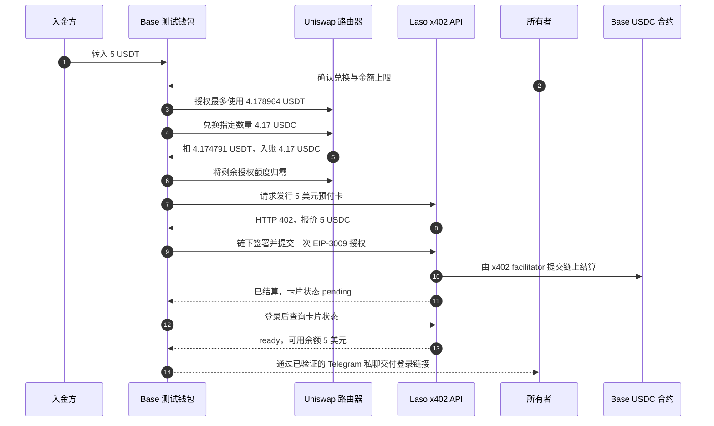
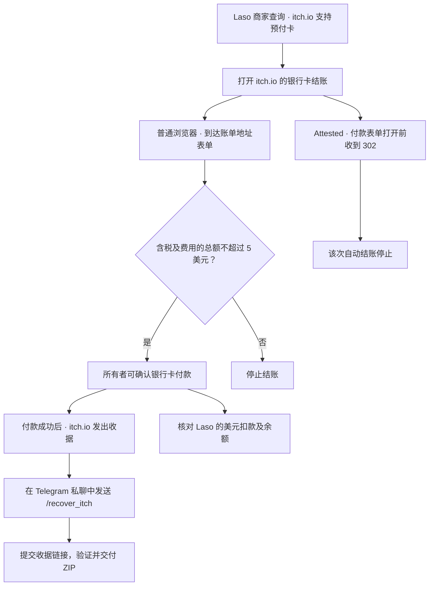

# 在 Base 上用 5 USDC 发行 Laso 美国预付卡

> 🌐 语言：[English](./use-case-laso-prepaid-card.md) · [Русский](./use-case-laso-prepaid-card-ru.md) · [Español](./use-case-laso-prepaid-card-es.md) · [Français](./use-case-laso-prepaid-card-fr.md) · **中文**

2026 年 11 月 13 日，经所有者批准，操作人员运行了一次性脚本。脚本调用 ARGUS 的 x402 支付库，从专用测试钱包在 Base 上支付 5 USDC，发行一张不可充值的 Laso 美国预付卡。Laso 先返回 `pending`，随后查询确认卡片为 `ready`，可用余额为 5 美元。随后，所有者在自己的浏览器中打开 itch.io 结账，进入 **Billing address**（账单地址）页面。 [Laso 预付卡指南](https://docs.laso.finance/guides/usa-prepaid-card)

## 从 Base 入账到卡片就绪

测试钱包在 Base 上收到 5 USDT，此前已有 0.838158 原生 USDC。Laso 的报价使用原生 USDC。经所有者确认，操作人员用 Uniswap 定额输出兑换补足余额，然后将临时授权额度归零。

| 步骤 | 实测结果 | 网络费用 | BaseScan 交易 |
| --- | --- | --- | --- |
| 入账 | 转入 5 USDT。 | 入金方支付 `0.000007796120104268 ETH`。 | [`0x0907…714b`](https://basescan.org/tx/0x0907b080cfd921ea9e57cb8efa6a7b9aa88fa0375c2b564c90a396106c61714b) |
| 授权 | 将 Uniswap 路由器的 USDT 使用额度设为 4.178964。 | `0.000000278888454135 ETH` | [`0xd122…229c`](https://basescan.org/tx/0xd122c5e7bb899e8adc41a1fb71f583c157ea665e9376959816239190c29f229c) |
| 兑换 | 扣除 4.174791 USDT，收到 4.17 USDC。兑换后钱包余额为 5.008158 USDC 和 0.825209 USDT。 | `0.000000766704068047 ETH` | [`0x11cb…0e3b`](https://basescan.org/tx/0x11cb25913e76087a4b3ce744ec09212b645c2755f5e3e08a58bb54cdacc60e3b) |
| 取消授权 | 将剩余 0.004173 USDT 的使用额度设为零。 | `0.000000147307564356 ETH` | [`0xae59…6b1d`](https://basescan.org/tx/0xae597e68aabc83612d488f3713e605b27c0bc74bda8ba0ad593e0a118a7b6b1d) |
| 发行 | 链上收据包含一个匹配的 EIP-3009 授权和一笔 5 USDC 转账。钱包剩余 0.008158 USDC。 | x402 facilitator 支付 `0.000000864119061217 ETH`。 | [`0xc8bd…9c68`](https://basescan.org/tx/0xc8bd81d9d1d39327736bc7b7a8f490658b50362aca8e295ee8cd655f20099c68) |

测试钱包支付的授权、兑换和取消授权费用合计 `0.000001192900086538 ETH`，其中包含 Base 的 L1 数据费用。核验时，公共 Base RPC 报告已最终确定的区块高度为 `56,894,431`，上述五笔交易均已达到最终确认。卡片就绪后，操作人员把有效期为 15 分钟的 Laso 登录链接发到所有者经过验证的 Telegram 私聊。所有者在 Laso 控制台的 **Cards** 栏目中查看卡片。 [Laso 控制台登录](https://docs.laso.finance/guides/authentication#getting-a-login-link-for-humans)

首次尝试在签名前停止，因为 x402 SDK 的默认单笔上限为 1 美元。修复后，ARGUS 将已校验的请求金额上限传给 SDK，并在签名前核对 Base 网络、USDC 合约、收款地址和确切金额。该修复已部署到 ARGUS。 [ARGUS 个人助理配置](./personal-assistant.md)

## ARGUS 中的操作流程

| 工具 | 行为 |
| --- | --- |
| `laso_card_quote` | 用钱包签名免费登录 Laso，检查已配置的商家是否明确标记为 `accepted`，然后生成包含商家和金额的短期报价。 |
| `laso_buy_card` | 核对报价编号和完整条款，等待所有者在私聊中批准，再提交一笔符合报价的付款。发行后，控制台链接只通过私密渠道发给所有者。 |

测试中，Laso 将 `Amazon` 标记为 `accepted`，将名称完全匹配的 `Uber` 标记为 `not_accepted`，将 `Uber Rides` 标记为 `unknown`。ARGUS 为 Amazon 生成了报价，并拒绝为 Uber 生成报价。商家查询和生成报价均免费。 [Laso 商家兼容性](https://docs.laso.finance/guides/usa-prepaid-card#check-the-merchant-first) · [Laso 钱包登录](https://docs.laso.finance/guides/authentication)

## itch.io 结账验证

Co-Working & Startup Office Icon Pack 的基础价为 **2.99 美元**。Laso 将 itch.io 标记为支持这种美国预付卡。所有者在普通浏览器中点选银行卡付款，进入 **Billing address** 页面。Attested 上的自动结账在进入 Stripe 或填写卡片信息前收到 HTTP 302，并跳到了 itch.io 首页。核验时，Laso 卡状态为 `ready`，可用余额为 **5 美元**，没有 itch.io 扣款，尚无已付款收据或 ZIP 交付。 [itch.io 商品页](https://aiimperium.itch.io/co-working-startup-office-icon-pack) · [Attested 核验记录](../../artifacts/argus-itch-live-2026-11-13/README.md) [本次验证记录](../../artifacts/argus-itch-live-2026-11-13/checkout-followup.json)

| 操作 | 资金变动和验证依据 |
| --- | --- |
| 发行 Laso 卡 | Base 上结算了一笔 5 USDC 转账。使用交易哈希查询链上收据，并在 Laso 查询卡片状态和可用余额。 |
| 查询商家和预览金额 | 查询 Laso 商家支持情况和预览 itch.io 价格均不扣款。进入账单地址页面也不扣款。 |
| 商家收取卡款 | 付款成功后，itch.io 提供收据，Laso 记录美元扣款。验证该笔扣款要核对收据金额和 Laso 余额变动。刷卡支付是链下交易，没有单独的 Base 交易哈希。 |
| 恢复交付 | `/recover_itch` 使用已有的收据下载文件，无需再次付款。机器人校验商品、已付款金额和 ZIP 的完整性。 |

商品页标明文件为 `Co_Working_Startup_Office_Icon_Pack.zip`，大小为 268 kB。对账时，ARGUS 检查是否恰好有一笔金额相同的 itch.io 扣款，以及扣款后余额是否等于 5 美元减去收据金额。 [Laso 卡片活动](https://laso.finance/openapi.json)

## Telegram 购买流程

配置的所有者可以在 Telegram 私聊中发送 `/buy_itch`。ARGUS 使用已配置的收据邮箱，或提示所有者直接回复邮箱。若 Laso 缺少必要的账单地址字段，机器人逐项询问。卡号与安全码由程序在付款阶段从 Laso 读取，并填入 Stripe 的支付表单。Telegram 提示不会索取这些数据。

ARGUS 从 itch.io 读取税额和最终美元总价，在私聊中显示商家、商品、金额和掩码邮箱，并要求所有者点击一次性确认按钮。总额超过 5 美元时停止。发送付款请求前，ARGUS 写入持久化记录。已有付款记录时，再次发送命令只会恢复交付或核对扣款。

若所有者已在浏览器中付款，可在 `@Argis3Bot` 私聊中发送 `/recover_itch`，确认交付，并直接回复机器人的提示，附上收据里的私密下载链接。ARGUS 校验收据、下载并检查指定 ZIP，再把文件发到同一私聊。若 Laso 会话已过期，仍可交付经验证的 ZIP，扣款状态待核对。这个流程已用模拟商家响应验证。

Attested 生产机器人已配置收据邮箱，并使用隔离的 Chromium。收据邮箱用于 itch.io 发送订单收据。最近一次检查时，ARGUS 尚未获得邮箱读取授权。 [ARGUS 结账和恢复指南](./personal-assistant.md#buy-the-itchio-icon-pack-from-telegram) · [邮箱配置](./mail-zh.md)

## 生产环境与 ModelMarket 目录

生产环境已部署 Laso 代码。当前私有 Telegram 实例只启用了 CoinMarketCap 的付费查询，使用独立的 CMC 钱包，每笔购买都需要批准。Laso 工具尚未在该实例启用，本次发行使用另一个测试钱包。ModelMarket 的公开外部服务目录列出 CoinMarketCap、Tavily 和 Laso，并链接到各服务商的官方文档。买方使用自己的钱包直接支付给服务商。Hub 的签名清单继续列出通过 Hub 调用的能力。 [ARGUS 可选付费工具](./personal-assistant.md#optional-paid-tools) · [ModelMarket 外部服务目录](https://modelmarket.dev/ai-market/v2/external-services)
