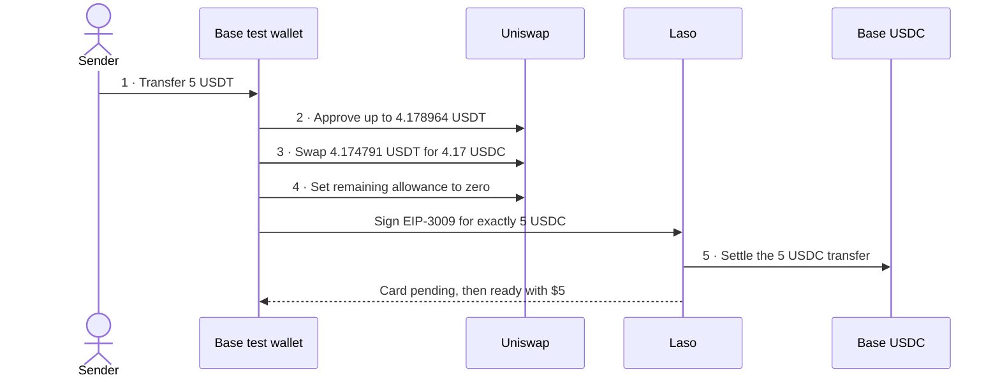
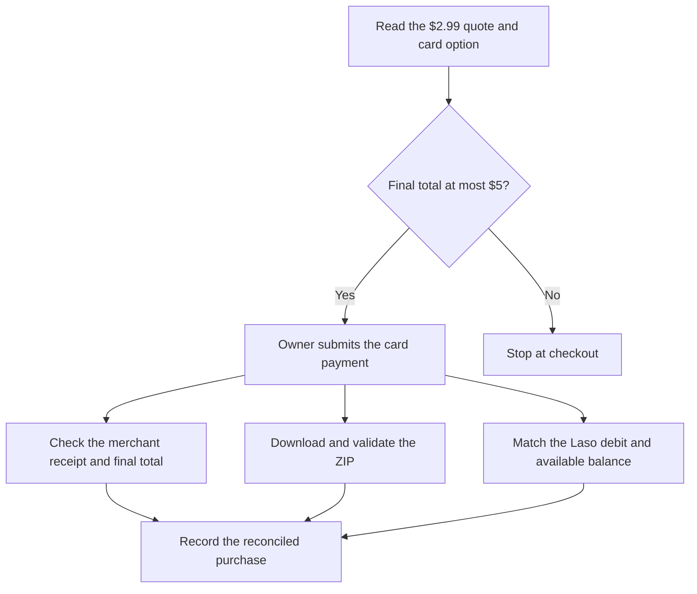

# Laso prepaid card pilot on Base

> 🌐 **English** · [Русский](use-case-laso-prepaid-card-ru.md) · [Español](use-case-laso-prepaid-card-es.md) · [Français](use-case-laso-prepaid-card-fr.md) · [中文](use-case-laso-prepaid-card-zh.md)

On 13 November 2026, an operator used ARGUS's x402 payment and Laso sign-in libraries in a one-off script to issue a $5 non-reloadable U.S. prepaid card. An authenticated Laso lookup confirmed `ready` and $5 available on the card associated with the operator's test wallet. [Laso card lifecycle](https://docs.laso.finance/guides/card-lifecycle)

## Funding, payment and verification

The wallet started with 0.838158 native USDC. The deposit arrived as Base USDT, so the operator used an exact-output swap to reach 5.008158 USDC before paying Laso. The receipts below had successful status and canonical block hashes at finalized Base height 56,894,431.

| Step | Base transaction | Effect and network fee |
|---|---|---|
| 1. Deposit | [Block 56,881,472](https://basescan.org/tx/0x0907b080cfd921ea9e57cb8efa6a7b9aa88fa0375c2b564c90a396106c61714b) | The sender funded the test wallet with 5 USDT and paid 0.000007796120104268 ETH in network fees. |
| 2. Approve | [Block 56,889,403](https://basescan.org/tx/0xd122c5e7bb899e8adc41a1fb71f583c157ea665e9376959816239190c29f229c) | The wallet authorized Uniswap to spend up to 4.178964 USDT. The approval moved no tokens and cost 0.000000278888454135 ETH. |
| 3. Swap | [Block 56,889,418](https://basescan.org/tx/0x11cb25913e76087a4b3ce744ec09212b645c2755f5e3e08a58bb54cdacc60e3b) | Uniswap took 4.174791 USDT and delivered exactly 4.17 USDC. The wallet paid 0.000000766704068047 ETH. |
| 4. Reset | [Block 56,889,432](https://basescan.org/tx/0xae597e68aabc83612d488f3713e605b27c0bc74bda8ba0ad593e0a118a7b6b1d) | The remaining 0.004173 USDT allowance was set to zero. The wallet paid 0.000000147307564356 ETH. |
| 5. Issue | [Block 56,890,293](https://basescan.org/tx/0xc8bd81d9d1d39327736bc7b7a8f490658b50362aca8e295ee8cd655f20099c68) | The x402 facilitator submitted the authorization and paid 0.000000864119061217 ETH in network fees. Base recorded one matching EIP-3009 nonce and a single 5 USDC transfer to the quoted recipient. Laso issued a card with $5. |

The wallet spent 0.000001192900086538 ETH across approval, swap and reset, including Base L1 data fees. After issuance it held 0.008158 USDC and 0.825209 USDT.

The first issuance attempt stopped before submission because the x402 SDK defaulted to a $1 ceiling. The client now supplies the validated ceiling for the request. Tests verified that a substituted recipient or a difference of one USDC atom stops the request before signing. The Laso sign-in, payment quote and card polling are HTTP operations. Only settlement of the signed authorization moved USDC on Base. [How Laso settles x402](https://docs.laso.finance/guides/how-x402-works)

## Checkout and reconciliation

The live itch.io checkout showed a $2.99 starting price, **Pay with Card**, and the file `Co_Working_Startup_Office_Icon_Pack.zip` at 268 kB. Laso's merchant lookup returned `accepted` for itch.io and this U.S. card type. The owner enters their email and card details in the browser and checks that the final total including tax is at most $5 before paying. [Asset listing](https://aiimperium.itch.io/co-working-startup-office-icon-pack) · [itch.io purchase flow](https://itch.io/docs/creators/how-buying-works)

A card purchase creates a merchant receipt and an issuer-side card debit in USD. The purchase does not create a second Base transaction. Reconcile the exact receipt total against one matching Laso debit and the change from the $5 available balance. Verify that the advertised ZIP downloads and passes an archive integrity check. Keep the private download URL and card credentials out of the evidence. [Laso card activity](https://laso.finance/openapi.json)

At the checkout handoff, Laso still showed `ready` with $5 and no matching itch.io debit. Receipt, ZIP delivery and card debit verification are pending.

## Telegram purchase pilot

The implementation adds an owner-only `/buy_itch` workflow for this pack. The bot uses the configured receipt address or connected mailbox address and asks for an address in the private chat if both are absent. It asks for missing billing fields, shows the exact total with tax, and waits for the owner's confirmation button. The order journal prevents a second charge after an uncertain response. ARGUS checks the receipt and ZIP, sends the file in Telegram, and reconciles the amount and remaining balance with Laso. The browser and Telegram paths were tested with simulated payments. Attested now runs the workflow with a configured receipt address and isolated Chromium. The mailbox remains disconnected. In the live test, itch.io redirected the checkout to its home page before Stripe opened. Laso still showed $5 and no itch.io debit. [Setup and recovery](personal-assistant.md#buy-the-itchio-icon-pack-from-telegram)

## Card access and production scope

The card belongs to the Laso account associated with the paying test wallet. The operator obtained a one-time Laso dashboard link and sent it directly to the owner's verified private Telegram chat. The owner opens **Cards** in the dashboard. Laso gives the link a 15-minute lifetime. [Laso dashboard access](https://docs.laso.finance/guides/authentication#getting-a-login-link-for-humans)

The deployed ARGUS code contains `laso_card_quote` and `laso_buy_card`. The quote tool checks an explicitly configured merchant. The issuance tool requires approval of the exact card load and a private channel for the dashboard link. The owner completes merchant checkout. In the private Attested bot, Laso is disabled and `cmc_buy_quotes` is the only active tool from the new paid provider integrations. CMC uses its own wallet and requires approval for each purchase. [ARGUS configuration](personal-assistant.md)

ModelMarket lists Laso, CoinMarketCap and Tavily as external x402 services. The cards describe published terms and link to each provider. Buyers pay the provider directly from their own wallets. Hub also supports an explicit GET probe and Base receipt verification for CMC's x402 format. METIS uses Tavily for its existing `web_search`, with DuckDuckGo fallback for keyless rate limits. [ModelMarket external services](https://modelmarket.dev/#external-directory) · [Directory API](https://modelmarket.dev/ai-market/v2/external-services)
